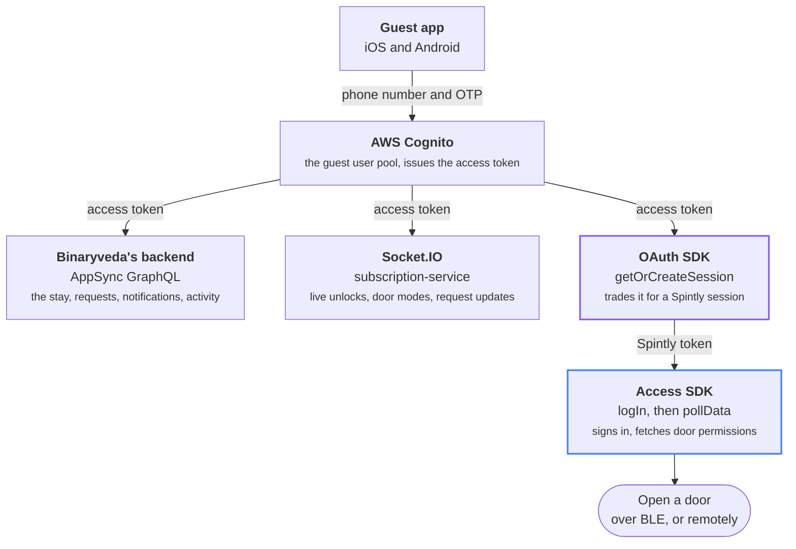
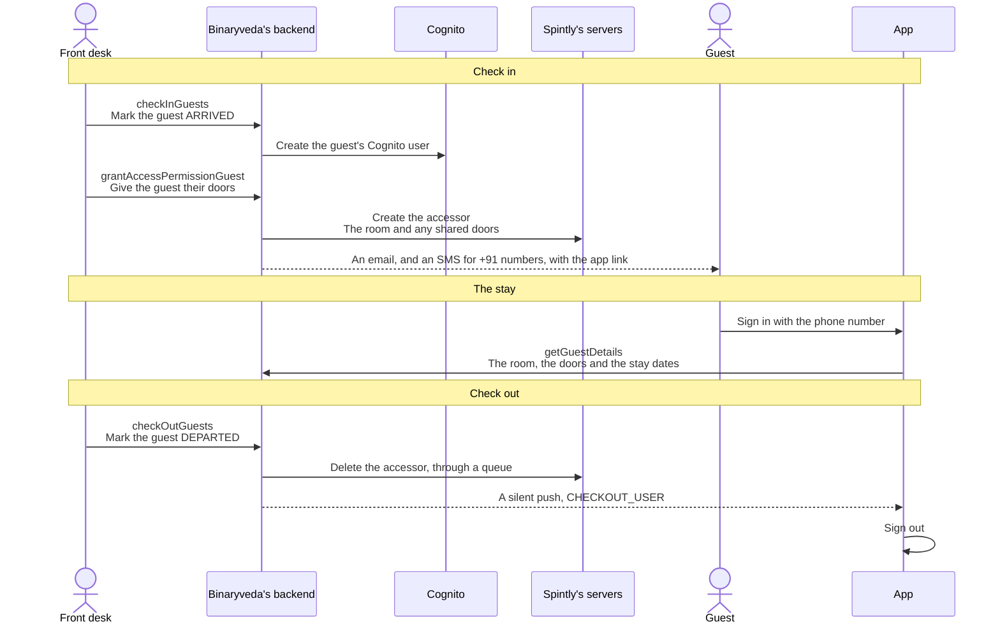

# Connected Lock Guest App

Hotel guests use this app during a stay. It opens their room door and any shared
doors they were given, sends requests to hotel staff, and shows who has opened
their room. Booking, check in and check out all happen at the front desk in the
admin console, so the app is only useful for the period between check in and
check out.

The app has three tabs: [Home](home.md), [Assistance](assistance.md) and
[Activity Trail](activity-trail.md). The bell opens the
[notification centre](notifications.md), and the menu icon opens the
[side menu](profile-and-logout.md) with the profile and Log out.

## What the app is made of

Cognito issues one access token, and the app sends it to three places: the
GraphQL API, the socket, and Spintly's OAuth SDK.

## A stay, from check in to check out

The app sees only the middle of a stay. Everything before the first sign in and
after checkout happens between the front desk and the backend.

Guests are registered by the front desk, not by signing up themselves. The
Cognito user is created at check in, so a number the front desk has not checked
in gets **"User does not exist"** at the OTP step.

### The guest's status

`getGuestDetails` returns a `guest.status`, and both apps read it.

| Status | Set when | What the app does |
|---|---|---|
| `ARRIVED` | Check in | Everything works |
| `GRACE_PERIOD` | The checkout time passes, on a site whose policy has `revokeAccessPostCheckout` turned on and a grace period longer than 00:00 | Everything still works. The accessor is still in place |
| `GRACE_EXPIRED` | The grace period ends | The backend deletes the accessor and sends `CHECKOUT_USER`, which signs the app out straight away on both platforms. Sign in is then refused |
| `DEPARTED` | The front desk checks the guest out | `CHECKOUT_USER` signs the app out. `getGuestDetails` never returns this status: the backend answers a checked-out guest with a 401, so sign in fails |

With `revokeAccessPostCheckout` off, the checkout time passes with no effect and
the accessor stays in place until the front desk checks the guest out. With it
on and a grace period of 00:00, the guest skips `GRACE_PERIOD`: access is revoked
and the app signs out at the checkout time itself.

## The two SDKs

The guest app ships the same **two** Spintly SDKs as the staff app, at the same
versions. They share nothing except the session token the OAuth SDK produces.

### OAuth SDK: the session token

Exchanges the Cognito access token for a Spintly **session token**. No other
Spintly call works until this succeeds. The exchange runs over callbacks: the
app asks for a session, the SDK asks how to authenticate, the app returns a
token exchange request, and the SDK returns the session.

### Access SDK: the credential

Holds the signed in credential and the guest's door permissions. `logIn` signs
in with the Spintly token, `pollData` fetches which doors the guest may open,
`bleUnlockAccessPoint` opens one over Bluetooth, and `remoteUnlockAccessPoint`
opens one through the internet when Bluetooth fails.

### There is no Config SDK

The third Spintly SDK, the one that writes to lock hardware, is **not shipped**,
so a guest can read a lock's state but never change it. Privacy mode and passage
mode are shown in the app and set elsewhere: privacy mode by the deadbolt inside
the room, and passage mode from the admin console.

### Versions shipped

| Short name | iOS (`Godrej-Locks-iOS-SpintlySDK` 2.1.0) | Android |
|---|---|---|
| **OAuth** | `SpintlyOauth` | `oauthsdk-0.7.0.aar` (`com.mrinq.oauthsdk`) |
| **Access** | `SmartAccessFramework` | `smartaccesssdk-1.16.0.0.aar` (`com.mrinq.smartaccesssdk`) |

!!! info "Accessor"

    Spintly's word for a person who can open a door is an **accessor**. A
    guest's accessor is created by the backend in `grantAccessPermissionGuest`,
    with the guest's Cognito `sub` as its identity. The doors on it are the room
    and any shared access areas. The unlock calls take their `accessPointId`,
    which `getGuestDetails` returns as `spintlyId`.
