# 11. Administration

**What it is.** The two tiers above a site. A Super Admin onboards hotels and
their administrators, and a Hotel Admin runs the sites under one hotel.

**How to get there.** The sidebar for these two roles is different from every
other role's. Neither sees Bookings, Requests or Inventory.

!!! warning "Key point"

    Neither tier belongs to a site, so neither has one to work in until they
    pick one. Opening a site card puts that site in the address and scopes the
    rest of the app to it, so a Hotel Admin can read a site dashboard.
    See [step 4](#4-opening-a-site).

## Participants

This page uses Admin, Hotel staff, Web app, Binaryveda's backend, Cognito and
File store.

Each one is defined, with the colour it keeps across the site, in
[Reading these pages](conventions.md).

## 1. What each tier sees

| Screen | Super Admin | Hotel Admin |
|---|---|---|
| Master dashboard | Across every hotel | Across one hotel's sites |
| Hotel Sites | Every hotel and its sites | One hotel's sites |
| Administrators | Hotel Admins | Site Admins |
| Global Policies | | One hotel's default policy |
| Reports | Estate wide | Hotel wide |

Global Policies belongs to the Hotel Admin because a policy is a hotel's
default. A Super Admin works across hotels that do not share one.

<figure>
<a href="images/administration/01-hotel-sites-super-admin.png">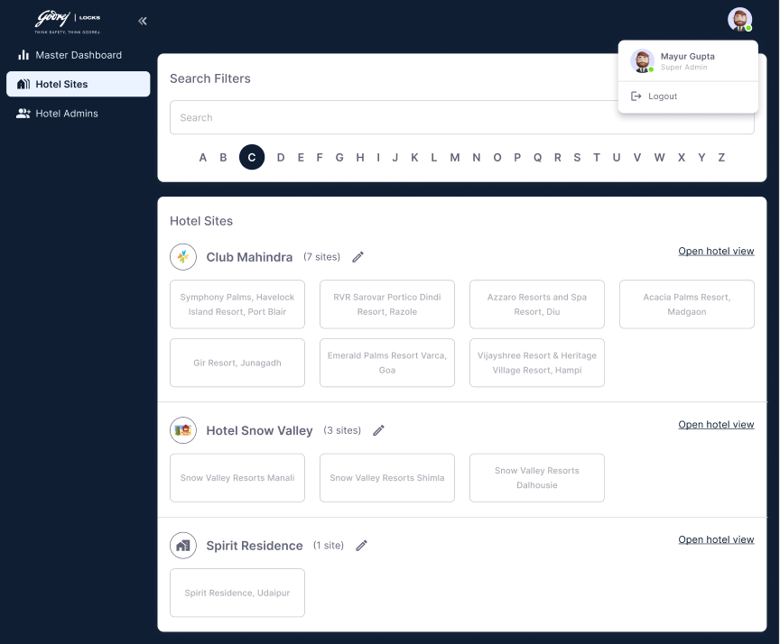</a>
<figcaption><strong>Super Admin</strong>The sidebar is Master Dashboard, Hotel Sites and Hotel Admins. The dark treatment marks these two tiers apart from a site role's screens.</figcaption>
</figure>
<figure>
<a href="images/administration/05-hotel-admin-view.png">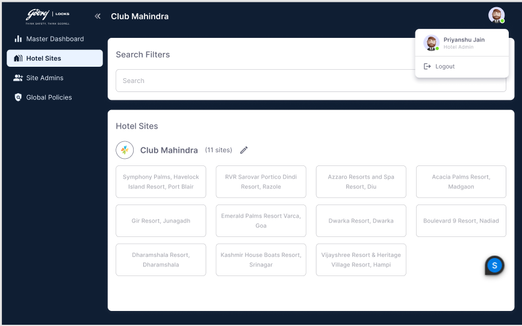</a>
<figcaption><strong>Hotel Admin</strong>The same screen scoped to one hotel, named in the top bar. Site Admins and Global Policies replace the Super Admin's Hotel Admins.</figcaption>
</figure>

## 2. Hotels and sites

Both tiers browse the same card layout, reading the same call with a different
scope.

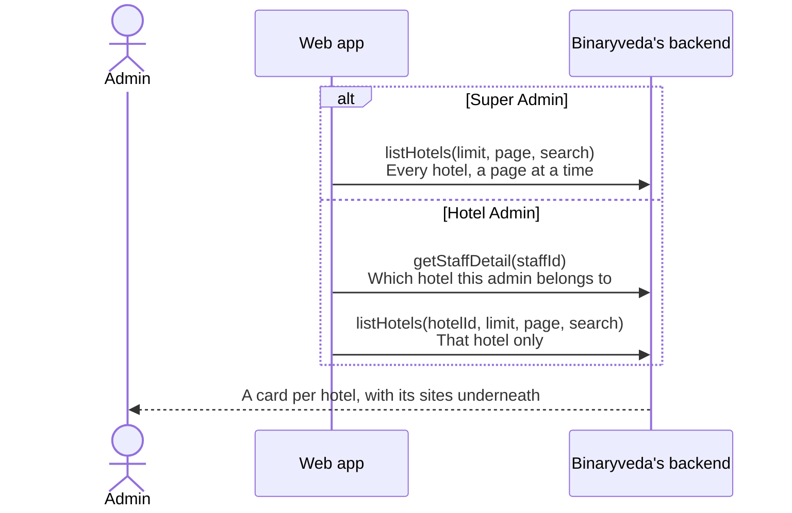

The Super Admin list loads a page at a time as the page is scrolled, using an
observer on the last card, and has an A to Z strip down the side to jump to a
letter. Hotels whose name starts with a digit are left out of the sorted list
the strip works against.

The Hotel Admin list is short enough to need neither, and has a search box
instead.

<figure>
<a href="images/administration/02-hotel-sites-search.png">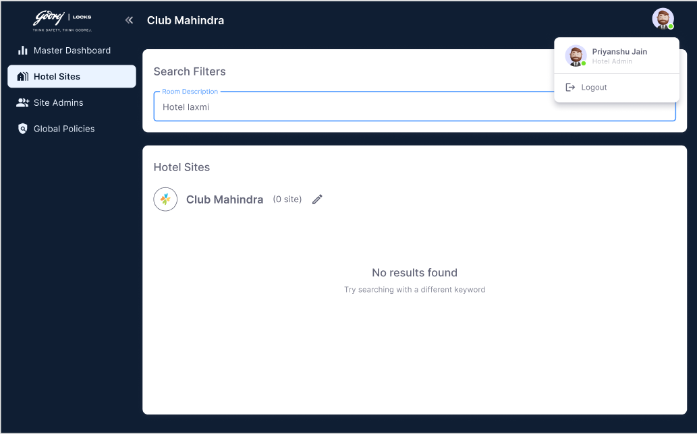</a>
<figcaption><strong>Searching</strong>The search narrows the sites under the hotel rather than the hotels themselves, so the hotel card stays and its count falls to zero.</figcaption>
</figure>

## 3. Hotel Admins and Site Admins

Two screens with the same shape. Each lists administrators, and each can add,
view, edit and remove one.

<figure>
<a href="images/administration/04-hotel-admins.png">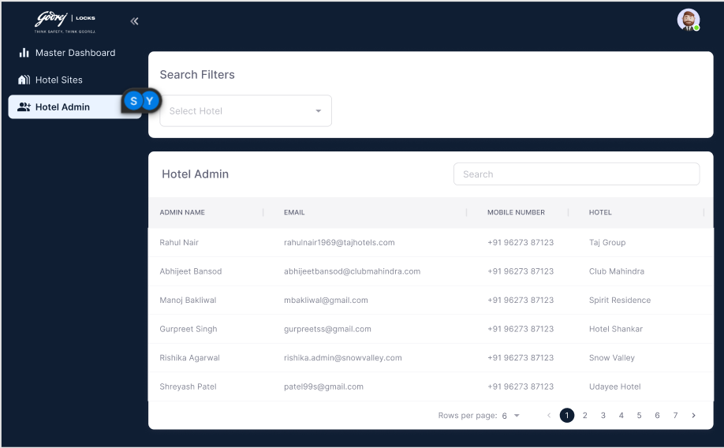</a>
<figcaption><strong>Hotel Admins</strong>The Super Admin's version. The last column is the hotel each administrator belongs to, and the filter above it narrows by hotel.</figcaption>
</figure>
<figure>
<a href="images/administration/06-site-admins.png">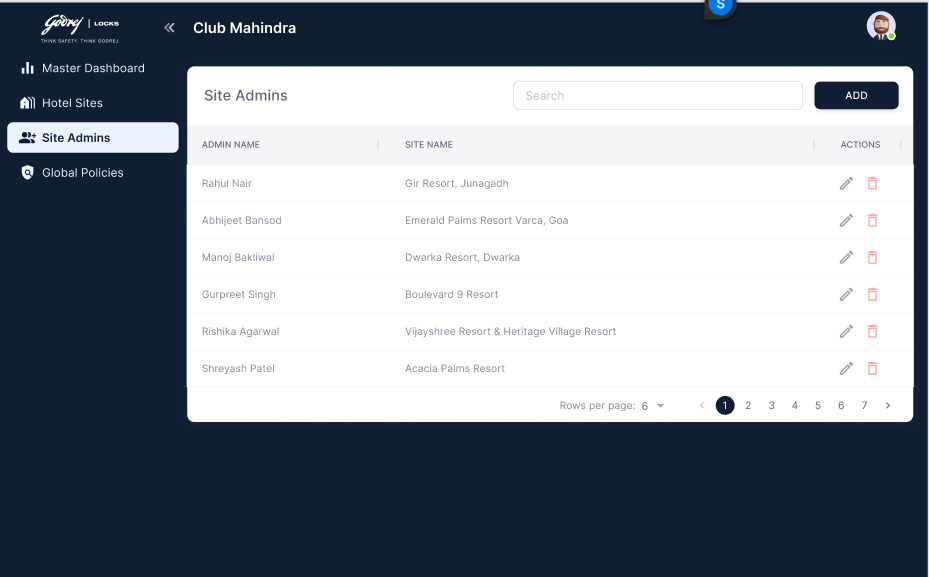</a>
<figcaption><strong>Site Admins</strong>The Hotel Admin's version of the same screen. The same shape against a site rather than a hotel.</figcaption>
</figure>
<figure>
<a href="images/administration/07-add-admin.png">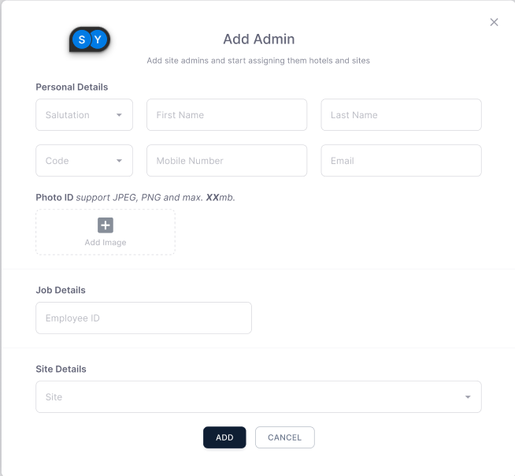</a>
<figcaption><strong>Add Admin</strong>Personal details, employee ID, then the one field that differs between the two screens. Here it is <strong>Site</strong>; on the Super Admin's it is the hotel.</figcaption>
</figure>
<figure>
<a href="images/administration/10-site-admins-search.png">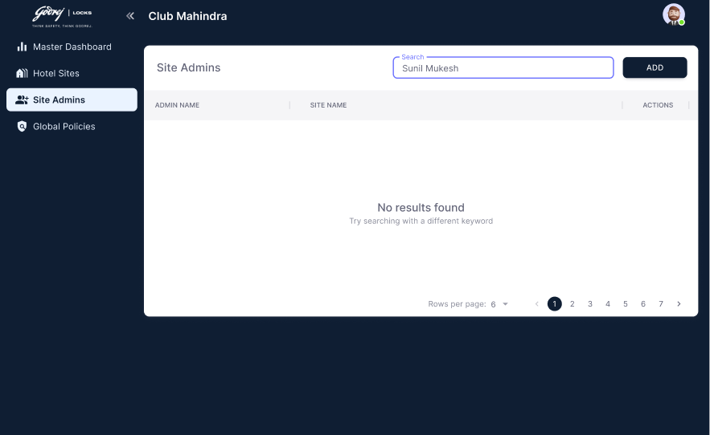</a>
<figcaption><strong>No match</strong>Both administrator lists search on the name, and both are paged from the server.</figcaption>
</figure>

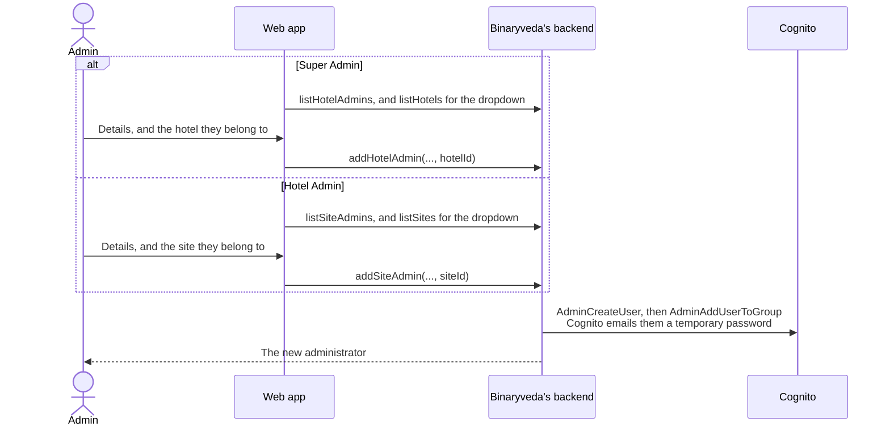

The forms ask for the same fields. Salutation, first and last name, country code
and mobile, email, employee ID, and the one thing that differs: a Hotel Admin is
attached to a **hotel**, a Site Admin to a **site**.

Email is required on both, because the Cognito account is created against it.
The rest of that path is
[Sign In and Roles, step 1](sign-in-and-roles.md#1-where-the-account-comes-from).

Editing uses `getHotelAdmin` or `getSiteAdmin` to fill the form, then
`updateHotelAdmin` or `updateSiteAdmin`. Removing asks for confirmation and
calls `deleteHotelAdmin` or `deleteSiteAdmin`.

<figure>
<a href="images/administration/08-edit-admin.png">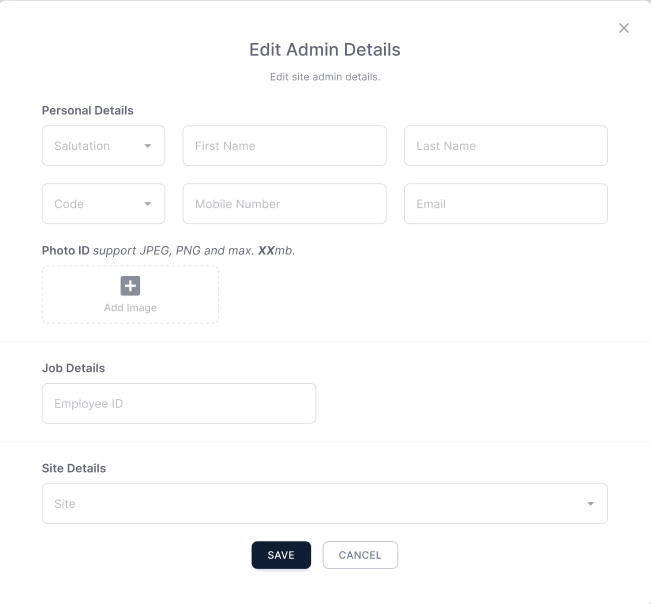</a>
<figcaption><strong>Edit Admin Details</strong>The same fields as adding, filled from <code>getSiteAdmin</code>.</figcaption>
</figure>
<figure>
<a href="images/administration/09-delete-admin.png">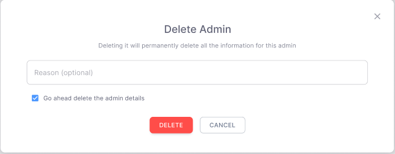</a>
<figcaption><strong>Delete Admin</strong>The reason and tick used throughout the app. No accessor is deleted here, because an administrator never had one.</figcaption>
</figure>

Neither screen creates staff. Everybody below Site Admin is added from
[Staff](staff.md#2-adding-a-staff-member).

## 4. Opening a site

An administrator with no site of their own picks one here.

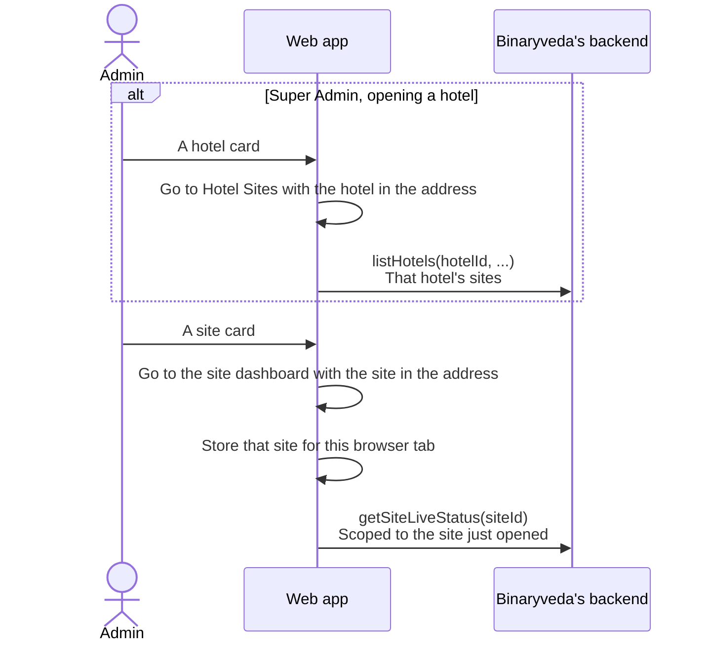

The site in the address is written into the same place a site role's own site
would be, so every later call on every screen is scoped to it without anything
else needing to know how the site was chosen.

A Super Admin reaches a site in two hops: a hotel card narrows the list to that
hotel, then a site card opens the site.

The two tiers also never open the Socket.IO connection described in
[Requests](requests.md#the-connection). Their own staff record has no site, so
there is no site room to join.

## 5. Policies at two levels

A hotel has one policy, and every site starts from it.

<figure>
<a href="images/administration/11-global-policies.png">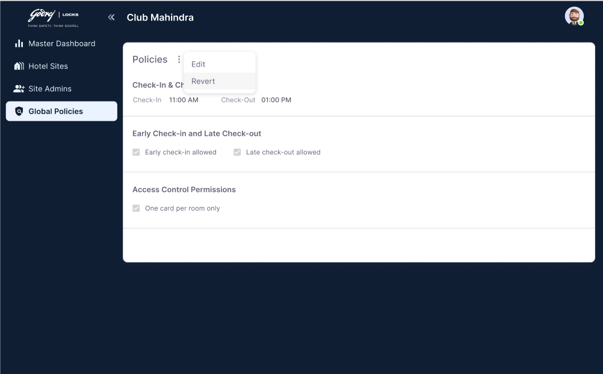</a>
<figcaption><strong>Global Policies</strong>Five settings in three groups, against the site policy's nine. Edit and Revert sit in the overflow menu, the same as on a site policy.</figcaption>
</figure>
<figure>
<a href="images/administration/12-global-policies-edit.png">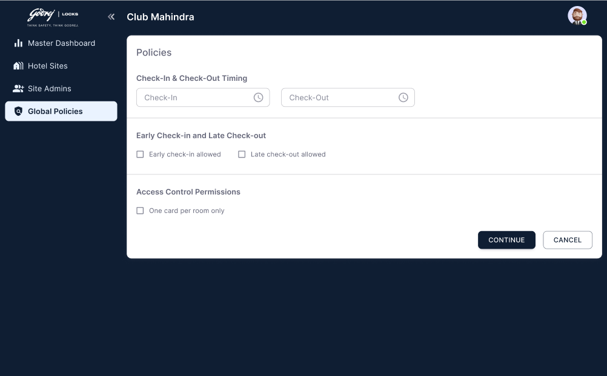</a>
<figcaption><strong>Editing</strong>The button reads <strong>Continue</strong> rather than Save, because the confirmation below comes next.</figcaption>
</figure>
<figure>
<a href="images/administration/13-global-policies-save.png">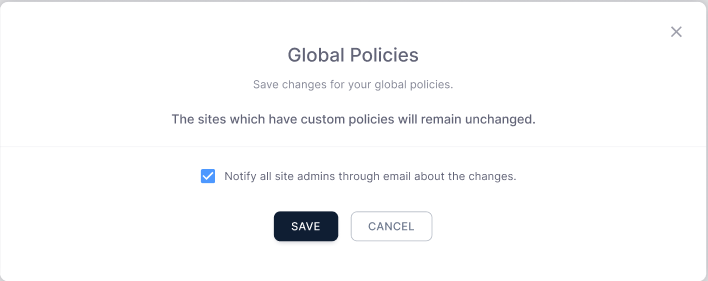</a>
<figcaption><strong>The confirmation</strong>It states what the change will not touch, and carries the notify tick that sends the new policy to the hotel's site admins.</figcaption>
</figure>

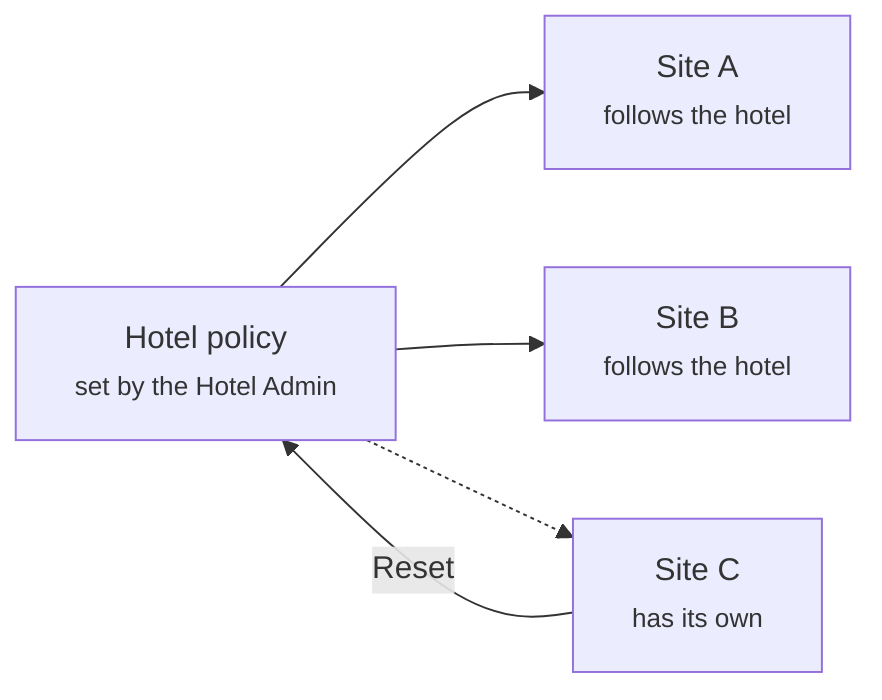

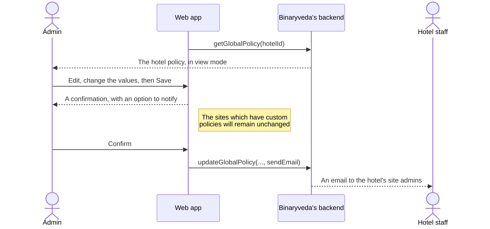

### What the hotel policy holds

| Setting |
|---|
| Check in time |
| Check out time |
| Early check in allowed |
| Late check out allowed |
| One card per room |

A site policy holds these five and adds the housekeeping trigger, the
housekeeping time, whether access is revoked after checkout, and the grace
period. Those four are per site, so they are set on
[the site policy screen](rooms-and-master-data.md#6-policies).

### Saving, resetting, and notifying

The confirmation appears before every save and says what the change leaves
alone: sites carrying their own policy stay as they are. It also carries the
notify tick.

Notifying is done by the backend rather than by the browser. It gathers every
Site Admin in the hotel, with their name, email and site, and sends them the new
policy.

The two reset buttons work at different levels and are worth keeping apart.

| Button | Where | Effect |
|---|---|---|
| Reset, on a site policy | [Rooms and Master Data](rooms-and-master-data.md#6-policies) | Copies the hotel policy onto that site |
| Reset, on the hotel policy | This screen | Puts the hotel policy back to the built in default |

## 6. The hotel logo

A small edit, reached from the pencil on a hotel card rather than from a screen
of its own.

<figure>
<a href="images/administration/03-add-hotel-logo.png">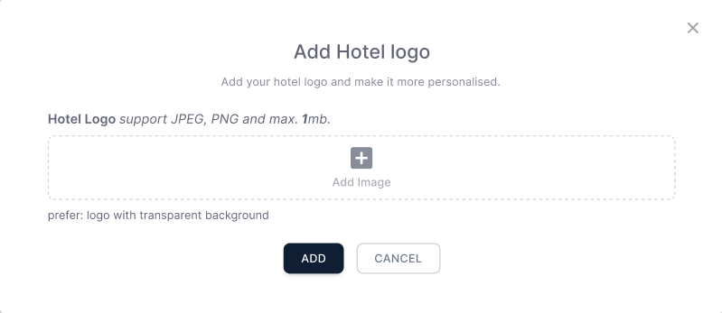</a>
<figcaption><strong>Add Hotel logo</strong>One image, up to 1mb, uploaded before <code>addHotelLogo</code> is sent. The backend receives the stored key.</figcaption>
</figure>

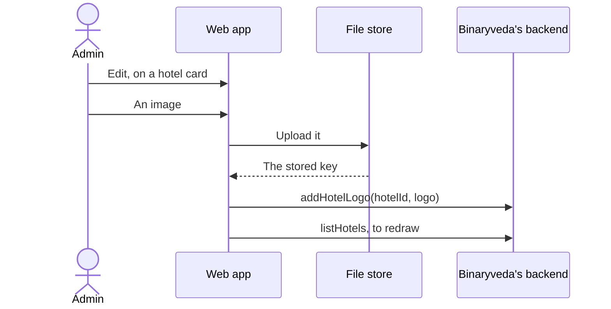

The logo is stored against the hotel and shown on its card wherever hotels are
listed.

## What the backend does

| Call | Service | Effect |
|---|---|---|
| `listHotels` | `user-service` | Hotels with their sites, optionally one hotel, paged and searchable |
| `getHotelById`, `getSiteById` | `user-service` | One hotel or one site |
| `listSites` | `user-service` | The sites under a hotel, for the site dropdown |
| `addHotelLogo` | `user-service` | Stores the uploaded logo against a hotel |
| `listHotelAdmins`, `getHotelAdmin`, `addHotelAdmin`, `updateHotelAdmin`, `deleteHotelAdmin` | `user-service` | Hotel administrators, including the Cognito account |
| `listSiteAdmins`, `getSiteAdmin`, `addSiteAdmin`, `updateSiteAdmin`, `deleteSiteAdmin` | `user-service` | Site administrators, including the Cognito account |
| `getGlobalPolicy`, `updateGlobalPolicy`, `resetGlobalPolicy` | `inventory-service` | The hotel policy, and the email to its site admins |

Nothing on this page reaches Spintly. An administrator opens no doors, so no
accessor is created for one.
