# 2. Bookings

**What it is.** The record of a stay before anyone arrives. A booking holds the
person who made it, the dates, and one or more rooms. It carries no room numbers
and no guest names beyond the booker, because both are filled in at check in.

**How to get there.** Bookings in the sidebar, which Site Admin, Site Manager,
Front Desk and Housekeeping Manager all have.

!!! warning "Key point"

    A booking reserves a **room type**, not a room. Availability is counted per
    type against the dates, and the actual room number is chosen during
    [check in](check-in.md#2-choosing-the-room). Nothing on this page touches a
    lock.

## Participants

This page uses Hotel staff, Web app and Binaryveda's backend.

Each one is defined, with the colour it keeps across the site, in
[Reading these pages](conventions.md).

## The whole flow

Five steps. Each one has its own section below.

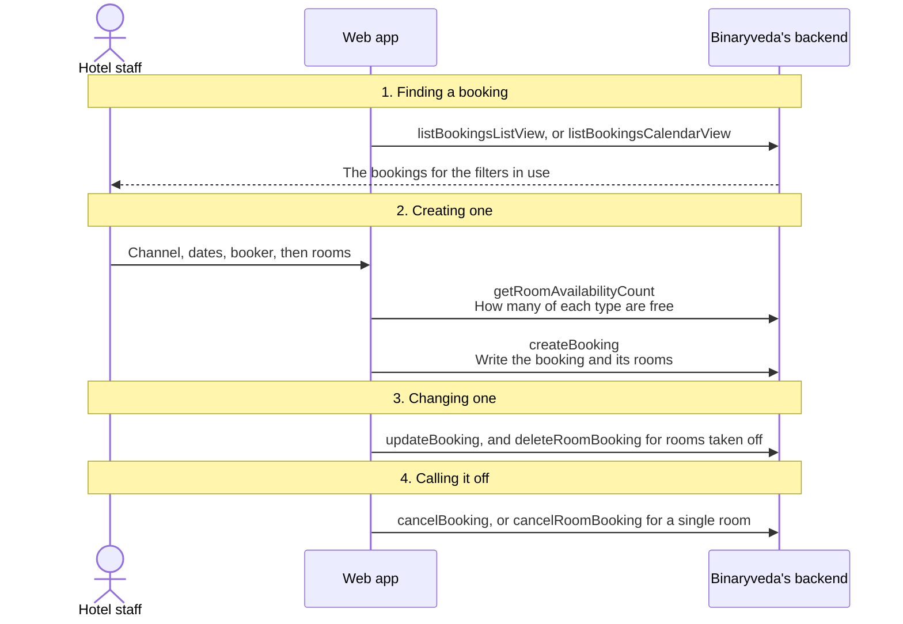

## 1. Finding a booking

The screen opens as a list and can be switched to a calendar. Both read the same
bookings through different calls, and the switch is held in the page rather than
in the address, so a reload returns to the list.

<figure>
<a href="images/bookings/01-bookings-list.png">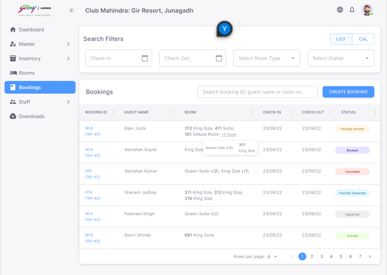</a>
<figcaption><strong>The list</strong>The Room column holds the types booked and how many of each, not a room number. The <strong>LIST</strong> and <strong>CAL</strong> toggle at the top right is the switch between the two calls.</figcaption>
</figure>
<figure>
<a href="images/bookings/02-bookings-calendar.png">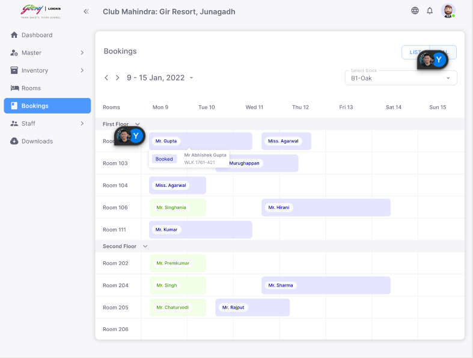</a>
<figcaption><strong>The calendar</strong>A row per room for one block, across one week. The arrows beside the date range are each a fresh call rather than a filter over what is loaded.</figcaption>
</figure>

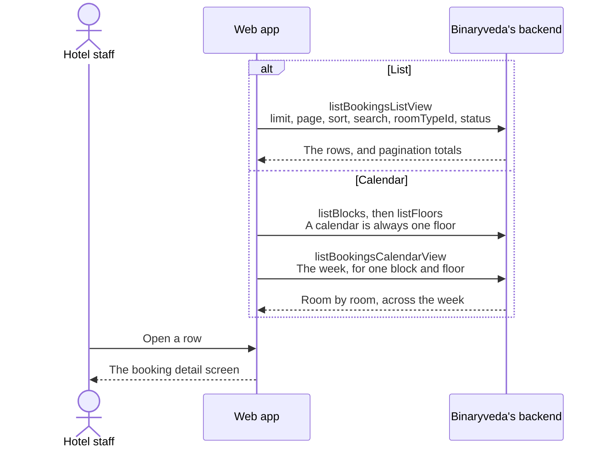

### The list

Six columns: booking ID, guest name, room, check in, check out, and status. The
list is paged and sorted on the server, and it sorts by check in descending
until told otherwise.

Searching matches the booker and the booking reference. The room type and status
dropdowns narrow it further, and both are sent to the server rather than applied
in the browser.

The **room** column holds a summary rather than a room number. Before anyone
arrives it shows the room types booked and how many of each. Once a room has
been checked in, its number appears.

### The calendar

The calendar is always scoped to one floor of one block, because it draws a row
per room. Opening it loads the blocks, selects the first, loads that block's
floors, and then asks for the week.

Weeks are moved with the arrows above the grid. Each move is a fresh call rather
than a filter over what is already loaded.

## 2. Creating a booking

One screen, two cards. The upper card is the booking, the lower card is the
rooms on it. Nothing is written until the form is submitted.

<figure>
<a href="images/bookings/03-create-booking.png">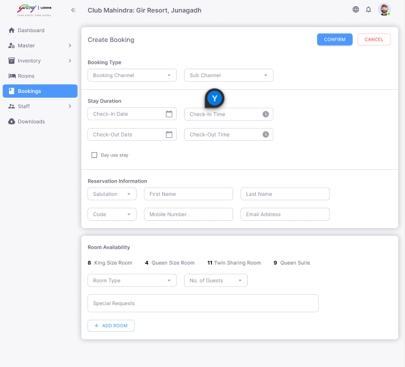</a>
<figcaption><strong>Create Booking</strong>The two cards. Room Availability already shows a count per type, before any dates are set.</figcaption>
</figure>
<figure>
<a href="images/bookings/04-create-booking-filled.png">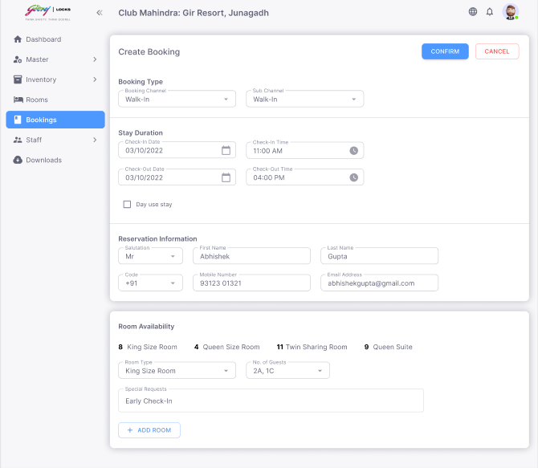</a>
<figcaption><strong>Filled in</strong>Channel first, because the sub channel dropdown beside it is loaded from whichever channel is picked.</figcaption>
</figure>
<figure>
<a href="images/bookings/05-create-booking-rooms.png">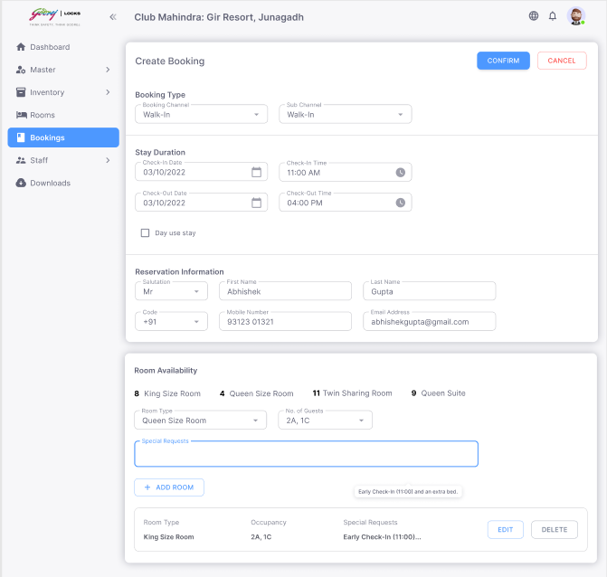</a>
<figcaption><strong>Rooms on the booking</strong>Each room added becomes a card under the form, carrying its type, occupancy and special request, and can be taken off before submitting.</figcaption>
</figure>

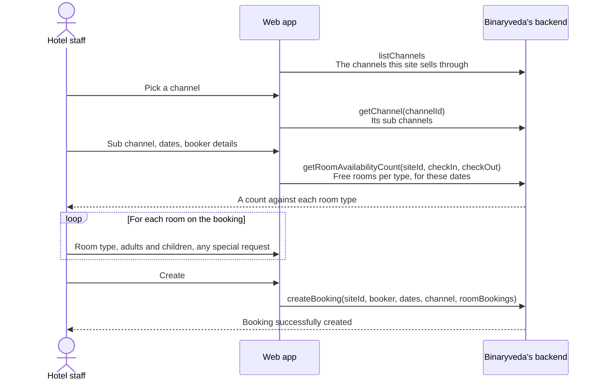

### What the form asks for

| Field | Notes |
|---|---|
| Booking channel | From `listChannels`. Set up in [Rooms and Master Data](rooms-and-master-data.md#7-channels) |
| Sub channel | Loaded from the chosen channel, so the dropdown is empty until a channel is picked |
| Check in, check out | Both required |
| Day use stay | A toggle. Turning it on sets check out to the check in date and stops it being edited |
| Salutation, first name, last name | The booker. First and last name are required |
| Country code and mobile number | Country codes come from `listCountryCodes` |
| Email | Optional |

### Adding rooms

Availability is fetched for the dates on the booking and refetched whenever
those dates change, so the counts always match the stay being booked.

Each room added takes a room type, an adults and children count from a stepper,
and an optional special request. Rooms appear as cards under the form and can be
removed before submitting.

A booking cannot be created with no rooms on it, and the browser refuses an
empty one before it is sent.

## 3. Changing a booking

Edit Booking on the detail screen returns to the same two card screen with
everything filled in, and the address carries the booking's ID.

<figure>
<a href="images/bookings/06-booking-details.png">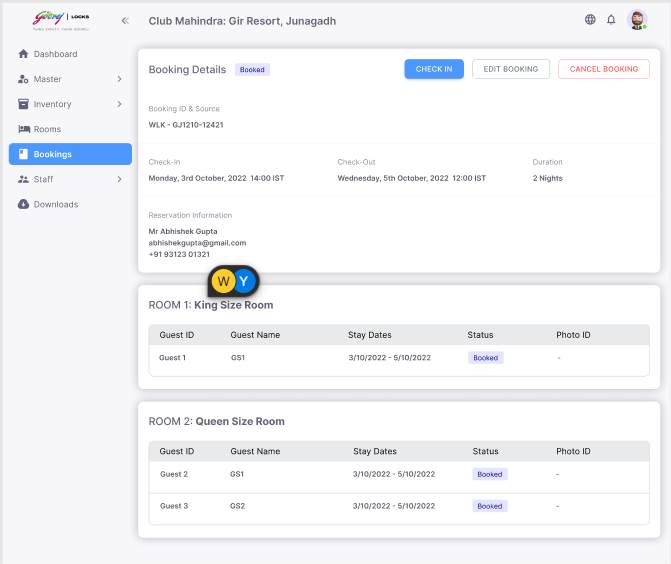</a>
<figcaption><strong>Booking Details</strong>The badge beside the title is the booking status, and a card per room sits below it. While everything is still <code>BOOKED</code>, the buttons are Check In, Edit Booking and Cancel Booking.</figcaption>
</figure>
<figure>
<a href="images/bookings/09-edit-room.png">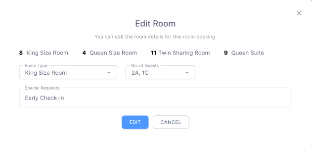</a>
<figcaption><strong>Edit Room</strong>Per room rather than per booking, which the app switches to once part of the booking has arrived. The counts along the top are the same availability figures as on the create screen.</figcaption>
</figure>

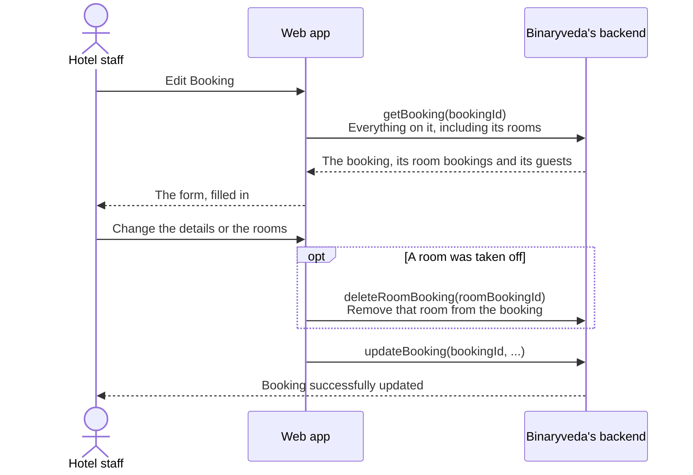

Rooms removed during an edit are deleted one at a time before the booking itself
is updated, because each room on a booking is its own record.

Editing is only offered while the booking is still `BOOKED`. Once anyone has
arrived, changes are made per room instead, through Edit Room on the detail
screen. That is
[Check In, step 6](check-in.md#changing-a-room-after-booking).

## 4. Cancelling

Cancelling works at two levels, and what has already happened to the booking
decides which one is offered.

<figure>
<a href="images/bookings/07-cancel-booking.png">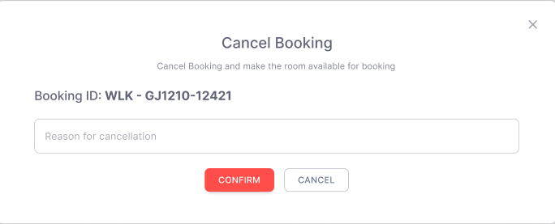</a>
<figcaption><strong>Cancel Booking</strong>The booking ID is repeated in the dialog, because this one confirmation takes every room on it.</figcaption>
</figure>
<figure>
<a href="images/bookings/08-booking-cancelled.png">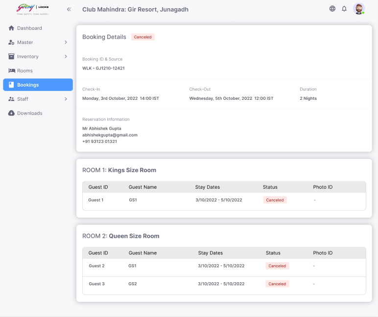</a>
<figcaption><strong>The whole booking</strong>The badge and every guest row move together, and the action buttons are gone.</figcaption>
</figure>
<figure>
<a href="images/bookings/10-room-cancelled.png">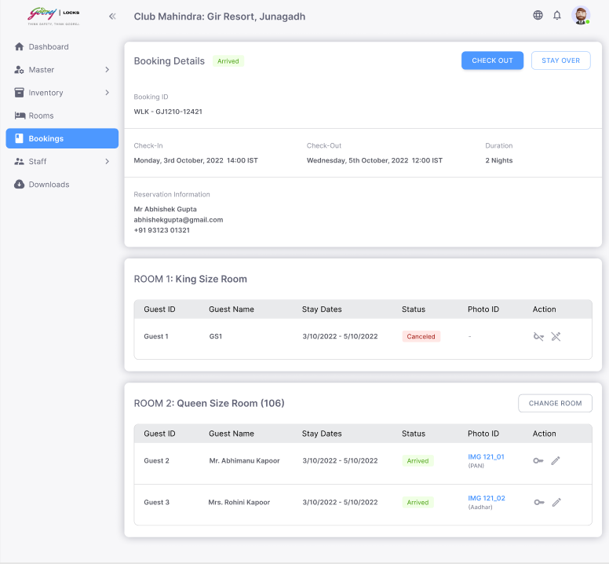</a>
<figcaption><strong>One room</strong>Cancelled on its own while the rest of the booking carries on. The booking keeps its own status, and only the one room card changes.</figcaption>
</figure>

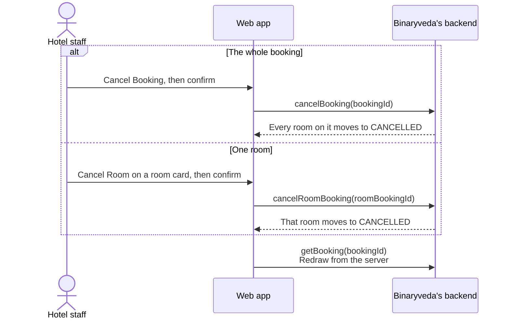

Cancel Booking is offered while the booking is `BOOKED`. Once part of it has
been checked in, only the rooms still `BOOKED` can be cancelled individually.

## 5. A booking's life

A booking has nine states. Four of them exist because a booking can hold several
rooms that are not all at the same stage.

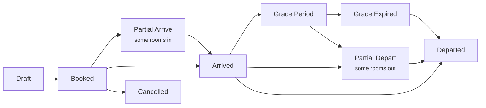

A room booking has a shorter set, because it is either in or out.

| Status | Meaning |
|---|---|
| `DRAFT` | Written but not confirmed |
| `BOOKED` | Confirmed, nobody has arrived |
| `ARRIVED` | Checked in, with a room number assigned |
| `DEPARTED` | Checked out |
| `CANCELLED` | Called off, at either level |

`GRACE_PERIOD` and `GRACE_EXPIRED` sit between the check out time on the policy
and the point where access is revoked. Both are set by the backend on a
schedule rather than by anything on this screen. What happens at the end of the
grace period is in
[Stay Over and Check Out](stay-over-and-check-out.md#4-when-nobody-checks-out).

Which buttons a room card offers follows directly from these two statuses.

| Booking status | Room status | Buttons on the room |
|---|---|---|
| `BOOKED` | `BOOKED` | Check In, Edit Booking, Cancel Booking |
| `PARTIAL_ARRIVE`, `PARTIAL_DEPART` | `BOOKED` | Check In, Edit Room, Cancel Room |
| `ARRIVED` | `ARRIVED`, with guests still to add | Check In, Edit Room, Cancel Room |
| `ARRIVED`, `PARTIAL_DEPART` | `ARRIVED`, all guests added | Check Out, Stay Over |

A room card offers Check In while it still has fewer guests recorded than the
adults it was booked for, so a room booked for two can have its second guest
added after the first has already arrived.

## What the backend does

Everything on this page is handled by `booking-service`, except the channel
lookups, which belong to `inventory-service`.

| Call | Service | Effect |
|---|---|---|
| `listBookingsListView`, `listBookingsCalendarView` | `booking-service` | Reads bookings for the site, paged or by week |
| `getBooking` | `booking-service` | One booking with its rooms, guests and channel |
| `getRoomAvailabilityCount` | `booking-service` | Counts free rooms per type across the dates |
| `createBooking`, `updateBooking` | `booking-service` | Writes the booking and its room bookings |
| `deleteRoomBooking` | `booking-service` | Removes one room from a booking |
| `cancelBooking`, `cancelRoomBooking` | `booking-service` | Moves the booking, or one room on it, to `CANCELLED` |
| `listChannels`, `getChannel` | `inventory-service` | The channels and sub channels the site sells through |

No call on this page reaches Spintly. A booking creates no accessor and writes
no door permission, because no guest and no room exist to attach them to yet.
That begins at [check in](check-in.md).
