# 3. Check In and Room Access

**What it is.** Turning a booking into a stay. Check in assigns a room number,
records who is actually staying, and issues the credentials that open the door.
It is where a guest first gets one.

**How to get there.** Check In, on a room card of a booking detail screen. The
booking is reached from [Bookings](bookings.md#1-finding-a-booking).

!!! warning "Key point"

    The room access step is where a guest becomes real to the lock system.
    Before it, the guest exists in the database and can sign in to the guest
    app, but has no accessor and no permission on any door. See
    [step 4](#4-issuing-room-access).

## Participants

This page uses Hotel staff, Web app, Binaryveda's backend, Spintly's servers,
Guest and File store.

Each one is defined, with the colour it keeps across the site, in
[Reading these pages](conventions.md).

## The whole flow

Six steps. Each one has its own section below.

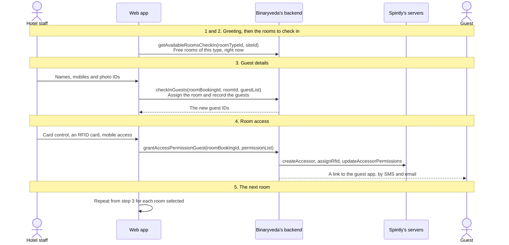

## 1. The greeting

The first screen of check in is a reminder to greet the guest. It makes no
call and can be moved past with one button.

It is not shown every time. The app counts how many times check in has been
opened and shows the greeting on every fifth open, so it appears on the first
check in of a run and then stays out of the way. The count is held in the
browser and is separate from the one used by
[check out](stay-over-and-check-out.md#2-checking-out).

<figure>
<a href="images/check-in/01-greeting.png">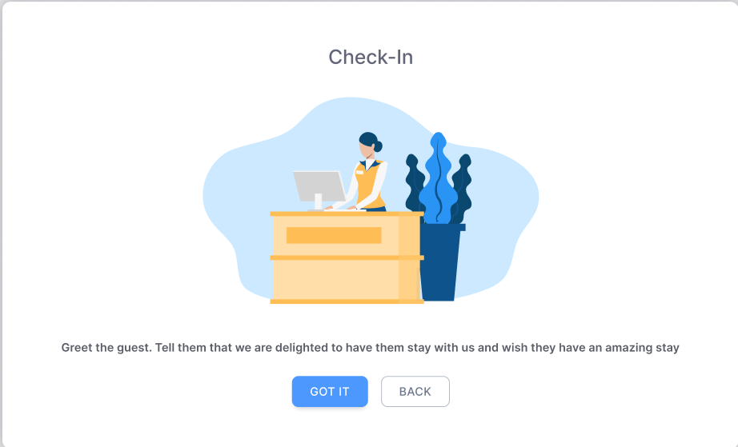</a>
<figcaption><strong>The greeting</strong>No call behind it. <strong>Got It</strong> moves on and <strong>Back</strong> closes check in.</figcaption>
</figure>

## 2. Choosing the room

A booking can hold several rooms, and several can be checked in without closing
the dialog. This step lists the room bookings that are still waiting and lets
one or more be ticked.

Each row also lists the guests expected in that room, from the adults the room
was booked for. Ticking the room ticks all of its guests, and individual guests
can be unticked to check in part of a room now and the rest later.

Check in then works through the selected rooms one at a time, repeating
[step 3](#3-guest-details) and [step 4](#4-issuing-room-access) for each.

<figure>
<a href="images/check-in/02-select-rooms.png">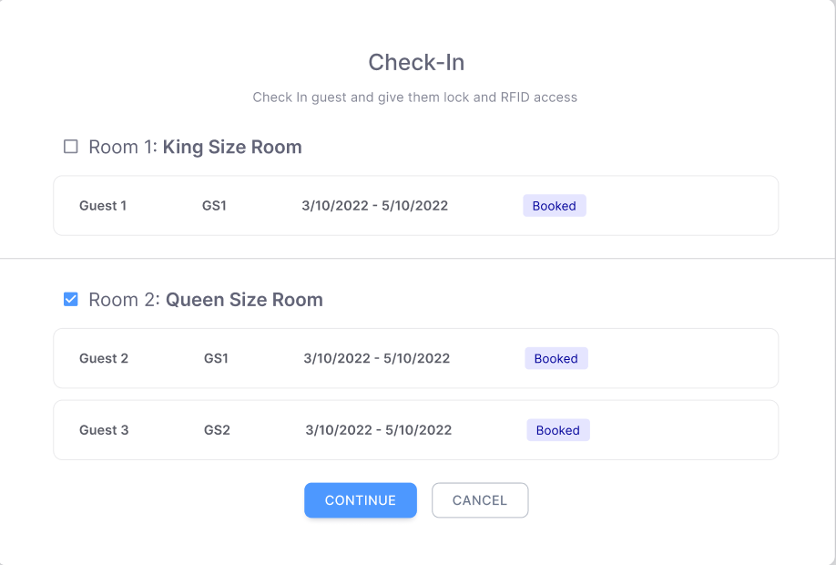</a>
<figcaption><strong>Choosing the rooms</strong>One tick per room and one per guest under it. Here the first room is left for later, which is what produces a partly arrived booking.</figcaption>
</figure>

## 3. Guest details

The room number is chosen here, and the people staying in it are recorded.

<figure>
<a href="images/check-in/03-guest-details.png">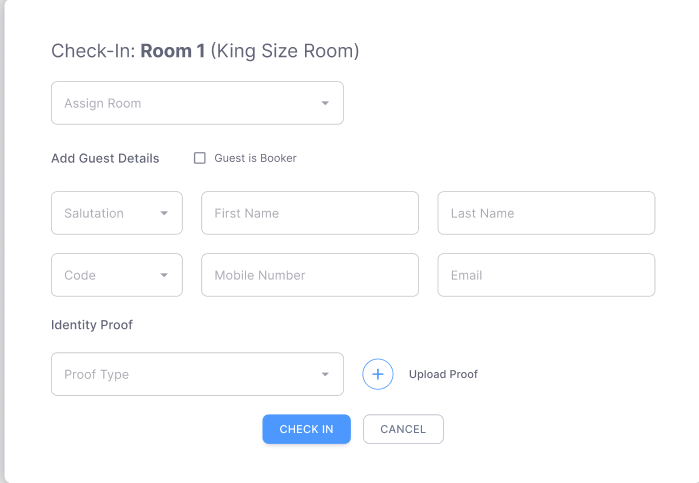</a>
<figcaption><strong>One guest</strong>Assign Room sits above the guest blocks, because the room number is fixed once for the room rather than per guest.</figcaption>
</figure>
<figure>
<a href="images/check-in/04-guest-details-two.png">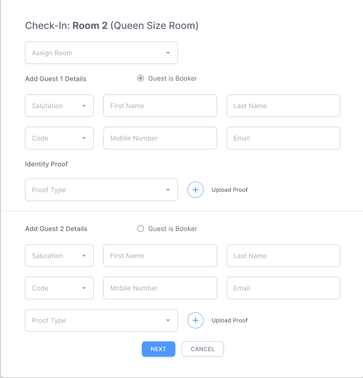</a>
<figcaption><strong>Two guests</strong>One block per adult still to be added. <strong>Guest is Booker</strong> is a choice across the blocks, so the booker fills exactly one of them.</figcaption>
</figure>
<figure>
<a href="images/check-in/11-edit-guest.png">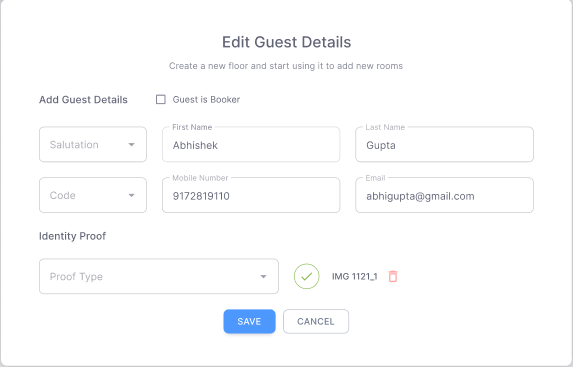</a>
<figcaption><strong>Edit Guest Details</strong>The same fields after arrival, reached from the pencil on a guest row. An uploaded proof shows as its stored key with a tick.</figcaption>
</figure>

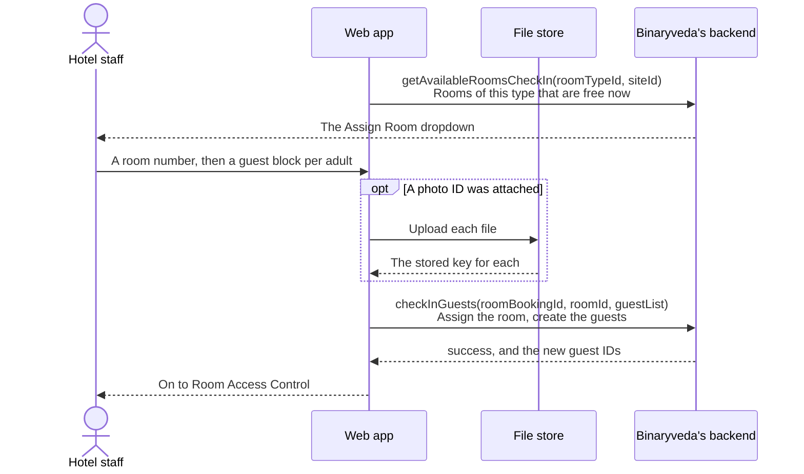

### What the form asks for

| Field | Rules |
|---|---|
| Assign Room | Required. Only offered while the room is still `BOOKED` |
| Guest is Booker | Copies the booker's details into that guest block |
| Salutation | Optional |
| First name, last name | Required |
| Country code, mobile number | Required. Checked against an Indian mobile pattern |
| Email | Optional, and validated when filled in |
| Photo ID type | Passport, Aadhar, Driving License, PAN or Others |
| Photo ID file | Optional |

One block is drawn per adult still to be added, so a room booked for two with
one guest already in it shows one block. **Two guests in the same room cannot
share a mobile number**, and the form refuses that before it sends anything.

Assign Room is only shown when the room is still `BOOKED`. Adding a second guest
to a room that is already `ARRIVED` skips it, because the room number was fixed
the first time.

### The photo ID

Files are uploaded straight from the browser to S3 before the mutation is sent,
each under a generated name. What goes to the backend is the stored key, not the
file, so a failed upload leaves the check in unsent rather than half written.

Reading one back later is a separate call. `getIdentityProofUrl` exchanges the
stored key for a temporary link, which is how the photo ID opens from a guest
row on the booking screen.

### What the backend does with it

`checkInGuests` does more than write a row. For each guest it also creates a
Cognito account against their mobile number, which is what later lets them sign
in to the guest app with a phone number and an OTP.

The response carries the new guest IDs, and the dialog keeps them. They are what
[step 4](#4-issuing-room-access) grants access to.

## 4. Issuing room access

The last step, and the one that reaches Spintly. It lists the
guests just checked in and decides, per guest, how they get into the room.

<figure>
<a href="images/check-in/05-room-access.png">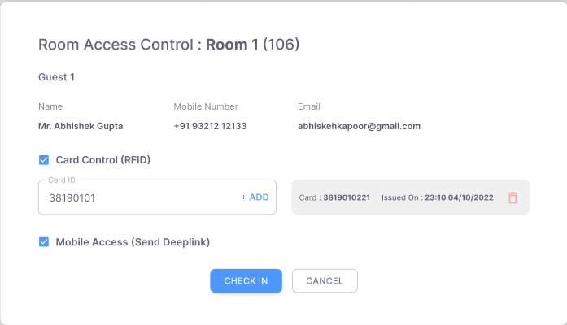</a>
<figcaption><strong>Room Access Control</strong>Both options arrive ticked. The card ID field sits under Card Control, and the panel to its right lists what has already been issued for this room.</figcaption>
</figure>
<figure>
<a href="images/check-in/07-room-access-two-guests.png">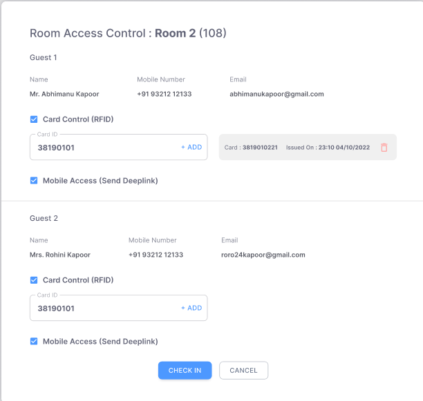</a>
<figcaption><strong>Per guest</strong>A block each, so one guest can take a card while another takes only the link. The permission list sent covers both.</figcaption>
</figure>
<figure>
<a href="images/check-in/06-room-access-cards.png">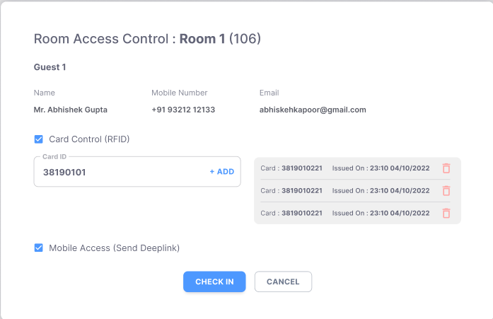</a>
<figcaption><strong>More than one card</strong>Each card added is listed with when it was issued. Where the site policy sets <strong>one card per room</strong>, a second card here stops the submission.</figcaption>
</figure>

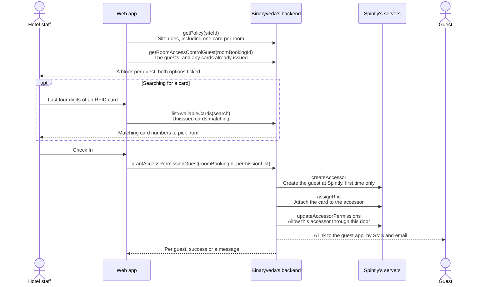

### The two options

| Option | Default | What it does |
|---|---|---|
| Card Control (RFID) | On | Issues a physical card. Needs a card number |
| Mobile Access (Send Deeplink) | On | Sends the guest a link to the guest app |

Both are sent per guest, so one guest in a room can have a card while another
has only mobile access.

Searching for a card matches the last four digits and only returns cards that
are free and active, so a card already out with another guest cannot be picked.
A card is added to the guest's block before the form is submitted, and cards
already issued for that room are listed underneath with who holds them and when
they were issued.

### Two checks before anything is sent

- **Card control with no card.** A guest with Card Control ticked and no card
  attached stops the submission with a prompt to add a card or untick the
  option.
- **One card per room.** When the site policy has this set, attaching more than
  one card across the room stops the submission. The policy is read at the top
  of this step, from [site policies](rooms-and-master-data.md#6-policies).

### What each Spintly call is for

| Call | When | Effect |
|---|---|---|
| `createAccessor` | The guest has no accessor yet | Creates the person at Spintly and stores the returned ID against the guest |
| `updateAccessorAccessSettings` | The guest already has an accessor | Sets which credential types that accessor may use, before permissions are written |
| `assignRfid` | Card control is on and a card was attached | Attaches the card to the accessor |
| `deleteRfid` | Card control was turned off for a guest who had a card | Detaches the card and releases the allocation |
| `updateAccessorPermissions` | Every time | Writes which doors this accessor may open |

The order matters on a second visit to this screen. Which credential types an
accessor may use is a setting on the accessor rather than on each door, so it is
written first and the permission call inherits it. Writing the permission alone
would leave a card tick with no effect.

### The result is per guest

`grantAccessPermissionGuest` answers with one entry per guest rather than a
single outcome, so a room can succeed for one guest and fail for another. The
app reports the three cases differently.

| Outcome | What the screen says |
|---|---|
| Every guest succeeded | Room Access allocated successfully |
| Some succeeded | Failed to give access to few guests. Please assign individually |
| None succeeded | The message returned for the failure |

A partial failure is recovered from [step 6](#6-changing-access-after-check-in)
rather than by running check in again.

### The link the guest receives

Ticking Mobile Access sends the guest into the guest app. The backend writes a
single use deep link record, then sends it by SMS and by email.

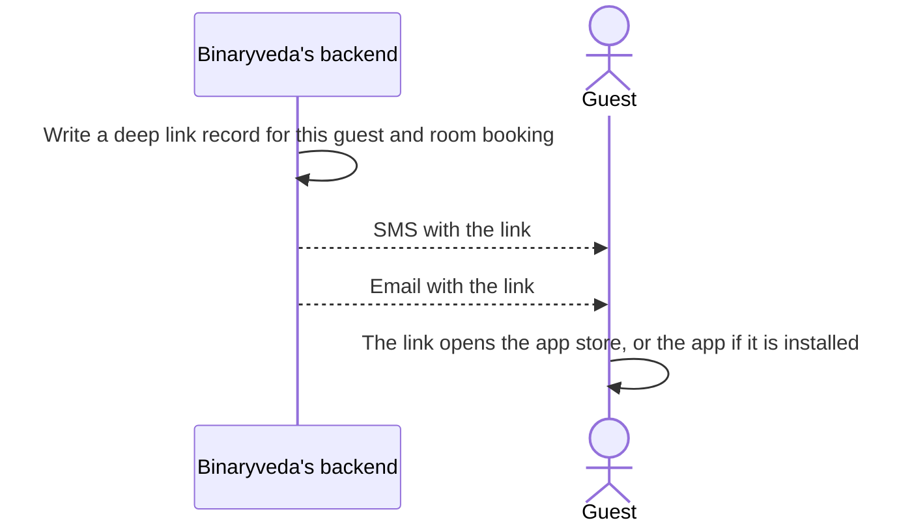

What the guest does next, including signing in with their mobile number, is in
the guest app's
[User Onboarding](../guest/user-onboarding.md).

## 5. Rooms after the first

When more than one room was ticked in [step 2](#2-choosing-the-room), granting
access does not close the dialog. It moves to the next room and returns to
[step 3](#3-guest-details) with that room's guest blocks. The dialog closes
after the last one.

Closing it at any point refetches the booking, so the room cards redraw with the
new room numbers and statuses.

<figure>
<a href="images/check-in/08-partially-arrived.png">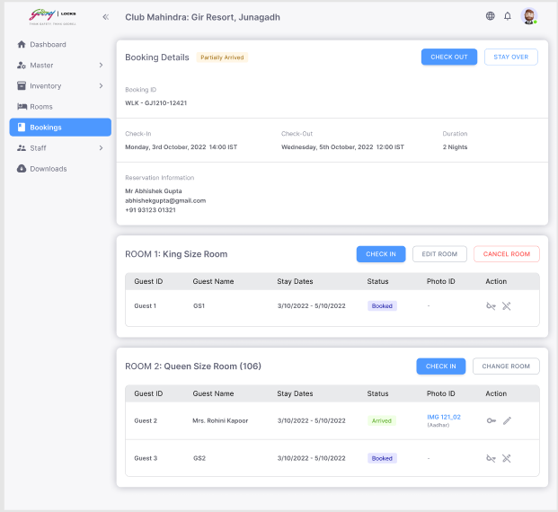</a>
<figcaption><strong>Partly arrived</strong>The room number appears beside the room type once that room is in. Rows still <code>BOOKED</code> keep their Check In button and have no icons in the Action column.</figcaption>
</figure>
<figure>
<a href="images/check-in/09-arrived.png">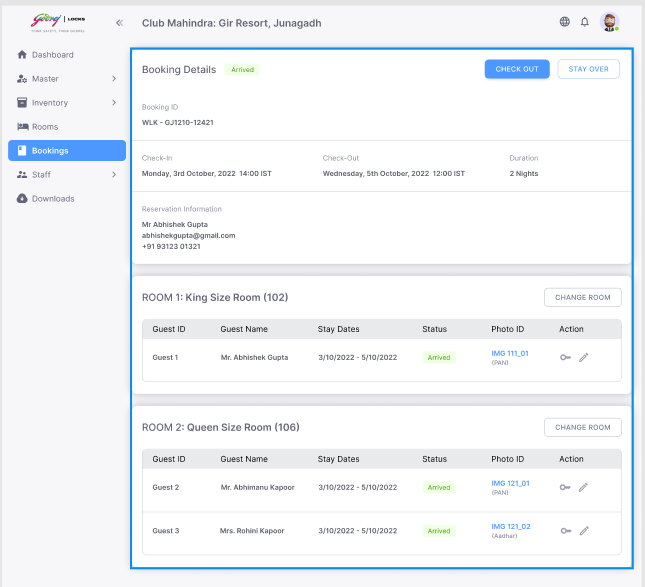</a>
<figcaption><strong>Arrived</strong>Every row now carries a photo ID link and the two icons from <a href="#6-changing-access-after-check-in">step 6</a>. The room cards offer Change Room instead of Check In.</figcaption>
</figure>

## 6. Changing access after check in

Once a guest has arrived, two icons appear on their row on the booking screen.
Neither reopens check in.

<figure>
<a href="images/check-in/10-room-access-panel.png">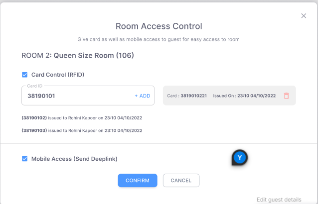</a>
<figcaption><strong>The key icon</strong>The same controls as <a href="#4-issuing-room-access">step 4</a>, opened on one room after arrival. Cards already out are named with who holds them and when they were issued.</figcaption>
</figure>

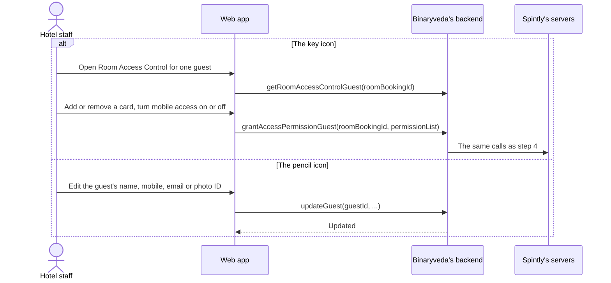

Both icons are inactive while the guest is `BOOKED`, `CANCELLED` or `DEPARTED`.
There is nothing to issue before arrival and nothing to change afterwards.

Editing a guest changes the record only. It writes no permission and makes no
Spintly call, so changing a name does not reissue a card.

### Changing a room after booking

Edit Room on a room card changes what was reserved rather than who is in it. It
takes a new room type, adult and child counts, and a special request, checks
them against availability for the booking's dates, and sends
`updateRoomBooking`.

It is offered while the room is still `BOOKED`. After arrival the room number is
fixed and the card offers check out and stay over instead.

## What the backend does

| Call | Service | Effect |
|---|---|---|
| `getAvailableRoomsCheckIn` | `booking-service` | Rooms of a given type free at this moment |
| `checkInGuests` | `booking-service` | Assigns the room, writes the guests, creates each guest's Cognito account |
| `getRoomAccessControlGuest` | `booking-service` | The room's guests, and the cards already issued against it |
| `listAvailableCards` | `booking-service` | Free, active RFID cards matching a search |
| `grantAccessPermissionGuest` | `booking-service` | The Spintly calls in [step 4](#what-each-spintly-call-is-for), the card allocation, and the guest's deep link |
| `updateGuest` | `user-service` | Updates one guest record |
| `getIdentityProofUrl` | `user-service` | A temporary link to a stored photo ID |
| `getPolicy` | `inventory-service` | The site's policy, including one card per room |
| `updateRoomBooking` | `booking-service` | Changes the room type, occupancy or special request |
