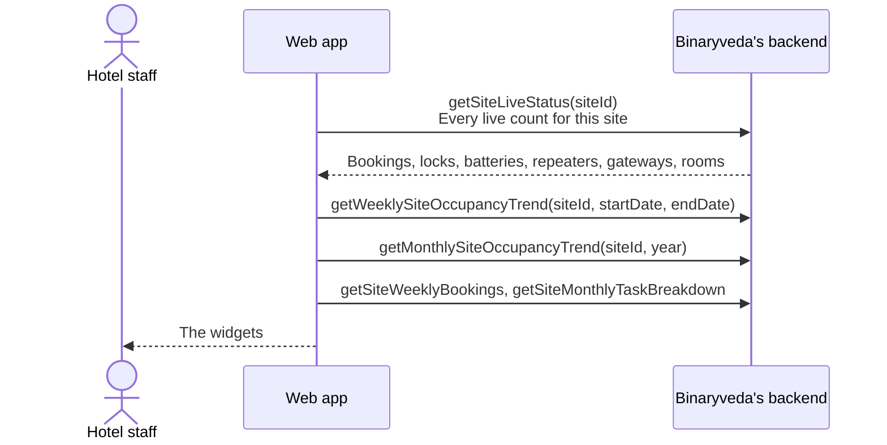
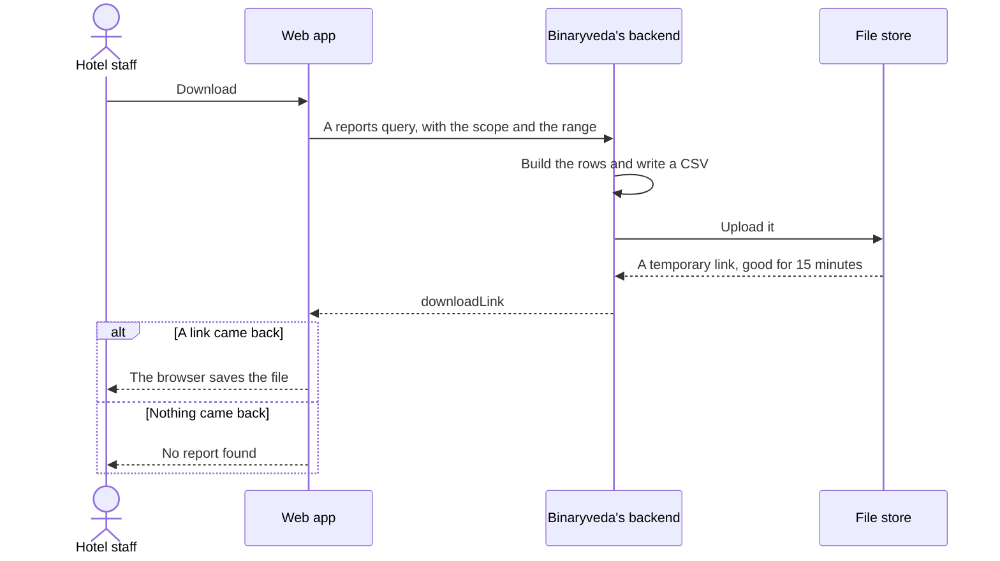
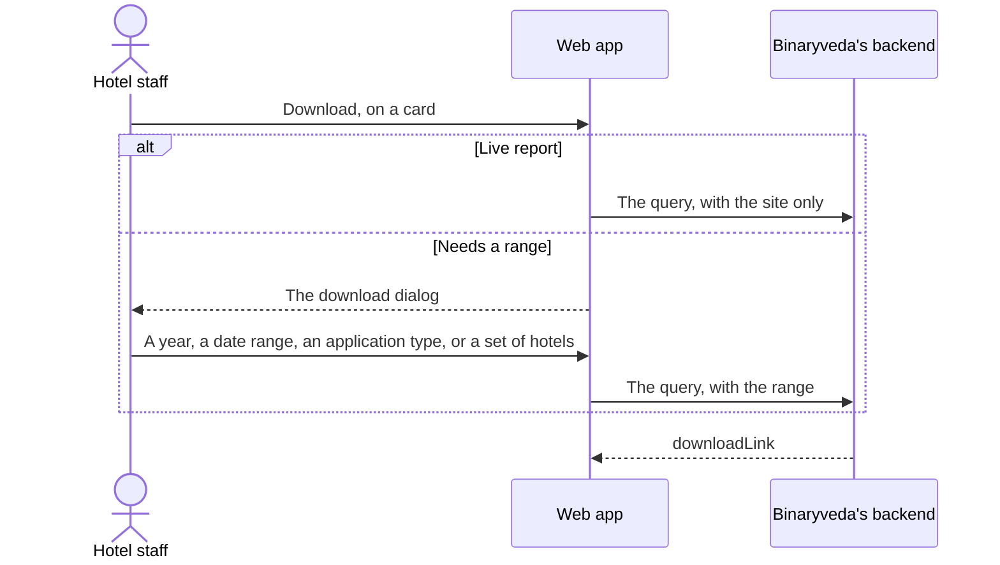

# 10. Dashboards and Reports

**What it is.** The read only half of the app. Three dashboards, one per tier,
and three report screens that all produce a CSV the same way.

**How to get there.** Dashboard is the landing screen for every role except the
Restaurant Manager. Reports is its own sidebar entry for Site Admin, Hotel Admin
and Super Admin.

!!! warning "Key point"

    A dashboard widget and its download are two different calls against two
    different paths. The widget reads a dashboard endpoint and the download
    reads a reports endpoint, which is why a download can be asked for a wider
    range than the widget is drawing.

## Participants

This page uses Hotel staff, Web app, Binaryveda's backend and File store.

Each one is defined, with the colour it keeps across the site, in
[Reading these pages](conventions.md).

## 1. The site dashboard

One call fills most of it. `getSiteLiveStatus` returns a document holding every
count on the screen, and the app splits it across the widgets.

### What the widgets hold

| Widget | Source |
|---|---|
| Bookings: new, checked in, cancelled | `monthlyBooking` from the live status |
| Weekly bookings | `getSiteWeeklyBookings`, with its own download |
| Live room status: booked, vacant, occupied, under maintenance | `roomStatus`. The total is the four added up |
| Total locks | `lockStatus` |
| Online, offline | `lockStatus` |
| Weak battery, critical battery | `batteryStatus` |
| Repeaters, gateways | `repeaterStatus` and `gatewayStatus` |
| Task breakdown | `getSiteMonthlyTaskBreakdown`, with its own download |
| Weekly occupancy trend | `getWeeklySiteOccupancyTrend`, four weeks at a time |
| Monthly occupancy trend | `getMonthlySiteOccupancyTrend`, a year at a time |

The lock status cards link into
[Inventory](inventory.md#1-locks) with the matching filter already applied.

### Moving through time

Both trend graphs page. The weekly graph moves four weeks at a time and the
monthly graph a year at a time, and each move is a refetch rather than a filter
over data already held.

Neither can be paged into the future. The forward arrow is disabled once the
range reaches the current week or the current year.

## 2. The hotel and master dashboards

Both are built the same way as the site dashboard and differ in scope.

| Dashboard | Live status call | The rest |
|---|---|---|
| Hotel Admin | `getHotelLiveStatus` | Daily, weekly and monthly occupancy trends, top performing sites, under performing sites |
| Super Admin | `getAllLiveStatus` | Organisations onboarded, sites onboarded, locks onboarded, guest app downloads, monthly unlocks |

The Super Admin dashboard counts growth rather than occupancy, because it looks
across every hotel. Each of its five widgets has a download of its own.

Both tiers can open the lock status behind their numbers. Super Admin opens
`listLockStatusForHotels` and Hotel Admin opens `listLockStatusForSites`, each
in a modal with its own download.

## 3. How a download works

Every download on every screen follows the same path, whether it comes from a
widget or a report card.

The file is built when it is asked for. Nothing is generated in advance, so a
report always reflects the moment it was requested.

The link expires after fifteen minutes. It is used immediately by the browser,
so the expiry only matters to a link that has been copied elsewhere.

## 4. The reports screen

Each report is a card. Some download straight away and some ask for a range
first.

Clicking **Download** either starts the file at once or opens a dialog asking
you to narrow the report first. Which of the two, and what the dialog asks for,
is fixed per card.

### Site reports

| Card | What Download asks for |
|---|---|
| Monthly Occupancy | A year |
| Lock Access | A date range |
| Lock Status | Nothing, it downloads at once |
| Battery | Nothing, it downloads at once |
| Rooms | Nothing, it downloads at once |
| Check-In/Check-Out | A date range |
| Web Access | A date range |
| Lock Credential | A date range |

### Hotel Admin reports

| Card | What Download asks for |
|---|---|
| Site Occupancy | A date range |
| Battery | Nothing, it downloads at once |
| Web Access | A date range |
| Monthly Occupancy | A year |

### Super Admin reports

| Card | What Download asks for |
|---|---|
| Lock Status Report | Which hotels to include |
| Gateway Status Report | Which hotels to include |
| Repeater Status Report | Which hotels to include |
| Battery | Which hotels to include |
| Web Access | A date range |
| App Access | A date range, and whether to report on the staff app or the guest app |
| Error Log | A date range |

The four that ask which hotels to include open a list to tick, because a super
admin report spans the whole estate and is usually wanted for a few properties
rather than all of them.

### Where the rows come from

A report is assembled from the same database the screens read, and joined out to
whatever it needs.

The Lock Access report is the clearest example. It reads the unlock events
`notification-service` wrote from Spintly's Kafka topics, resolves each to a
room number and to the guest or staff member who was there at the time, and
writes a row per event.

The Web Access report reads what `addLoginAccessDetails` recorded at sign in,
which is why it can separate a web sign in from a staff app sign in by the same
person. See
[Sign In and Roles, step 5](sign-in-and-roles.md#5-what-the-app-loads-next).

## What the backend does

Every call on this page belongs to `inventory-service`, split across two paths.

| Path | Used by | Returns |
|---|---|---|
| `dashboard` | Widgets | Counts and series, as data |
| `reports` | Downloads | A CSV in the file store, and a temporary link |

| Call | Returns |
|---|---|
| `getSiteLiveStatus`, `getHotelLiveStatus`, `getAllLiveStatus` | Every live count for one site, one hotel or the estate |
| `getWeeklySiteOccupancyTrend`, `getMonthlySiteOccupancyTrend` | Site occupancy series |
| `getDailyHotelOccupancyTrend`, `getWeeklyHotelOccupancyTrend`, `getMonthlyHotelOccupancyTrend` | Hotel occupancy series |
| `getSiteWeeklyBookings`, `getSiteMonthlyTaskBreakdown` | The two site widgets with their own downloads |
| `getTopPerformingSitesByOccupancy`, `getTopUnderperformingSitesByOccupancy` | Site rankings for a hotel |
| `getOrganisationsOnboardedMonthly`, `getSitesOnboardedMonthly`, `getLocksOnboardedMonthly`, `getGuestAppDownloadsMonthly`, `getMonthlyUnlocks` | The five estate wide growth series |
| `listLockStatusForHotels`, `listLockStatusForSites` | Lock status behind a dashboard number |
| Every `...Report` and `...Download` query | A CSV and its temporary link |

Nothing on this page reaches Spintly. The device and unlock data in these
reports was written into the database by `notification-service` from Spintly's
Kafka topics before the report asked for it.
