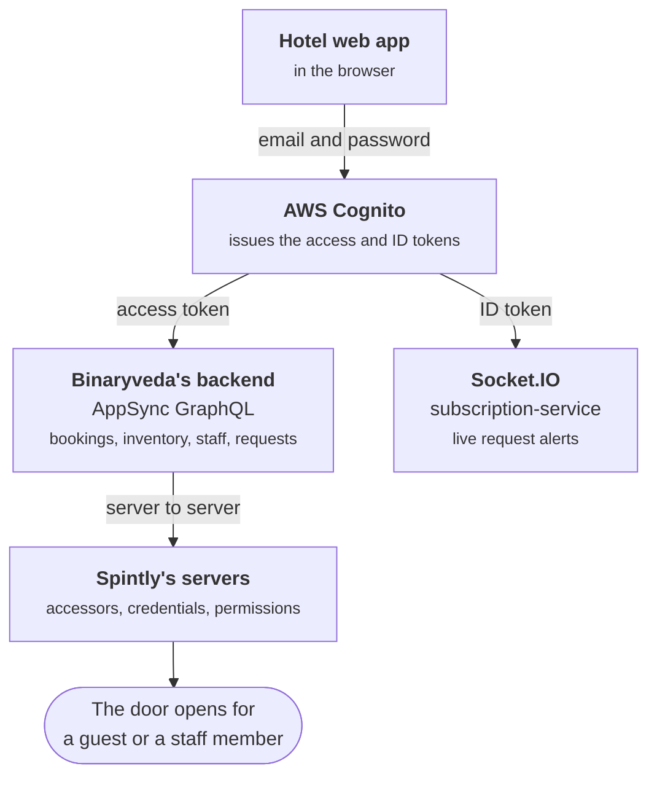

# Connected Lock Hotel Web App

This is the web app hotel employees use to run the property. Front desk staff
take bookings, check guests in and hand out room access from here. Managers and
administrators use the same app to set up the property, run the day, and pull
reports.

The two mobile apps in the Connected Lock family, the
[Connected Lock Staff App](../staff/index.md) and the
[Connected Lock Guest App](../guest/index.md), work on what this app produces. A
guest cannot sign in to the guest app until the front desk has checked them in
here, and a staff member cannot open a door until an administrator has created
them here.

## Who uses it

Eight roles sign in to the same app and see different things. The **Scope**
column is how far a role reaches. A **site** is one property, with its own
rooms, locks and staff. A **hotel** is the group that owns one or more sites.
Six of the roles work inside a single site. Super Admin and Hotel Admin sit
above a site and pick the one they want to work on.

| Role | Scope | What it is for |
|---|---|---|
| Super Admin | Every hotel | Onboarding hotels and their administrators |
| Hotel Admin | One hotel, many sites | Site administrators, hotel wide policy, hotel reporting |
| Site Admin | One site | Everything at that site |
| Site Manager | One site | Day to day running, without master data |
| Front Desk | One site | Bookings, check in, check out, room status |
| Housekeeping Manager | One site | Requests, staff, inventory, room status |
| Restaurant Manager | One site | Room service requests and the restaurant menu |
| Engineering Maintenance | One site | Device faults, inventory, read only master data |

The full permission matrix, and what each role lands on after sign in, is on
[Sign In and Roles](sign-in-and-roles.md).

## What the app is made of

Cognito issues two tokens and the app uses both. The GraphQL API is called with
the **access token**, and the socket is opened with the **ID token**.

One query runs without a signed in user. `listCountryCodes` fills the country
code dropdown on the sign in and guest forms, and it is sent with an API key
instead of a token so the form works before anyone has signed in.

## There is no Spintly SDK in the browser

The staff and guest apps each ship Spintly SDKs, because a phone opens a door
over Bluetooth and needs a credential on the device to do it. A browser does
neither. **This app ships no Spintly SDK at all.**

Everything Spintly related happens on the server. When the front desk ticks
Mobile Access or adds an RFID card during check in, the web app sends one
GraphQL mutation, and `booking-service` calls Spintly to create the accessor,
assign the card and write the door permission. The browser never sees a Spintly
token, a credential or an access point.

That means a page in this site never has an SDK table. Where the staff and guest
pages end with **Every SDK member this flow uses**, these pages end with **What
the backend does**, which names the Spintly calls the mutation sets off.

## The services behind the API

Every call from the app goes to one AppSync GraphQL endpoint, which forwards it
to one of four services over HTTP. Knowing which service owns an area explains
why some things happen together and others do not.

| Service | What it owns | Areas in this app |
|---|---|---|
| `user-service` | People and property records | Sign in details, administrators, staff, hotels and sites, guest records |
| `inventory-service` | The physical site and its devices | Blocks, floors, room types, rooms, locks, gateways, repeaters, RFID cards, policies, channels, restaurant, dashboards, reports |
| `booking-service` | Stays and access | Bookings, check in, check out, stay over, room access control |
| `assistance-service` | Guest requests | The Requests screen |

Two more services never receive a call from this app but change what it shows.
`notification-service` consumes Spintly's Kafka topics and pushes the alerts
that appear in the corner of the screen, and `subscription-service` is the
Socket.IO server the app holds that connection open against.

## Where to start

[Sign In and Roles](sign-in-and-roles.md) covers how an account is created and
what each role can reach, and the rest of these pages assume it. After that,
[Check In and Room Access](check-in.md) is the flow that issues credentials.

!!! info "Accessor"

    Spintly's word for someone who can open a door is an **accessor**. Both a
    guest and a staff member get one, and in both cases the backend creates it,
    never this app. A guest's is created when their room access is granted
    during check in, and a housekeeping staff member's when their shift is
    saved.
