# 8. Inventory and RFID

**What it is.** The hardware at the site, and the cards handed to people. Locks,
repeaters and gateways are read only here. RFID cards are the one part of
inventory this app changes.

**How to get there.** The Inventory group in the sidebar. Site Admin, Site
Manager, Housekeeping Manager and Engineering Maintenance see all four screens.
Front Desk sees RFID only.

!!! warning "Key point"

    Devices are not commissioned from this app. A lock, repeater or gateway
    arrives in the inventory already registered at Spintly, and what this app
    adds is a room to attach it to and a way to report it when it stops working.

## Participants

This page uses Hotel staff, Web app and Binaryveda's backend.

Each one is defined, with the colour it keeps across the site, in
[Reading these pages](conventions.md).

## 1. Locks

The largest of the four lists, and the only one with location filters, because a
lock belongs to a room.

<figure>
<a href="images/inventory/01-locks.png">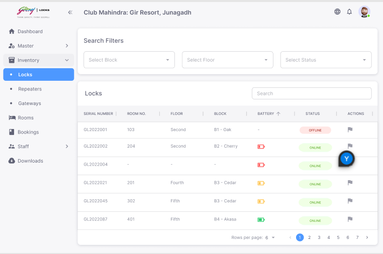</a>
<figcaption><strong>Locks</strong>Battery and status are the two columns this app did not write. A blank room number is a lock in the inventory with no room yet, which is what <code>getAvailableLocks</code> returns.</figcaption>
</figure>

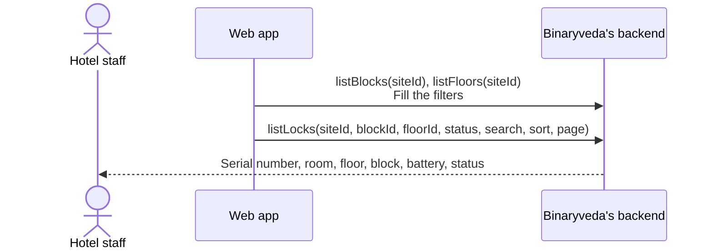

| Column | Notes |
|---|---|
| Serial Number | Sortable |
| Room No. | Blank on a lock not yet attached to a room |
| Floor, Block | From the room |
| Battery | Sortable |
| Status | `ONLINE` or `OFFLINE` |

Both the status and the battery come from Spintly through
`notification-service`, not from anything this app does. The same events raise
the device faults on the [Requests](requests.md#system) screen.

The battery column can be opened already sorted. The lock cards on the
[site dashboard](dashboards-and-reports.md#1-the-site-dashboard) link here with
the sort already applied, so clicking a weak battery count lands on the locks
worth looking at.

Attaching a lock to a room is done from
[Rooms](rooms-and-master-data.md#5-rooms), not here. `getAvailableLocks` is what
that screen offers, and it returns only locks with no room.

## 2. Repeaters and gateways

Both are simple lists: a serial number, a status, and the report action.

<figure>
<a href="images/inventory/03-repeaters.png">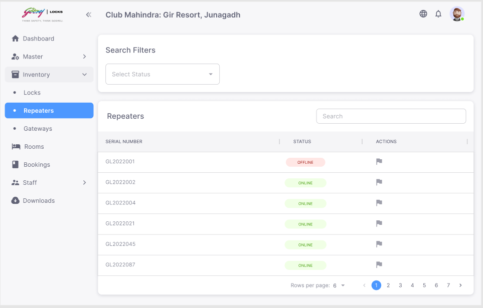</a>
<figcaption><strong>Repeaters</strong>Three columns against the locks table's six, because a repeater has no room behind it to name a block and a floor.</figcaption>
</figure>
<figure>
<a href="images/inventory/04-gateways.png">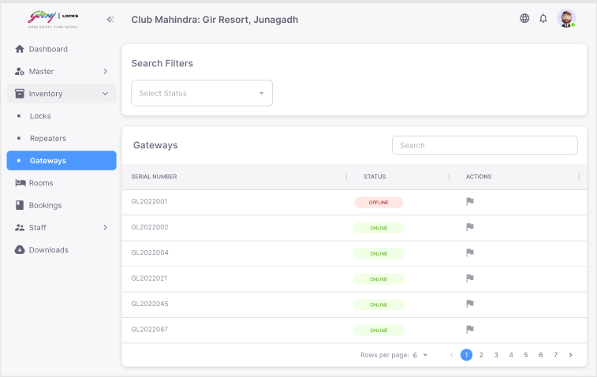</a>
<figcaption><strong>Gateways</strong>The same screen against a different call. Only the list behind it differs.</figcaption>
</figure>

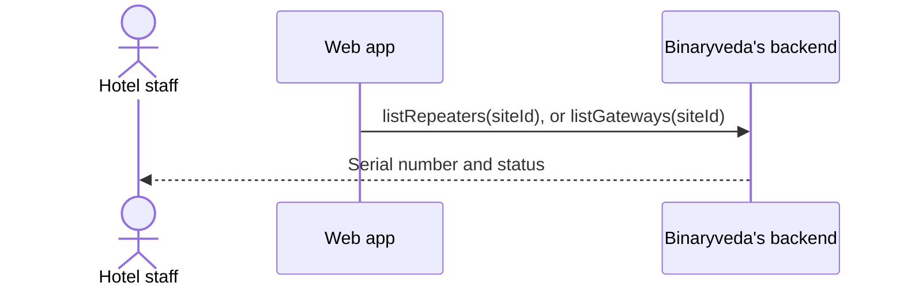

Neither belongs to a room, so neither carries a block or a floor. Their status
comes from the same Spintly events as a lock's.

## 3. Reporting a device

Every row on the three device lists offers the same action. It does not open a
request or change the device.

<figure>
<a href="images/inventory/02-report-lock.png">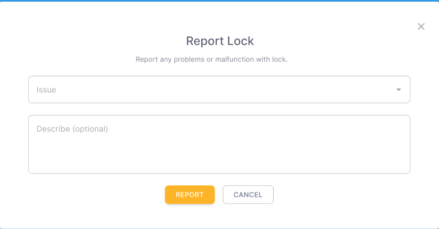</a>
<figcaption><strong>Report</strong>An issue from the list and an optional description. Repeaters and gateways open the same dialog under their own name, and all three queue an email rather than writing a request.</figcaption>
</figure>

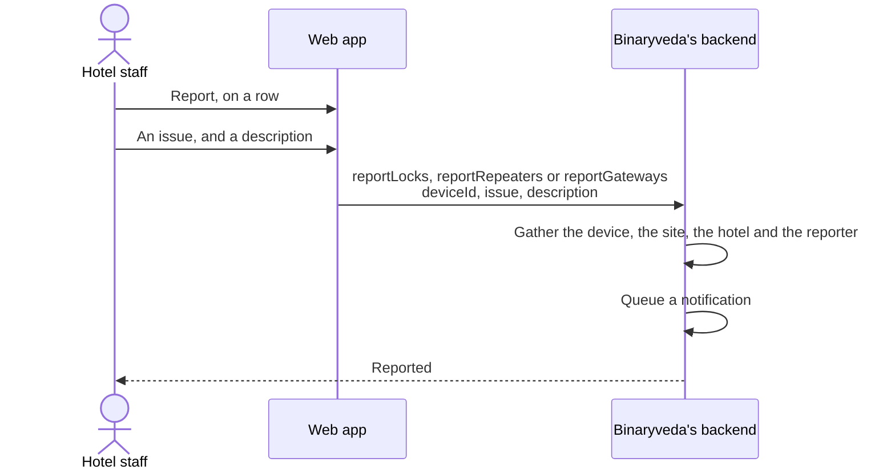

The three calls behave the same way and differ only in the device type they
record. The backend collects the serial number, the site and hotel names, and
the reporting staff member's name, role, email and mobile, then queues an email
to support.

That is a separate path from the System requests on
[Requests](requests.md#system), which are raised by the hardware rather than by
a person. A device can therefore be both reported here and showing as a System
request, and closing one does not close the other.

## 4. RFID cards

The cards themselves, wherever they currently are.

<figure>
<a href="images/inventory/05-rfid.png">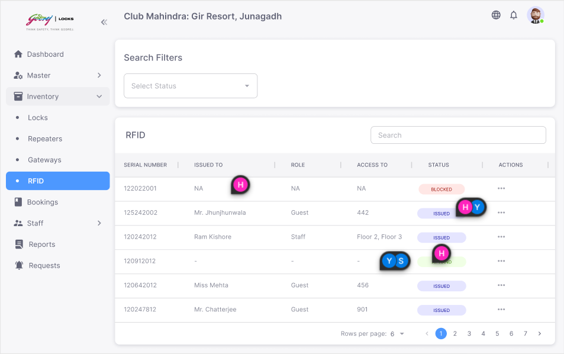</a>
<figcaption><strong>RFID</strong>Guest and staff cards in one list. A blank Role is a guest, and Access To is the room set when the card was issued at check in.</figcaption>
</figure>

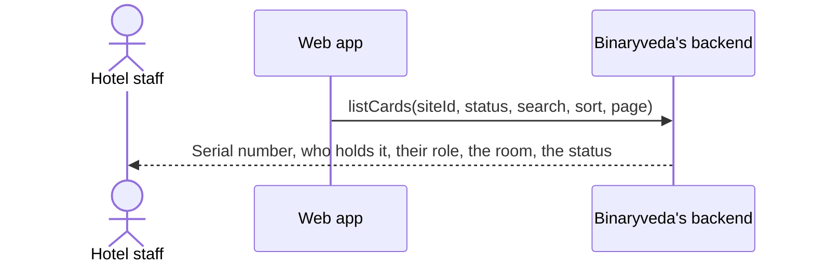

| Column | Notes |
|---|---|
| Serial Number | The card's RFID |
| Issued To | The guest or staff member holding it |
| Role | Blank for a guest |
| Room Number | Set when the card was issued for a room during check in |
| Status | `AVAILABLE`, `ISSUED` or `BLOCKED` |

One list covers both kinds of card, because a guest card issued during
[check in](check-in.md#4-issuing-room-access) and a staff card attached to a
[shift](staff.md#3-shifts) are the same physical stock.

### Blocking and unblocking

<figure>
<a href="images/inventory/07-block-card.png">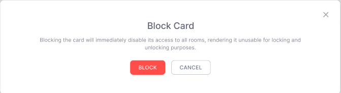</a>
<figcaption><strong>Block Card</strong>The confirmation blocking asks for. Unblocking has none, because it only returns a card to the pool.</figcaption>
</figure>
<figure>
<a href="images/inventory/06-block-rfid-issued.png">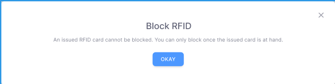</a>
<figcaption><strong>A card that is out</strong>The backend checks for a live allocation before the status can change, so the card has to be back in hand first.</figcaption>
</figure>

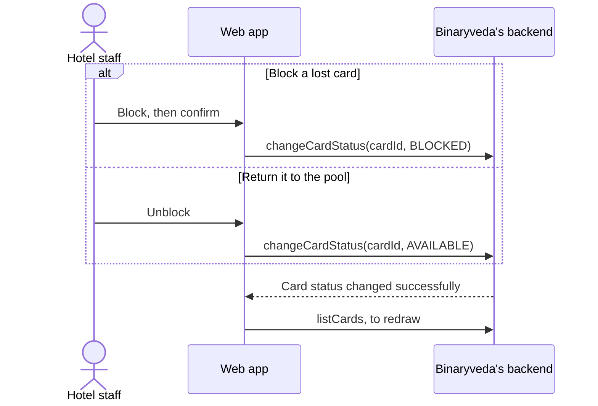

Blocking asks for confirmation. Unblocking does not, because it only returns a
card to the pool.

**Neither works on a card that is currently out.** The backend checks for a live
allocation first and answers `Card status can't be updated for assigned cards`,
so a card has to be returned through check out or by changing the shift before
its status can be changed.

A blocked card is left out of `listAvailableCards`, which also leaves out cards
already allocated to a guest or a staff member. So a blocked card cannot be
picked during check in or when attaching a card to a shift, and unblocking
returns it to the pool.

The card search matches the **end** of the RFID, which is why searching by the
last four digits works wherever a card is picked.

## What the backend does

| Call | Service | Effect |
|---|---|---|
| `listLocks` | `inventory-service` | The site's locks with their room, battery and status |
| `listRepeaters`, `listGateways` | `inventory-service` | The site's repeaters and gateways |
| `reportLocks`, `reportRepeaters`, `reportGateways` | `inventory-service` | Queues a support email with the device, site and reporter |
| `listCards` | `inventory-service` | The site's RFID cards and who holds them |
| `changeCardStatus` | `inventory-service` | Moves a card between `AVAILABLE` and `BLOCKED` |

None of these calls reaches Spintly. The device status and battery on these
lists were written by `notification-service` from Spintly's Kafka topics before
the page asked for them.
