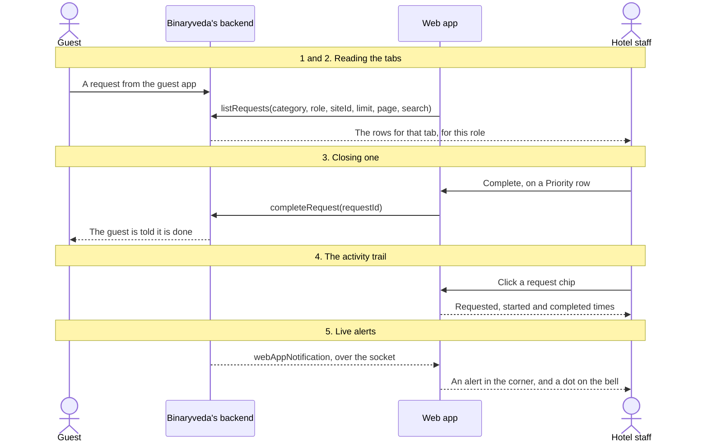
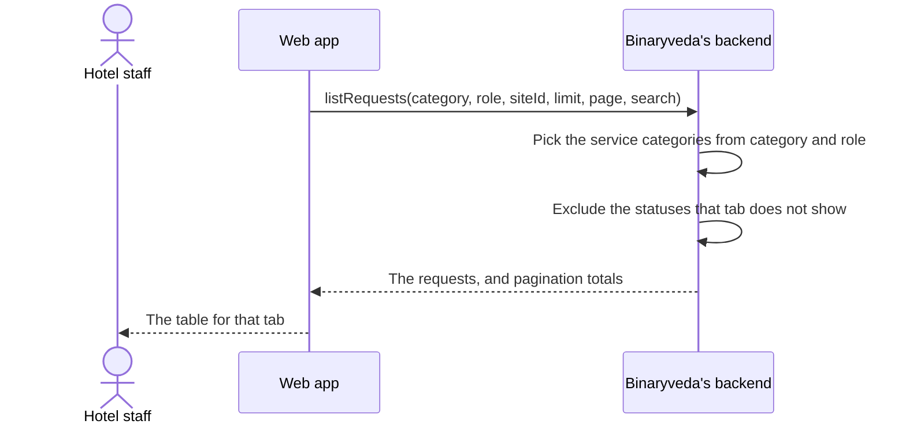
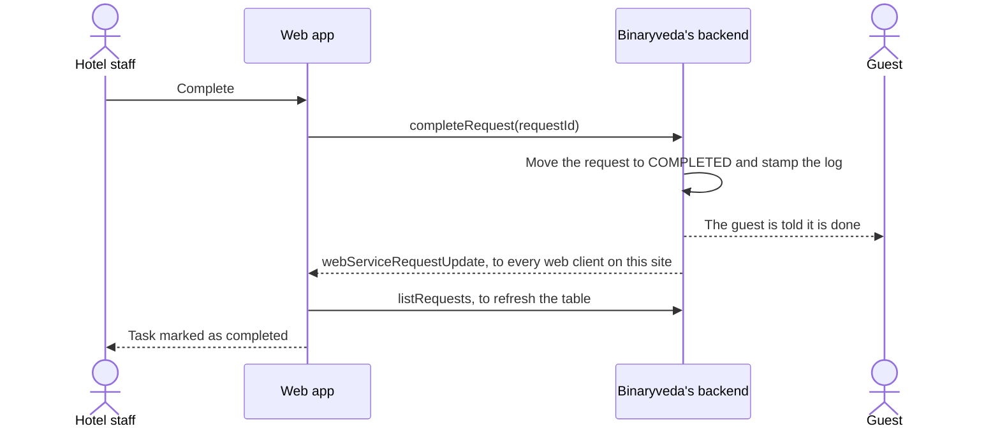
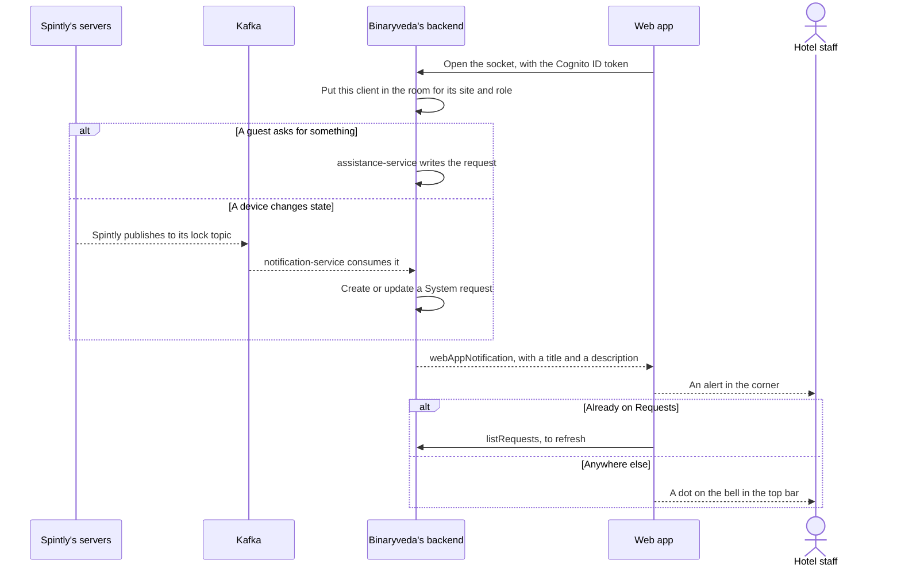

# 5. Requests

**What it is.** Everything the hotel has been asked to do, in one table. Guest
requests raised from the guest app sit here alongside device faults raised by
the hardware, split across tabs.

**How to get there.** Requests in the sidebar. Every site role reaches it, and
the Restaurant Manager lands on it after sign in.

!!! warning "Key point"

    This screen shows work, it does not assign it. Starting a request, claiming
    it and doing it happen in the staff app. What this screen adds is a view
    across the whole site, and a way to close a request without the staff app.

## Participants

This page uses Hotel staff, Web app, Binaryveda's backend, Kafka, Spintly's
servers and Guest.

Each one is defined, with the colour it keeps across the site, in
[Reading these pages](conventions.md).

## The whole flow

Five steps. Each one has its own section below.

## 1. The four tabs

The tabs are a view over one call. Changing tab changes the `category` sent and
resets the page, the search and the sort.

| Tab | Category sent | Holds |
|---|---|---|
| Priority | `PRIORITY` | Urgent guest requests that are not finished |
| Others, shown as Requests to a Housekeeping Manager | `OTHERS` | Housekeeping and check out work in progress |
| Completed | `COMPLETED` | Everything finished, newest first |
| System | `SYSTEM` | Device faults and revoked access |

Not every role sees every tab.

| Tab | Shown to |
|---|---|
| Priority | Every role with `manage` on requests, which is all of them except the Housekeeping Manager |
| Others | Every role except the Restaurant Manager |
| Completed | Everyone |
| System | Hotel Admin, Site Admin, Site Manager, Engineering Maintenance |

A Housekeeping Manager therefore opens on Others rather than Priority, and that
tab is labelled Requests for them.

## 2. What each tab returns

The rows are chosen by the service from the category **and** the role, so two
people on the same tab at the same site can see different work.

### Priority

| Role | Service categories returned |
|---|---|
| Restaurant Manager | Room service |
| Site Admin, Site Manager, Hotel Admin | Emergency, reception, room service |
| Everyone else | Emergency, reception |

Anything already completed is left out. Emergencies are sorted to the top, and
the rest by age with the oldest first.

### Others

Housekeeping and check out, for every role that sees the tab. Requests that are
completed, awaiting the guest, or rejected are left out, so what remains is work
that is live. Sorted newest first.

### Completed

| Role | Service categories returned |
|---|---|
| Restaurant Manager | Room service |
| Site Admin, Site Manager, Hotel Admin | All six, including system |
| Everyone else | Emergency, reception, check out, housekeeping |

Sorted by when they were completed, newest first.

### System

System requests only, excluding completed ones. This tab has a table of its own
because a device fault has no guest and no room service item. It shows a device
icon, the room if the device belongs to one, and the serial number with the
fault.

| Field | Values |
|---|---|
| `deviceType` | `LOCK`, `GATEWAY`, `REPEATER` |
| `deviceStatus` | `OFFLINE`, `CRITICAL` for critical battery, `WEAK` for weak battery |

Where these come from is [step 5](#5-live-alerts). The other thing that lands
here is a room whose access was revoked when a stay ran past its grace period,
which is
[Stay Over and Check Out, step 4](stay-over-and-check-out.md#4-when-nobody-checks-out).

### Searching and paging

The search box matches a room number, a guest's first name or a guest's last
name, is debounced by 300 milliseconds, and is sent to the server. Page sizes
are 5, 10, 15 and 20, and both the page and the size are server side.

## 3. Closing a request

One call, and it is only offered on the Priority tab.

What each tab offers is fixed.

| Tab | Button |
|---|---|
| Priority | Complete |
| Others | View, which opens the activity trail |
| Completed | None |
| System | None |

`completeRequest` takes only the request ID. It does not claim the request
first, which is why this screen can close work that nobody started in the staff
app.

## 4. The activity trail

Every request row shows its items as chips, one per thing the guest asked for.
A row with more than two shows the first two and a count. Clicking any chip
opens the trail.

The trail is three steps drawn from the log already on the row, so opening it
makes no call.

| Step | Source |
|---|---|
| Requested | `createdAt` |
| Started | `startedAt`, present once someone claimed it in the staff app |
| Completed | `completedAt`, with the staff member who did it |

Steps with no timestamp are not drawn, so a request nobody has started shows one
step.

The View button on the Others tab opens the same trail for the row rather than
for a single chip.

## 5. Live alerts

The app holds a Socket.IO connection open for as long as someone is signed in,
and new work arrives on it without a refresh.

### The connection

| Detail | Value |
|---|---|
| Token sent | The Cognito **ID** token, not the access token the API uses |
| Transport | WebSocket only, with no polling fallback |
| Reconnection | Unlimited attempts, backing off from 1 second to 5 |
| Roles that connect | Site roles only. Super Admin and Hotel Admin do not open it |

The server reads the staff record behind the token and puts the client in a room
named for the site and the role. Everything is delivered to a room rather than
to a person, so a shared queue stays in step across every browser open at that
site.

### Who gets which alert

The room the event is sent to is chosen by what the request is.

| What happened | Roles alerted |
|---|---|
| Room service request | Site Admin, Site Manager, Restaurant Manager |
| Check out request | Site Admin, Site Manager, Housekeeping Manager |
| Reception or emergency request | Site Admin, Site Manager, Front Desk |
| Device fault | Site Admin, Site Manager, Engineering Maintenance |
| Access revoked after a grace period | Site Admin, Site Manager, Front Desk |

A reception or emergency request raises one alert per item on it, so a guest
asking for two things produces two.

### The dot on the bell

The dot is worked out in the browser rather than sent by the server. On load,
and on every alert, the app pages through the Priority requests for the site and
compares the newest one against the newest it has seen.

If they differ and the user is already on Requests, the list is refreshed and
the stored list is brought up to date, so the dot never appears. Anywhere else,
the dot is shown until Requests is opened.

The seen list is kept in the browser and survives a reload.

## What the backend does

| Call | Service | Effect |
|---|---|---|
| `listRequests` | `assistance-service` | Picks service categories from the category and the role, filters by status and site, pages the result |
| `completeRequest` | `assistance-service` | Moves the request to `COMPLETED`, stamps the log, notifies the guest and the web clients |

Guest requests are written by `assistance-service` when the guest app sends
them. System requests are written by `notification-service` from Spintly's Kafka
topics, and a device that goes offline and comes back updates the same request
rather than opening a new one.

Neither path involves this app. Both surface here as rows.
