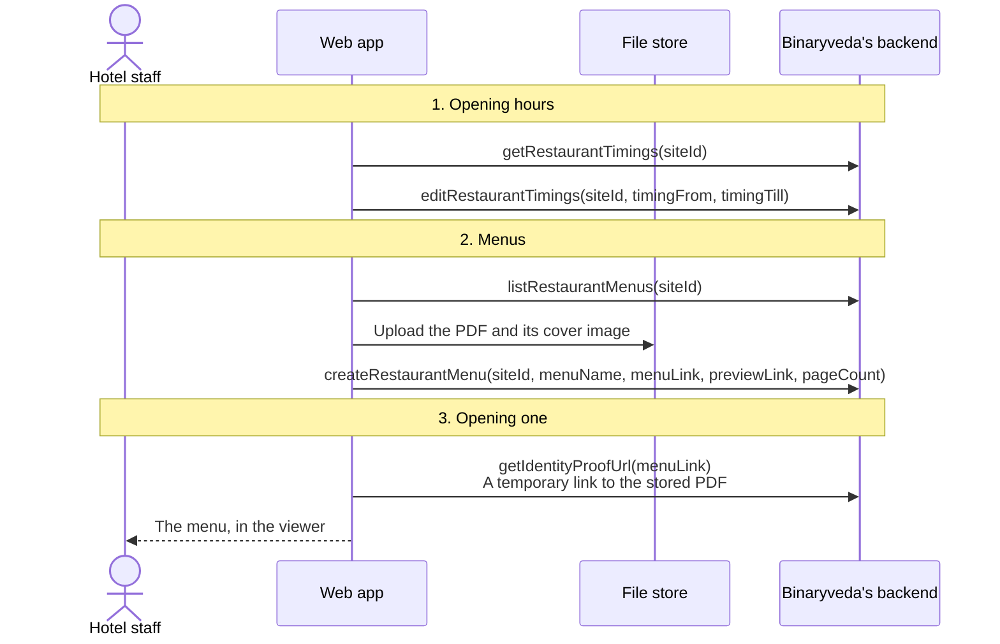
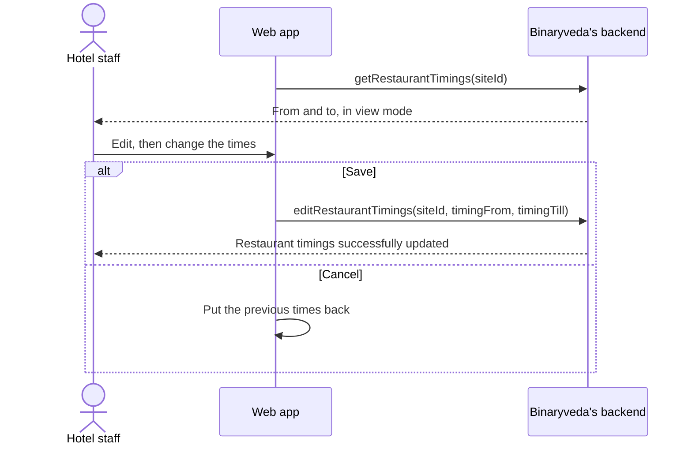
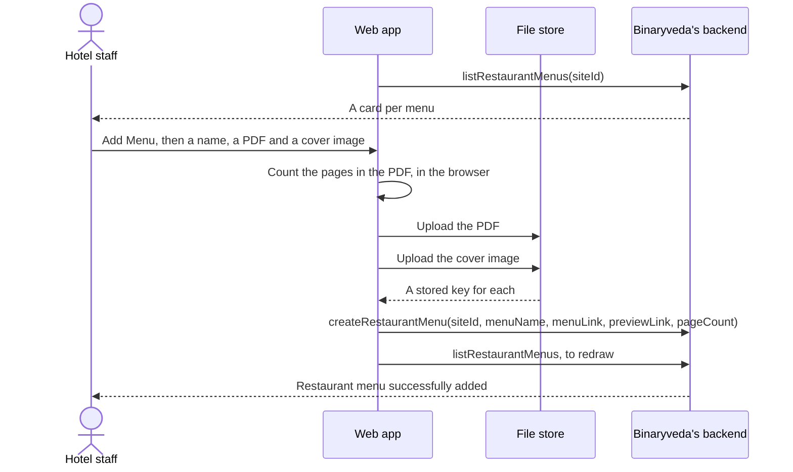
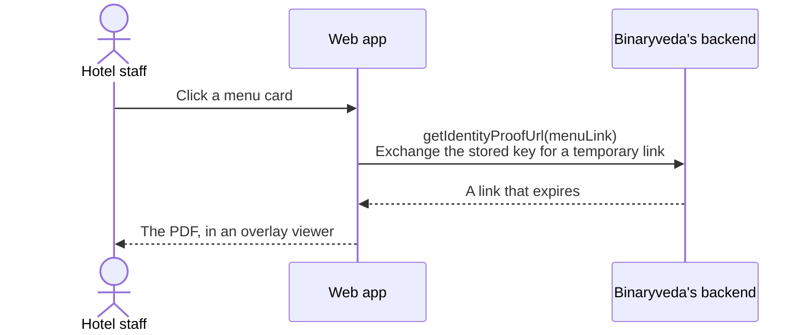

# 9. Restaurant

**What it is.** The restaurant's opening hours and its menus. Along with
[Requests](requests.md), it is one of the two screens a Restaurant Manager has.

**How to get there.** Restaurant in the sidebar, under Master for a Site Admin
and at the top level for a Restaurant Manager. Those are the two roles with a
menu entry for it.

!!! warning "Key point"

    What is set here is read by the guest app. The hours decide when a guest can
    order room service, and the menus are what they browse.

## Participants

This page uses Hotel staff, Web app, Binaryveda's backend and File store.

Each one is defined, with the colour it keeps across the site, in
[Reading these pages](conventions.md).

## The whole flow

Three steps. Each one has its own section below.

## 1. Opening hours

One pair of times for the whole site, shown read only until Edit is pressed.

The times are sent as hours and minutes. Cancel restores the values held before
Edit was pressed, so an abandoned change leaves nothing behind.

## 2. Menus

Menus are cards. Each one is a PDF with a cover image, and the last card on the
row adds a new one.

### What a menu needs

All three are required, and the form checks them before anything is uploaded.

| Field | Notes |
|---|---|
| Menu name | Cannot be blank or only spaces |
| Menu file | The PDF itself |
| Cover image | What the card shows |

The page count is worked out in the browser by reading the PDF and counting its
page objects, then stored with the menu. Nothing reads the PDF again to find
out how long it is.

Both files go straight to S3 under generated names, and what reaches the backend
is the stored key for each.

### Deleting

Deleting takes the menu ID and removes the record. The card leaves the row and
the list is refetched.

## 3. Opening a menu

The stored key is not a link, so viewing a menu is a two step operation.

`getIdentityProofUrl` is named for the photo ID it was written for, and it
signs any stored key. The restaurant screen reuses it for menus rather than
having a call of its own.

The PDF opens in an overlay rather than a new tab, paged with the count stored
alongside the menu.

## What the backend does

| Call | Service | Effect |
|---|---|---|
| `getRestaurantTimings` | `inventory-service` | The site's opening hours |
| `editRestaurantTimings` | `inventory-service` | Writes new hours |
| `listRestaurantMenus` | `inventory-service` | The site's menus with their keys and page counts |
| `createRestaurantMenu` | `inventory-service` | Writes a menu against the uploaded keys |
| `deleteRestaurantMenu` | `inventory-service` | Removes one menu |
| `getIdentityProofUrl` | `user-service` | A temporary link to a stored file |

Nothing on this page reaches Spintly.
