# 6. Rooms and Master Data

**What it is.** The site itself. Blocks, floors, room types and rooms describe
the building, policies set the rules the rest of the app works to, and channels
say where bookings come from.

**How to get there.** The Master group in the sidebar, which holds all of it
including Rooms. How much of the group a role sees varies.

| Role | Entries under Master |
|---|---|
| Site Admin | Blocks, Floors, Room Types, Rooms, Policies, Restaurant, Channels |
| Engineering Maintenance | The same, without Restaurant, and read only |
| Site Manager, Front Desk, Housekeeping Manager | Rooms and Policies |

!!! warning "Key point"

    These records have to exist before anything else works. A room cannot be
    created without a block, a floor, a room type and a free lock, and a booking
    cannot be taken without a room type or a channel.

## Participants

This page uses Hotel staff, Web app, Binaryveda's backend and File store.

Each one is defined, with the colour it keeps across the site, in
[Reading these pages](conventions.md).

## 1. The order things are created in

Each record depends on the ones above it.

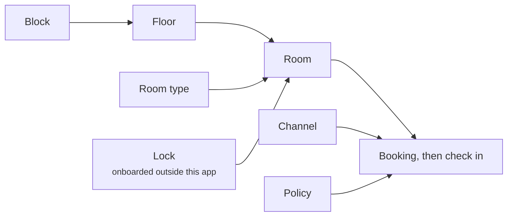

Locks are the one thing on this diagram the web app does not create. They arrive
in the inventory already commissioned, and this app attaches one to a room. See
[Inventory and RFID](inventory.md#1-locks).

## 2. Blocks

The largest division of a site. A block holds floors.

<figure>
<a href="images/rooms-and-master-data/01-blocks-list.png">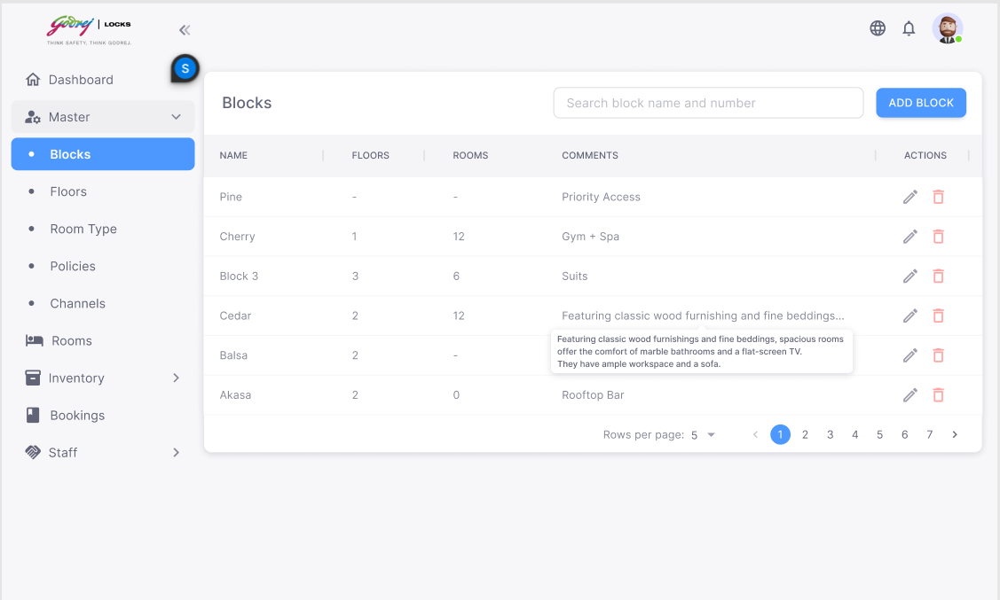</a>
<figcaption><strong>Blocks</strong>Each row carries the number of floors and rooms under it, which is what makes a delete a cascade rather than a single record.</figcaption>
</figure>
<figure>
<a href="images/rooms-and-master-data/02-add-block.png">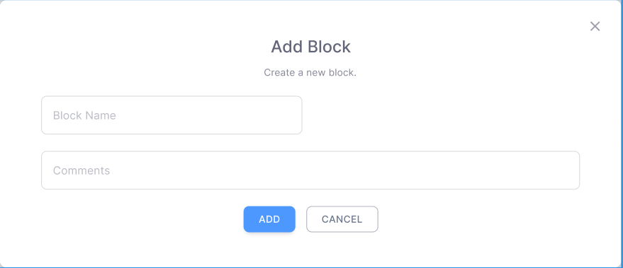</a>
<figcaption><strong>Add Block</strong>Name and comments. Only the name is required, so this is the shortest form under Master.</figcaption>
</figure>
<figure>
<a href="images/rooms-and-master-data/03-add-block-network.png">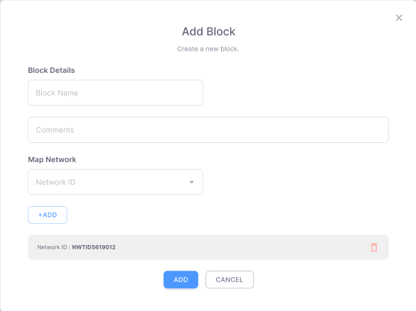</a>
<figcaption><strong>Mapping a network</strong>The same dialog with <strong>Map Network</strong>. Each network ID is added to a list under the field, and the trash icon takes one back off.</figcaption>
</figure>

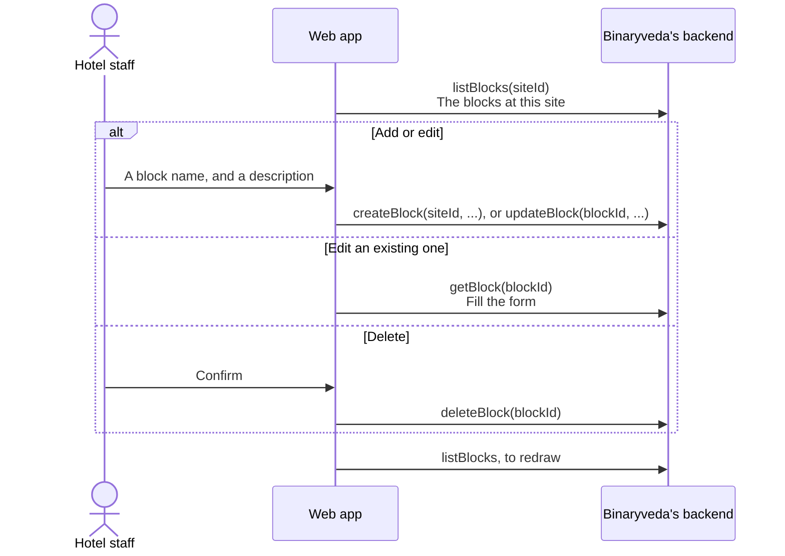

The block name is required. Everything else on the form is optional.

## 3. Floors

A floor belongs to one block, so the form asks for the block first.

<figure>
<a href="images/rooms-and-master-data/04-floors-list.png">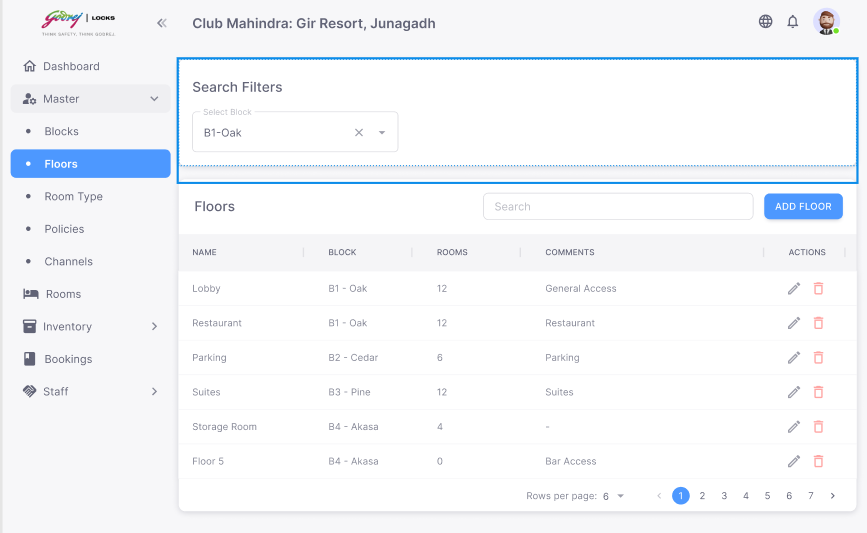</a>
<figcaption><strong>Floors</strong>Filtered by block, which is the optional argument <code>listFloors</code> takes. The Block column repeats it on every row, because a floor name is only unique within its block.</figcaption>
</figure>
<figure>
<a href="images/rooms-and-master-data/05-add-floor.png">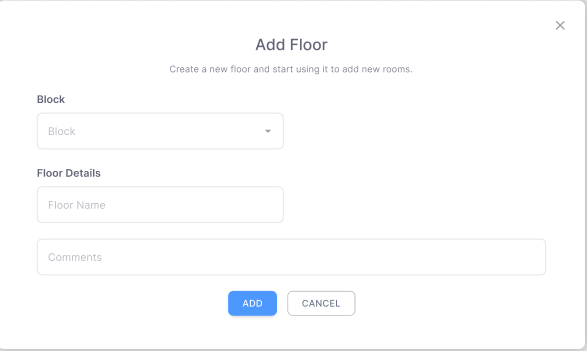</a>
<figcaption><strong>Add Floor</strong>The block comes first because the floor hangs off it. Block and floor name are required, comments are not.</figcaption>
</figure>

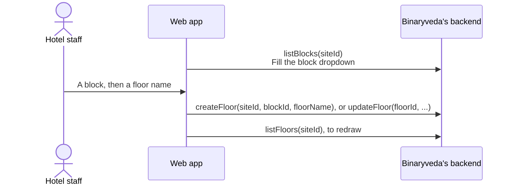

The floor list can be filtered by block. `listFloors` takes an optional block,
and most screens that offer a floor dropdown pass one, which is why a floor
dropdown stays empty until a block is chosen.

Both the block and the floor name are required.

## 4. Room types

A category of room rather than a room. This is what a booking reserves.

<figure>
<a href="images/rooms-and-master-data/06-room-types.png">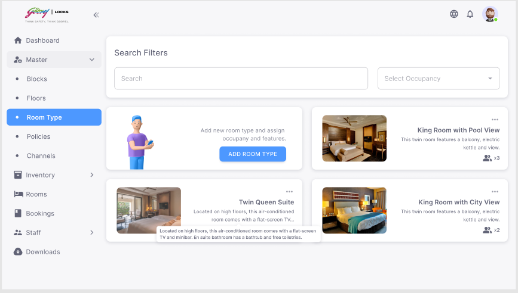</a>
<figcaption><strong>Room types</strong>Cards rather than a table, because each type carries images. The figure at the bottom right of a card is its occupancy.</figcaption>
</figure>
<figure>
<a href="images/rooms-and-master-data/07-add-room-type.png">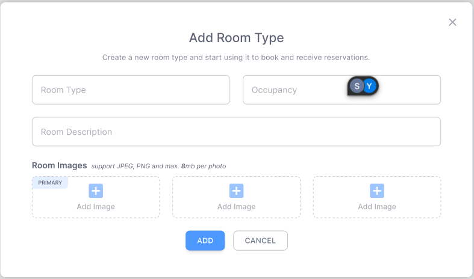</a>
<figcaption><strong>Add Room Type</strong>Three image slots, the first marked <strong>Primary</strong>, at up to 8mb each. The type, occupancy and description are required and the images are not.</figcaption>
</figure>
<figure>
<a href="images/rooms-and-master-data/08-edit-room-type.png">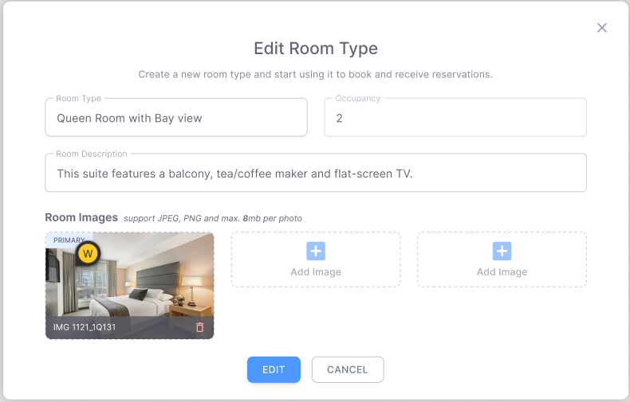</a>
<figcaption><strong>Edit Room Type</strong>An uploaded image keeps its stored key as its name, which is what was sent to the backend rather than the file itself.</figcaption>
</figure>
<figure>
<a href="images/rooms-and-master-data/09-delete-room-type-blocked.png">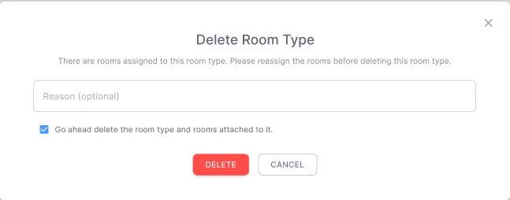</a>
<figcaption><strong>Deleting a type in use</strong>Rooms assigned to the type have to be reassigned first, because a room cannot exist without one.</figcaption>
</figure>

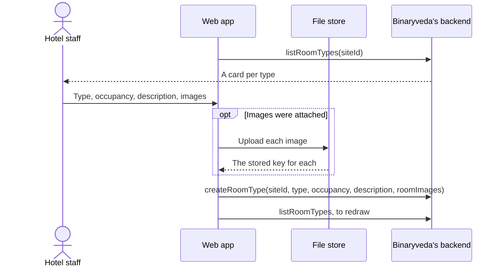

Room types are shown as cards rather than as a table, because each one carries
images. The type, the occupancy and the description are all required, and images
are optional.

Images are uploaded straight to S3 from the browser, the same way a photo ID is
in [Check In](check-in.md#the-photo-id). What reaches the backend is the stored
key.

Occupancy is what the booking screen uses to cap the adults and children on a
room.

## 5. Rooms

A real room, with a number and a lock on the door.

<figure>
<a href="images/rooms-and-master-data/10-rooms-list.png">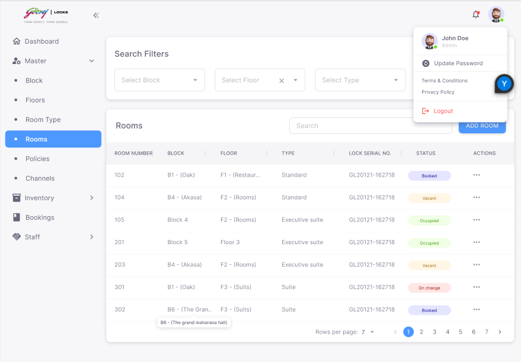</a>
<figcaption><strong>Rooms</strong>The lock serial sits on the row, so the room and the door it opens are read together. The status chip is what decides the row menu.</figcaption>
</figure>
<figure>
<a href="images/rooms-and-master-data/11-add-room.png">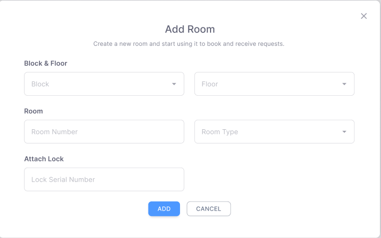</a>
<figcaption><strong>Add Room</strong>The five required fields, in the order they depend on each other. Floor stays empty until a block is chosen.</figcaption>
</figure>
<figure>
<a href="images/rooms-and-master-data/12-edit-room-lock.png">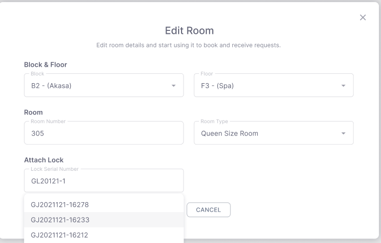</a>
<figcaption><strong>Choosing a lock</strong>The serial field suggests as it is typed, from <code>getAvailableLocks</code>. Only locks not already on a room appear.</figcaption>
</figure>

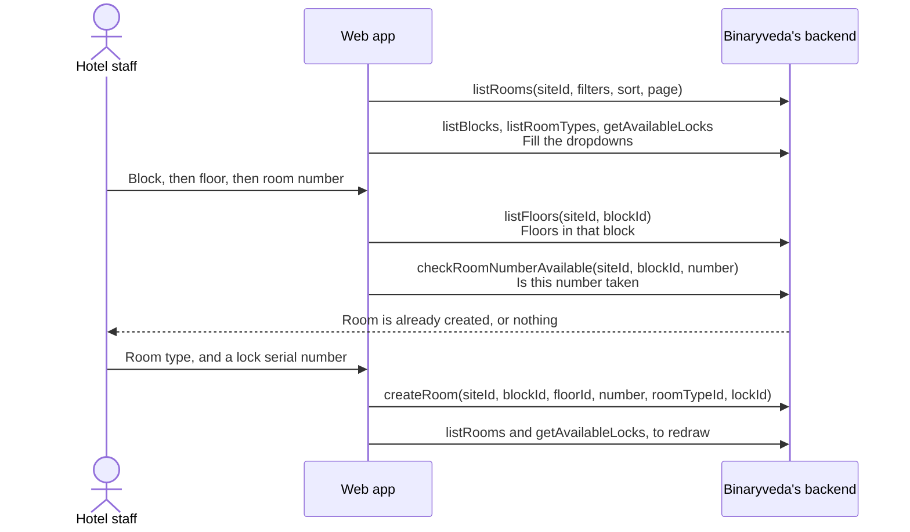

### What the form asks for

All five fields are required.

| Field | Notes |
|---|---|
| Block | From `listBlocks` |
| Floor Number | Loaded for the chosen block, so it stays disabled until a block is picked |
| Room Number | Checked against the block as it is typed |
| Room Type | From `listRoomTypes` |
| Lock Serial Number | From `getAvailableLocks`, which returns only locks not already on a room |

The room number check is debounced by 300 milliseconds and runs against the
chosen block, because numbers repeat across blocks. A number already in use
marks the field and blocks the submission.

`getAvailableLocks` is refetched after every create, edit and delete, so a lock
freed by a deleted room becomes available immediately and one just used
disappears from the list.

### Occupied rooms

A room whose status is `OCCUPIED` cannot be edited or deleted. Both modals open
with the reason instead of the form and a single button to close them, because
changing the room or its lock under a guest who is still in it would take their
access away.

<figure>
<a href="images/rooms-and-master-data/15-edit-room-occupied.png">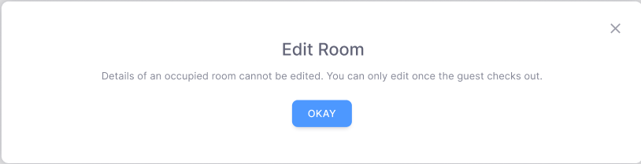</a>
<figcaption><strong>Edit, refused</strong>The form is not drawn at all. One button closes it, and the room becomes editable when the guest checks out.</figcaption>
</figure>
<figure>
<a href="images/rooms-and-master-data/14-delete-room-occupied.png">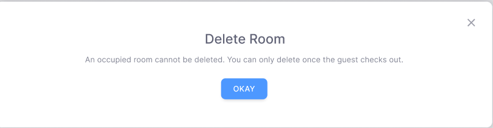</a>
<figcaption><strong>Delete, refused</strong>The same treatment for deleting, and for the same reason.</figcaption>
</figure>

### Deleting

Deletion asks for an optional reason and a mandatory confirmation tick, and the
button stays disabled until the tick is on. The lock returns to the available
pool.

<figure>
<a href="images/rooms-and-master-data/13-delete-room.png">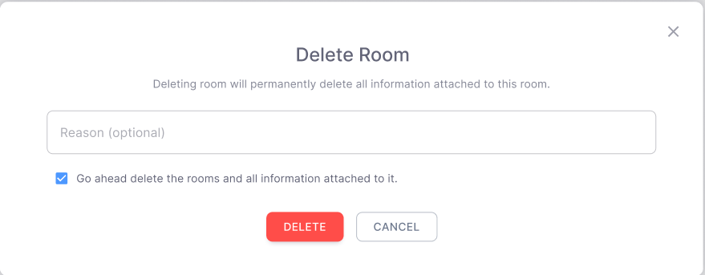</a>
<figcaption><strong>Delete Room</strong>The tick is what enables the button. The reason above it is optional, and the same shape is used for deleting a block, a floor and a room type.</figcaption>
</figure>

### Room status

Every row carries a status, and the row menu offers different actions depending
on it.

| Status | Menu options |
|---|---|
| `VACANT` | Under Maintenance, Edit, Delete |
| `ON_CHANGE`, shown as under maintenance | Vacant, Edit, Delete |
| `OCCUPIED` | Checkout, Edit, Delete |
| `BOOKED` | Edit, Delete |

Under Maintenance and Vacant are the same call, `changeRoomStatus`, with
different targets. Checkout is not a call at all. It looks up the room's current
booking and opens it, so the checkout itself happens on the booking screen. It
needs `manage` on bookings, so a role without that gets an error rather than a
booking.

The list filters on block, floor, room type and status, searches on the room
number, and sorts on the server by number, block, floor, type, lock serial or
status.

## 6. Policies

One record per site, holding the rules the booking and access flows read. It is
stored as a single document rather than as columns, and the screen edits the
whole thing at once.

<figure>
<a href="images/rooms-and-master-data/16-site-policies.png">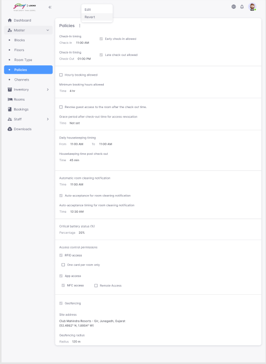</a>
<figcaption><strong>Policies</strong>The screen opens read only, with every setting shown as a value rather than a control. Edit and Revert are in the overflow menu beside the title.</figcaption>
</figure>
<figure>
<a href="images/rooms-and-master-data/17-site-policies-edit.png">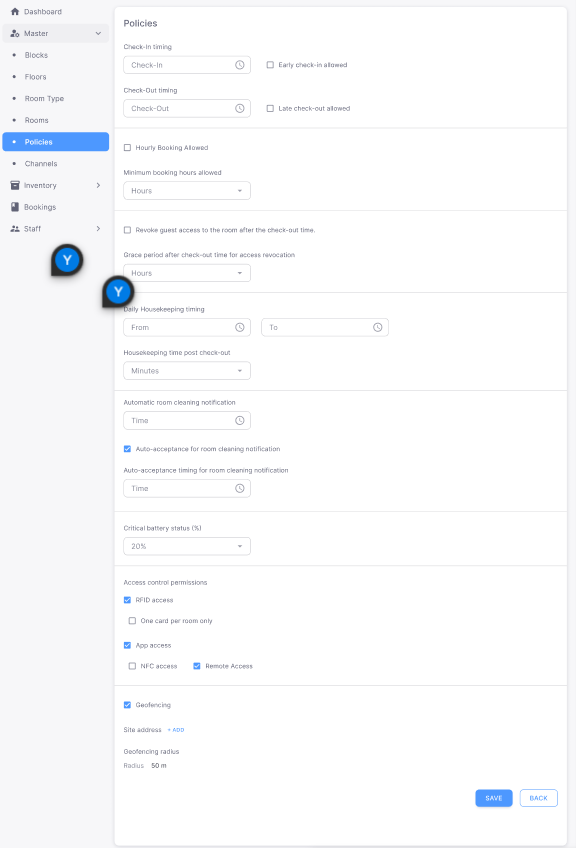</a>
<figcaption><strong>Editing</strong>The whole document at once, in the order the settings are read: timings, then housekeeping, then access control.</figcaption>
</figure>
<figure>
<a href="images/rooms-and-master-data/18-geofence-address.png">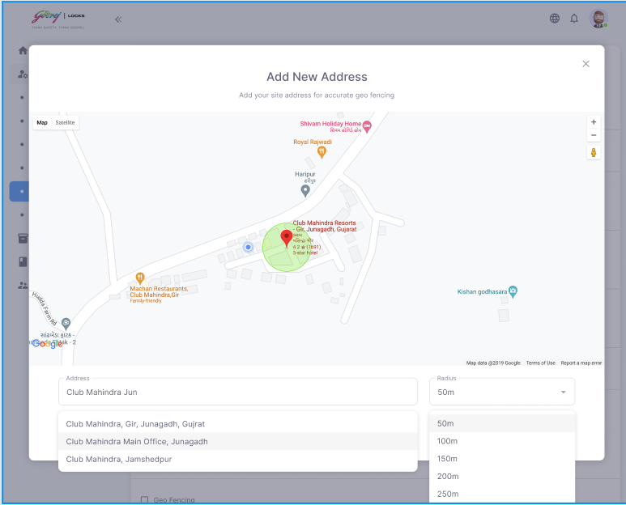</a>
<figcaption><strong>The site address</strong>Set on a map rather than typed. The address search pins the site and the radius beside it is what the circle on the map draws.</figcaption>
</figure>

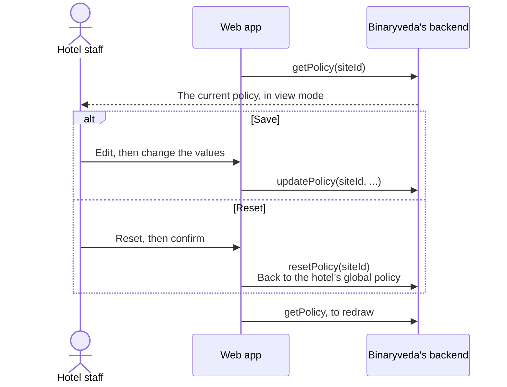

| Setting | What reads it |
|---|---|
| Check in time | When a stay is considered to start |
| Check out time | When the revoke schedule fires. See [Stay Over and Check Out, step 4](stay-over-and-check-out.md#4-when-nobody-checks-out) |
| Early check in allowed | Whether a guest can arrive before the check in time |
| Late check out allowed | Whether a guest can leave after the check out time |
| Housekeeping trigger, housekeeping time | When room cleaning work is raised |
| One card per room | Enforced during [check in](check-in.md#two-checks-before-anything-is-sent) |
| Revoke access after checkout | Whether access is taken away automatically at all |
| Grace period | How long after check out before access goes, as hours and minutes |

Turning off **revoke access after checkout** sets the grace period to zero
rather than leaving it at the last value, so the two always agree.

The screen opens read only. Edit puts it into a form, and the buttons are Save
and Cancel until it is left.

Reset does not clear the policy. It puts the site back onto the hotel wide
policy set by the hotel admin, which is
[Administration, step 5](administration.md#5-policies-at-two-levels).

## 7. Channels

Where a booking came from. A channel has a name, a short code, and a list of sub
channels under it.

<figure>
<a href="images/rooms-and-master-data/19-channels.png">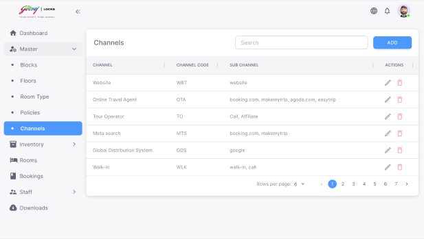</a>
<figcaption><strong>Channels</strong>The code beside each name is what prefixes a booking ID, so a booking can be read back to the channel that brought it.</figcaption>
</figure>
<figure>
<a href="images/rooms-and-master-data/20-add-channel.png">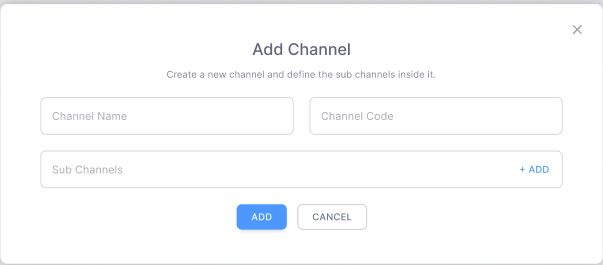</a>
<figcaption><strong>Add Channel</strong>Name, code and at least one sub channel. <strong>+ Add</strong> commits what is in the field as a chip.</figcaption>
</figure>
<figure>
<a href="images/rooms-and-master-data/21-edit-channel.png">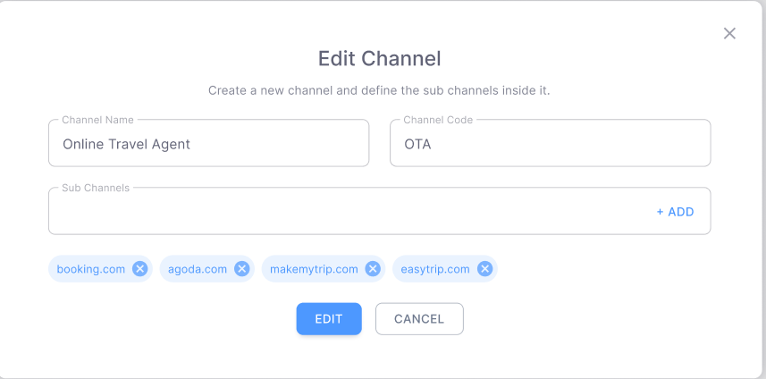</a>
<figcaption><strong>Sub channels</strong>Held as chips below the field, each removable on its own. The booking form reads this list into its second dropdown.</figcaption>
</figure>

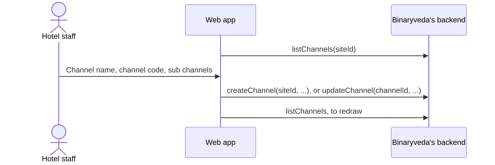

| Field | Rules |
|---|---|
| Channel name | Required, up to 60 characters |
| Channel code | Required, up to 5 characters |
| Sub channels | Required, at least one |

Sub channels are entered as chips on one field. At least one is needed, because
the booking form asks for a channel and then a sub channel, and a channel with
none would leave that dropdown empty.

## What the backend does

Everything on this page belongs to `inventory-service`.

| Call | Effect |
|---|---|
| `listBlocks`, `getBlock`, `createBlock`, `updateBlock`, `deleteBlock` | Blocks |
| `listFloors`, `getFloor`, `createFloor`, `updateFloor`, `deleteFloor` | Floors, optionally filtered by block |
| `listRoomTypes`, `getRoomType`, `createRoomType`, `updateRoomType`, `deleteRoomType` | Room types and their images |
| `listRooms`, `getRoom`, `createRoom`, `updateRoom`, `deleteRoom` | Rooms |
| `checkRoomNumberAvailable` | Whether a number is free within a block |
| `getAvailableLocks` | Locks at the site not yet attached to a room |
| `changeRoomStatus` | Moves a room between vacant, occupied and under maintenance |
| `getPolicy`, `updatePolicy`, `resetPolicy` | The site policy document |
| `listChannels`, `getChannel`, `createChannel`, `updateChannel`, `deleteChannel` | Channels and their sub channels |

Attaching a lock to a room writes the relationship in the database. It does not
call Spintly, because the lock is already an access point there. What the
Spintly permission is written against is the guest, during
[check in](check-in.md#4-issuing-room-access).
