# 1. Sign In and Roles

**What it is.** How an account comes into existence, how someone signs in with
it, and what their role is then allowed to reach. Everything else in this app
assumes this page.

**How to get there.** The sign in screen is the app's entry point. Any address
reached without a session redirects to it and keeps the original address, so
signing in lands on the page that was asked for.

!!! warning "Key point"

    Nobody signs themselves up. Every account is created by someone a tier
    above, and the first password always arrives by email from Cognito. A super
    admin creates hotel admins, a hotel admin creates site admins, and a site
    admin creates the site's staff.

## Participants

This page uses Hotel staff, Admin, Web app, Cognito and Binaryveda's backend.

Each one is defined, with the colour it keeps across the site, in
[Reading these pages](conventions.md).

## The whole flow

Six steps. Each one has its own section below.

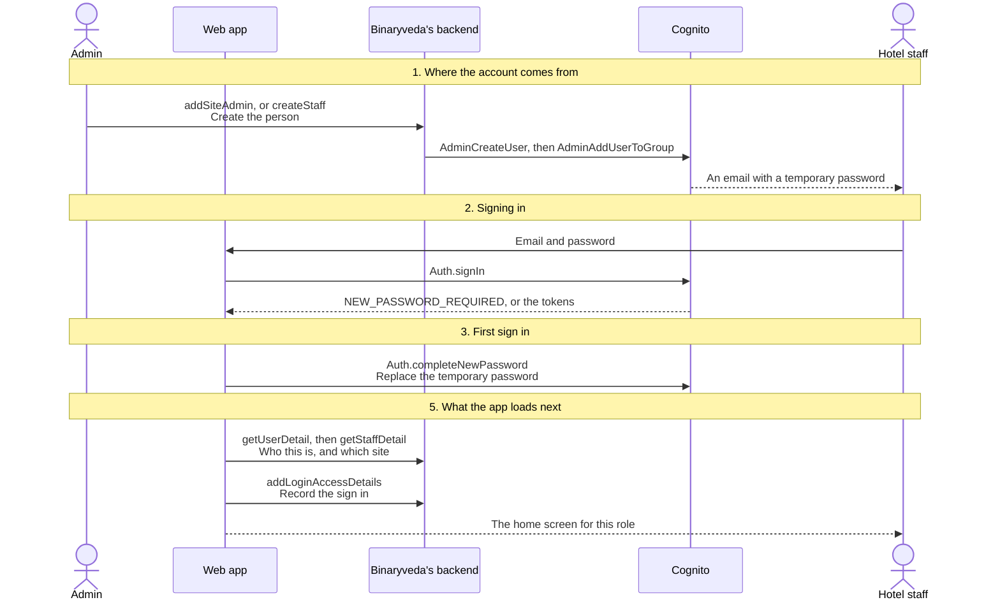

## 1. Where the account comes from

A person exists in two places at once. `user-service` writes the staff or
administrator record to its own database, and creates the matching Cognito user
in the same call.

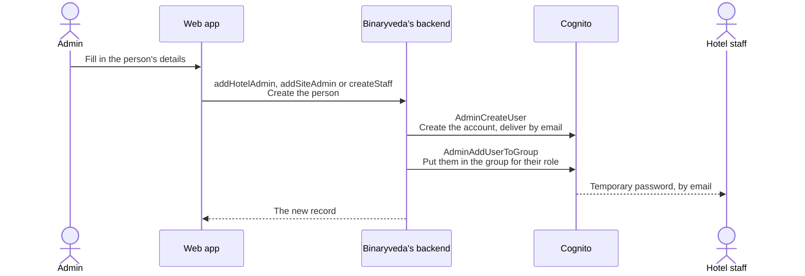

Two things about that Cognito user decide what happens later.

- **The delivery medium is email.** Cognito generates the temporary password and
  sends it. The administrator never sees it and cannot set it.
- **The group is the role.** `AdminAddUserToGroup` puts `SITE-ADMIN` or
  `FRONTDESK` into the token, and the app reads the role from nowhere else.

The email itself is formatted by a Cognito Lambda trigger rather than by any
service. The `CustomMessage` trigger fires on `AdminCreateUser` and returns the
branded new user email, and on `ForgotPassword` it returns the reset email used
in [step 4](#4-forgotten-passwords).

## 2. Signing in

The sign in form takes an email and a password, validated in the browser before
anything is sent. Cognito answers in one of three ways.

<figure>
<a href="images/sign-in-and-roles/01-sign-in.png">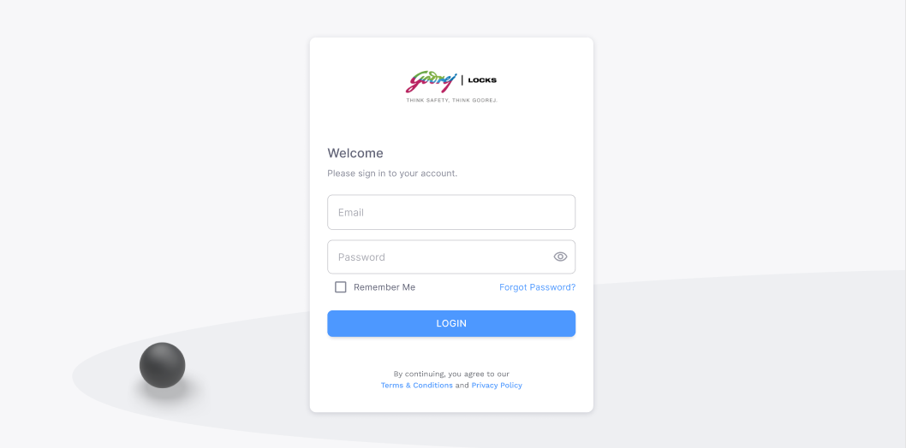</a>
<figcaption><strong>Sign in</strong>The app's entry point, and where every address reached without a session lands. Both fields are checked in the browser before <code>Auth.signIn</code> is called. <strong>Forgot Password?</strong> opens <a href="#4-forgotten-passwords">step 4</a>.</figcaption>
</figure>

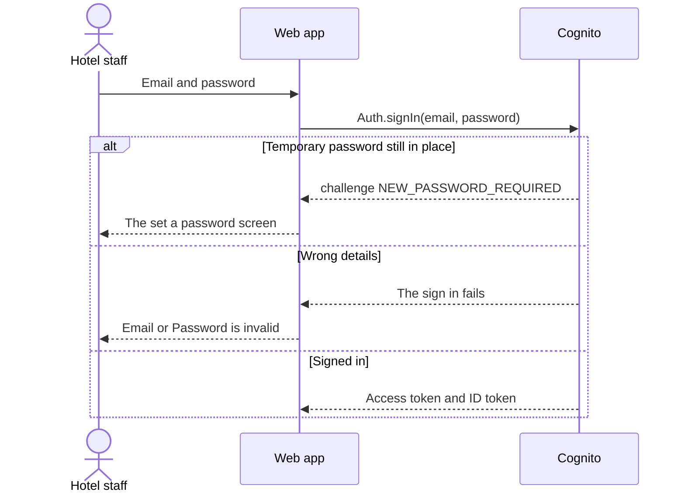

The error message is deliberately the same whether the email or the password was
wrong.

Once Cognito returns tokens, the app holds both and uses them for different
things. The GraphQL API is called with the **access token**, and the Socket.IO
connection in [Requests](requests.md#5-live-alerts) is opened with the **ID
token**.

## 3. First sign in

A `NEW_PASSWORD_REQUIRED` challenge means the temporary password from
[step 1](#1-where-the-account-comes-from) has not been replaced yet. The app
keeps the challenge open and moves to a screen that asks for a new password.

<figure>
<a href="images/sign-in-and-roles/02-set-password.png">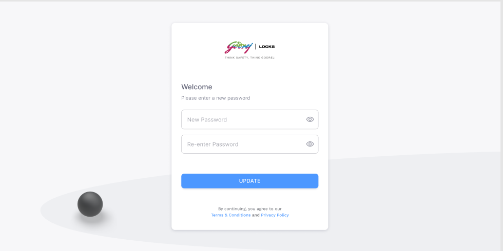</a>
<figcaption><strong>Set a password</strong>One screen serving both this step and the end of a reset. Which of the two it is comes from the address rather than the screen, and the rules checked here are the same either way.</figcaption>
</figure>

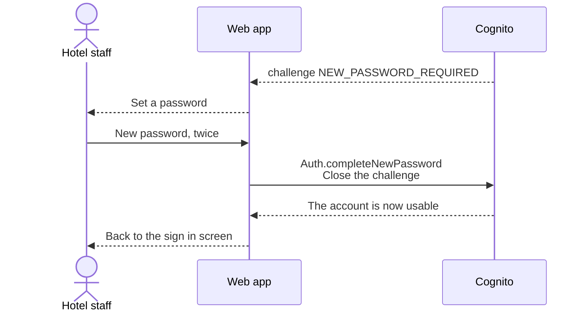

The challenge is closed rather than carried forward, so the new password is
entered once more on the sign in screen. There is no automatic sign in here.

The same screen serves the end of the reset flow in
[step 4](#4-forgotten-passwords), and both are checked in the browser against
the same rules: at least eight characters, with a lowercase letter, an uppercase
letter, a number, and a special character. The confirmation field has to match.

## 4. Forgotten passwords

Resetting runs across two screens, and the middle of it reuses the sign in form.

<figure>
<a href="images/sign-in-and-roles/03-forgot-password.png">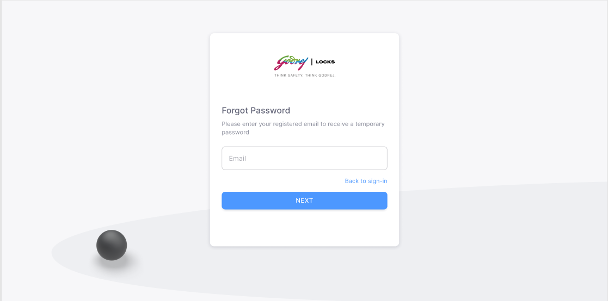</a>
<figcaption><strong>Forgot Password</strong>The email address on its own. <strong>Next</strong> calls <code>Auth.forgotPassword</code>, and <strong>Back to sign-in</strong> returns to the form in its ordinary state.</figcaption>
</figure>
<figure>
<a href="images/sign-in-and-roles/04-check-your-inbox.png">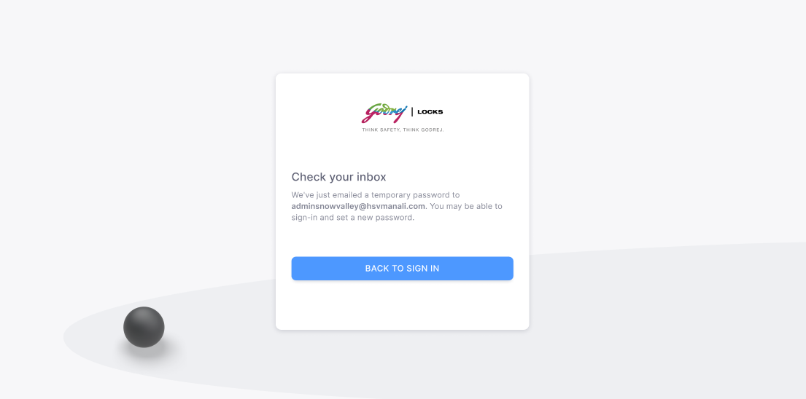</a>
<figcaption><strong>Check your inbox</strong>The same screen once it has been sent, naming the address it went to. <strong>Back to sign in</strong> is the second screen below, the sign in form with <code>forgotPassword</code> in the address.</figcaption>
</figure>

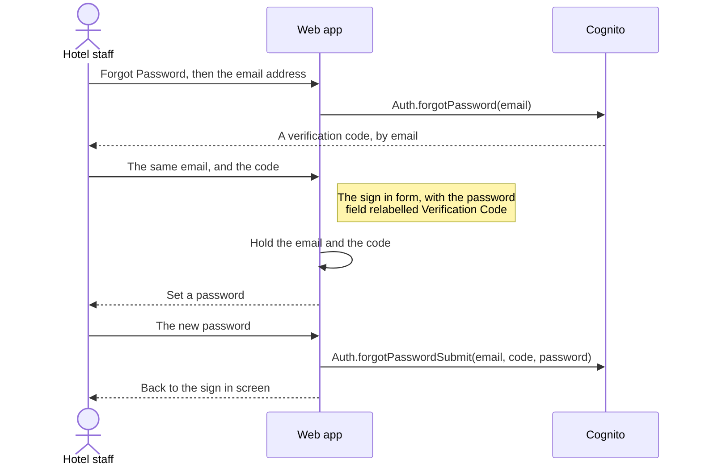

The second screen is the sign in form with `forgotPassword` set in the address.
In that state it validates the second field as a code rather than a password,
and submitting it does not call Cognito. The app holds the email and the code,
then sends both with the new password from the next screen.

## 5. What the app loads next

Three calls follow a successful sign in, before the first screen is drawn. The
site they resolve scopes the rest of the session.

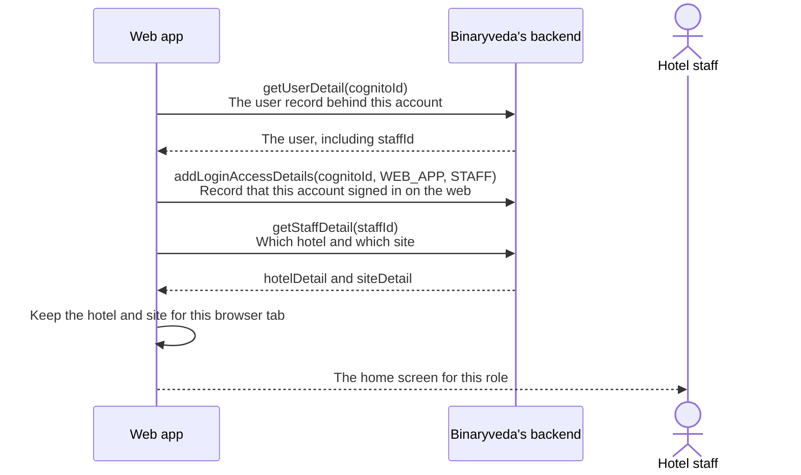

The Web Access report in
[Dashboards and Reports](dashboards-and-reports.md#4-the-reports-screen) reads
`addLoginAccessDetails` back. It records the platform and the application type,
so a web sign in can be told apart from a staff app sign in by the same person.

The hotel and site are held for the browser tab and cleared when it closes. The
user record is held for the browser and survives a reload, so a refreshed page
redraws without signing in again.

A hotel admin or super admin has no site on their staff record. They work
without one until they open a site, which is
[Administration, step 4](administration.md#4-opening-a-site).

### Where each role lands

| Role | First screen after sign in |
|---|---|
| Super Admin | Master dashboard |
| Hotel Admin | Master dashboard |
| Site Admin, Site Manager, Front Desk, Housekeeping Manager, Engineering Maintenance | Site dashboard |
| Restaurant Manager | Requests |

## 6. What each role can reach

This is the permission matrix for the whole app. For every role it answers which
areas that person can open, and whether they can change anything once they are
in.

The app splits itself into thirteen **subjects**, mostly one per area, and gives
each role one of two **actions** against each of them.

- `manage` is full use of the area. Open it, create, edit and delete.
- `read` is viewing only. The screens open and nothing on them can be changed.
- A dash means the role has no permission for that subject at all.

Read a row to compare one area across all eight roles, and a column to see
everything one role can do.

| Subject | What it covers | Super Admin | Hotel Admin | Site Admin | Site Manager | Front Desk | Housekeeping Mgr | Restaurant Mgr | Engineering |
|---|---|---|---|---|---|---|---|---|---|
| Site dashboard | The live picture of one site | manage | manage | manage | manage | manage | manage | – | manage |
| Hotels and sites | The hotel and site records themselves | manage | manage | – | – | – | – | – | – |
| Bookings | Taking bookings, check in, check out | manage | manage | manage | manage | manage | read | – | – |
| Requests | Guest requests and device faults, in one table | manage | manage | manage | manage | manage | read | manage | manage |
| System requests | The System tab on Requests, on its own | manage | manage | manage | manage | – | – | – | manage |
| Rooms | The rooms at the site and their status | manage | manage | manage | manage | manage | manage | – | read |
| Master data | Blocks, floors, room types and channels | manage | manage | manage | – | – | – | – | read |
| Policies | The rules the rest of the app works to | manage | manage | manage | read | read | read | – | read |
| Staff | The people who sign in, and what they are allowed | manage | manage | manage | manage | – | manage | – | read |
| Inventory | Locks, repeaters and gateways | manage | manage | manage | manage | – | manage | – | manage |
| RFID cards | The cards handed to guests and staff | manage | manage | manage | manage | manage | manage | – | manage |
| Restaurant | The menu and room service | manage | manage | manage | manage | – | – | manage | – |
| Reports | Downloadable occupancy, access and device reports | manage | manage | manage | – | – | – | – | manage |

Two entries are worth reading twice. The Housekeeping Manager sees bookings and
requests but cannot act on them, and the Site Manager sees policies without
being able to change them. Both are `read` rather than `manage`.

The matrix is not the same thing as the sidebar. The menu a role is given and
the permission check on the page are set separately, so a role can hold a
permission for a subject that has no menu entry in its sidebar. Reaching that
screen by a link works, because the check on the page decides rather than the
menu.

### The three guards

Every page passes through the same three checks in order.

| Guard | Applies to | What it does |
|---|---|---|
| Guest guard | Sign in, set a password, forgotten password | Sends a signed in user away from these screens |
| Auth guard | Everything else | Sends a signed out user to sign in, keeping the address that was asked for |
| Permission guard | Everything | Compares the page's action and subject against the role, and shows the not authorised page on a mismatch |

The role used by all three comes from the Cognito group in the access token, not
from the staff record. An account in more than one group resolves to the highest
one, in the order of the columns in the table above.

## 7. Changing the password, and signing out

Both sit in the avatar menu in the top bar.

<figure>

<figcaption><strong>The avatar menu</strong>The name and the role under it are the signed in account. <strong>Update Password</strong> and <strong>Logout</strong> both end at the sign in screen.</figcaption>
</figure>

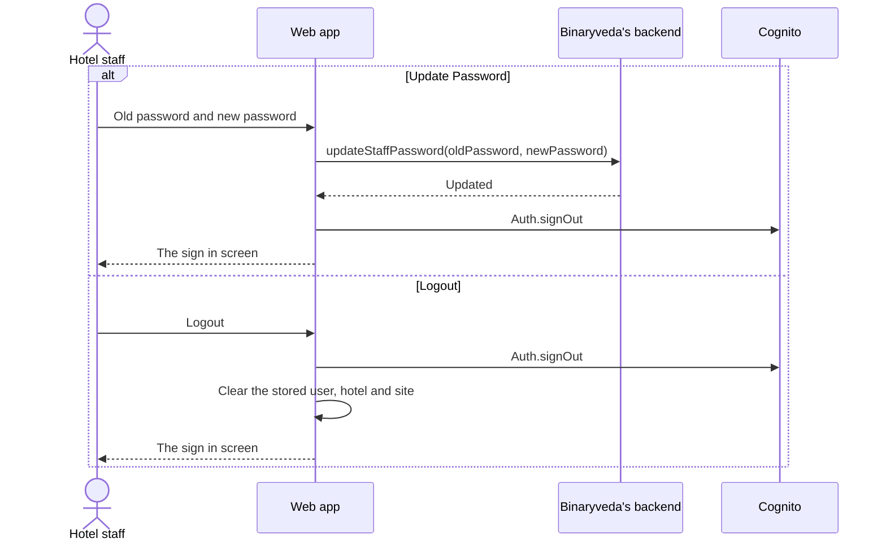

Changing the password signs the account out on purpose. The session in the
browser was issued against the old password, so it ends with it and the new one
is used on the next sign in.

Signing out also closes the Socket.IO connection described in
[Requests](requests.md#5-live-alerts). A sign out that fails at Cognito still
clears the browser and returns to the sign in screen.

## What the backend does

| Call | Service | Effect |
|---|---|---|
| `addHotelAdmin`, `addSiteAdmin`, `createStaff` | `user-service` | Writes the person, then `AdminCreateUser` and `AdminAddUserToGroup` at Cognito |
| `getUserDetail` | `user-service` | Resolves the Cognito account to a user record and a `staffId` |
| `getStaffDetail` | `user-service` | Returns the staff record with its hotel and site |
| `addLoginAccessDetails` | `user-service` | Records the sign in against a platform and an application type |
| `updateStaffPassword` | `user-service` | Changes the password at Cognito |

Signing in, setting a password and resetting a password are handled entirely by
Cognito through the Amplify library in the browser. No service is involved in
them.
