# 7. Staff

**What it is.** The people who work at the site. Adding someone here creates
their account, and giving them a shift decides which doors they can open.

**How to get there.** Staff in the sidebar. Site Admin, Site Manager and
Housekeeping Manager can change it. Engineering Maintenance can read it.

!!! warning "Key point"

    For housekeeping staff, door access comes from the **shift** rather than
    from the staff record. The shift names a block and floors, and the backend
    turns those floors into the doors their accessor may open. Changing the
    floors changes the doors, so there is no separate access screen.

## Participants

This page uses Hotel staff, Web app, Binaryveda's backend, Cognito, File store
and Spintly's servers.

Each one is defined, with the colour it keeps across the site, in
[Reading these pages](conventions.md).

## The whole flow

Four steps. Each one has its own section below.

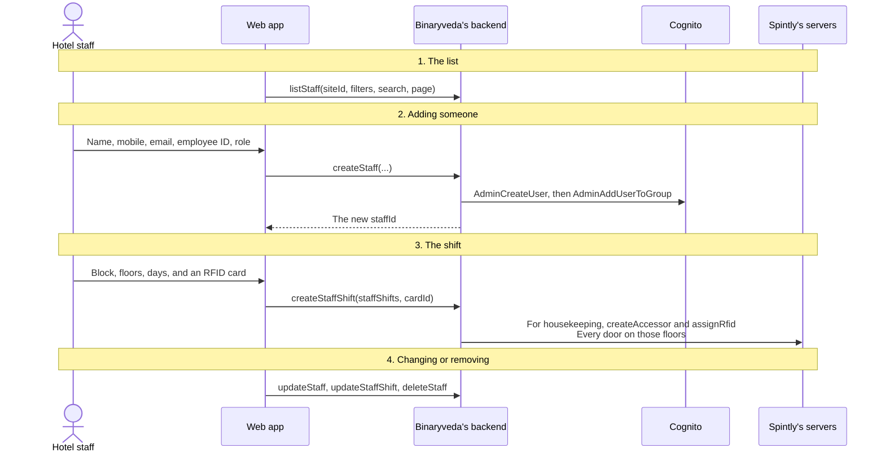

## 1. The list

A paged table with filters that are all sent to the server.

<figure>
<a href="images/staff/01-staff-list.png">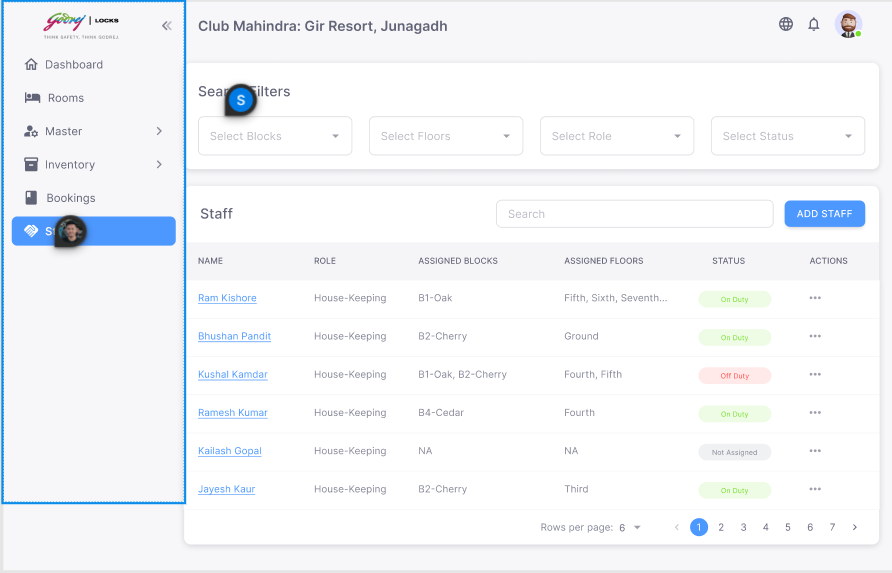</a>
<figcaption><strong>Staff</strong>Assigned Blocks and Assigned Floors are read off the shift rather than the staff record, so a row with no shift reads <strong>Not Assigned</strong>.</figcaption>
</figure>
<figure>
<a href="images/staff/07-staff-details.png">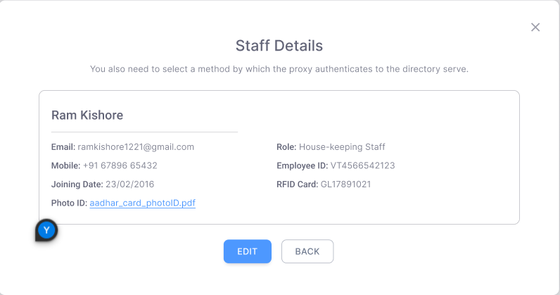</a>
<figcaption><strong>Staff Details</strong>Read only. The RFID card shown here is the one attached to their shift, and the photo ID opens through a temporary link.</figcaption>
</figure>

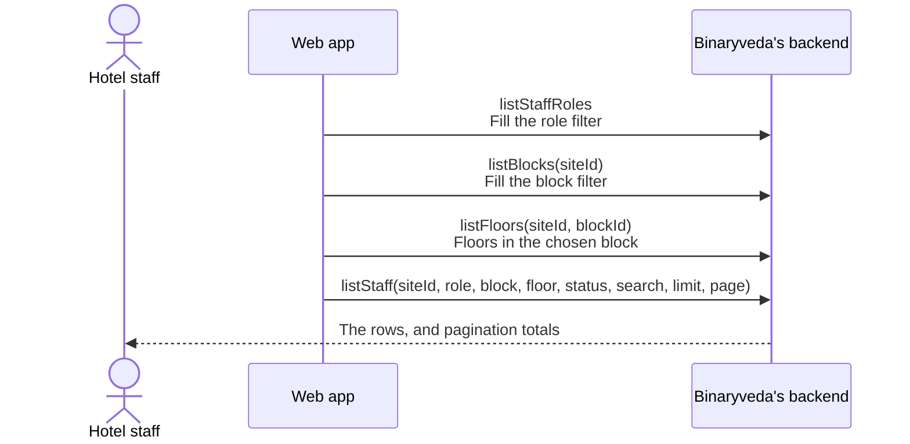

Filters are role, block, floor and status. The floor filter is loaded for the
chosen block, so it stays empty until a block is picked.

Each row shows a duty status worked out from the shift.

| Status | Meaning |
|---|---|
| `ON_DUTY` | A shift covers now |
| `OFF_DUTY` | Has shifts, none covering now |
| `NOT_ASSIGNED` | No shift at all |

Opening the row menu gives details, edit, shift and delete.

## 2. Adding a staff member

<figure>
<a href="images/staff/02-add-staff.png">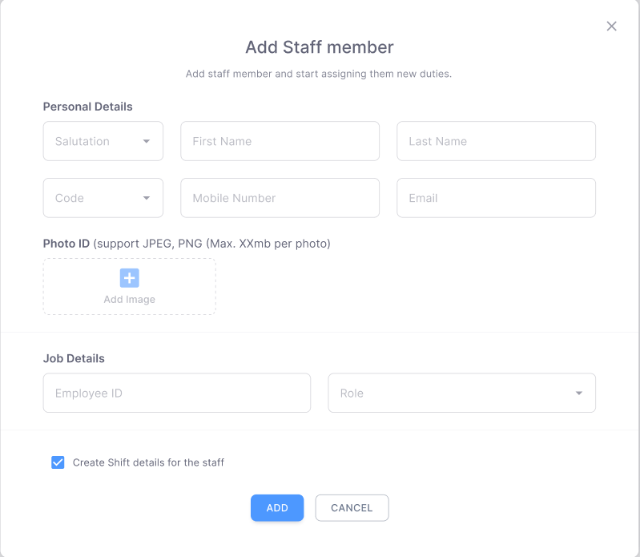</a>
<figcaption><strong>Add Staff member</strong>Personal details, then job details. <strong>Create Shift details for the staff</strong> at the bottom carries straight on into <a href="#3-shifts">step 3</a>.</figcaption>
</figure>
<figure>
<a href="images/staff/03-add-staff-filled.png">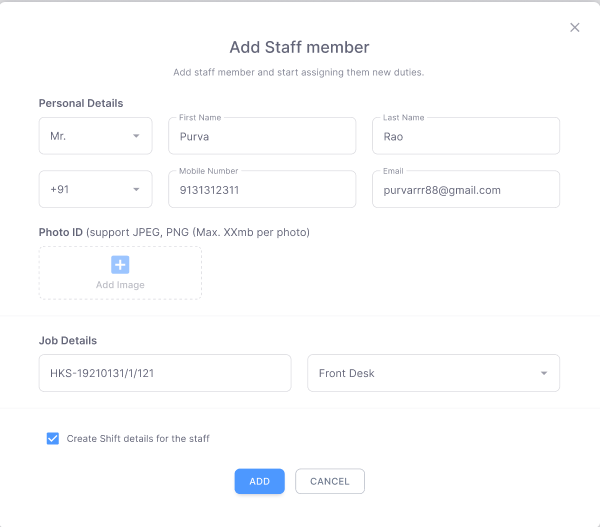</a>
<figcaption><strong>Filled in</strong>The role picked here decides the Cognito group, and so which of the two apps this person can sign in to.</figcaption>
</figure>
<figure>
<a href="images/staff/08-edit-staff.png">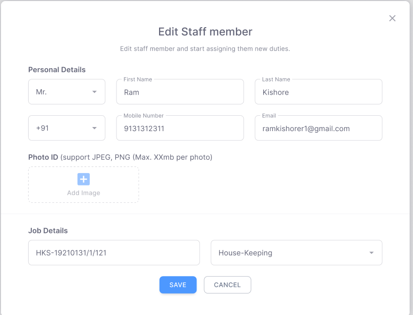</a>
<figcaption><strong>Edit Staff member</strong>The same form against <code>getStaffDetail</code>. The shift is edited separately.</figcaption>
</figure>

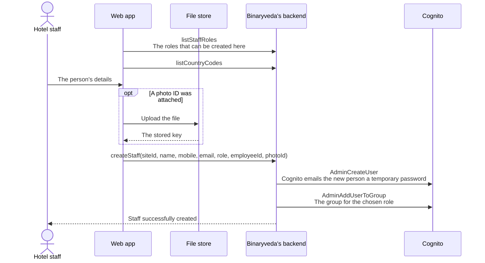

### What the form asks for

| Field | Rules |
|---|---|
| Salutation | Optional |
| First name, last name | Required |
| Country code, mobile number | Required |
| Email | Required, and the account is created against it |
| Employee ID | Optional |
| Role | Required |
| Photo ID | Optional, uploaded to S3 before the mutation is sent |

Email is required here even though it is optional for a guest, because the
account Cognito creates is keyed to it and the temporary password is delivered
there.

### The roles offered

`listStaffRoles` returns every role except Hotel Admin and Site Admin, which
have screens of their own in
[Administration](administration.md#3-hotel-admins-and-site-admins).

| Role | Signs in to |
|---|---|
| House-Keeping | The staff app only |
| Front Desk, House-Keeping Manager, Restaurant Manager, Site Manager, Engineering Maintenance | This app, and the staff app |

So this one screen creates both the people who use the web app and the people
who use the staff app. The Cognito group the role maps to decides which, by the
same mechanism as
[Sign In and Roles, step 1](sign-in-and-roles.md#1-where-the-account-comes-from).

## 3. Shifts

A shift says where someone works and on which days. Every role uses it for the
duty status on the list and for which work reaches them. For housekeeping it
also sets their door access.

<figure>
<a href="images/staff/04-shift-details.png">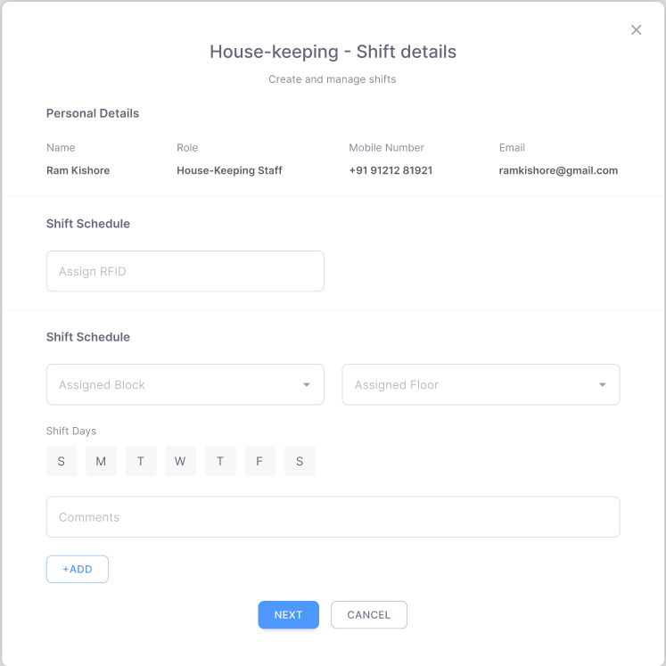</a>
<figcaption><strong>A housekeeping shift</strong>Block and floors are asked for, because for this role the doors are resolved from them. The person's details sit read only at the top.</figcaption>
</figure>
<figure>
<a href="images/staff/05-shift-details-filled.png">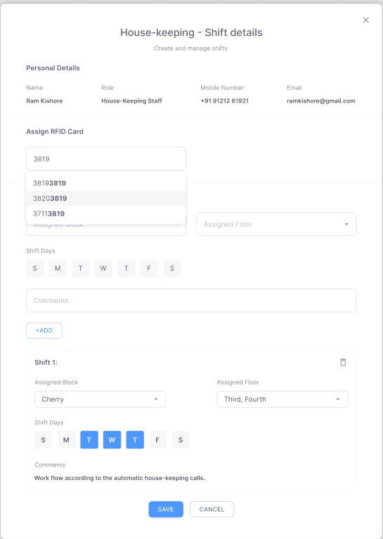</a>
<figcaption><strong>Card and shift rows</strong>The card field matches on the last four digits, the same as at check in. <strong>+ Add</strong> commits a shift row, and several can be built up before saving.</figcaption>
</figure>
<figure>
<a href="images/staff/06-shift-front-desk.png">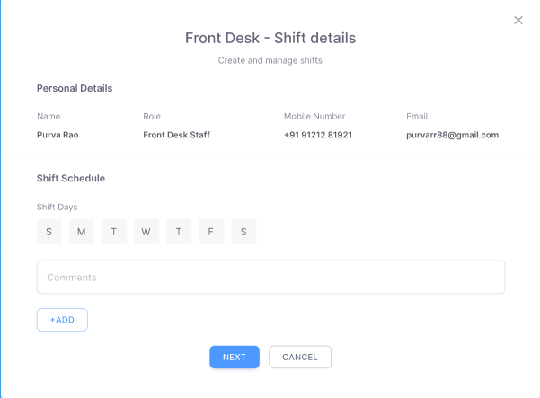</a>
<figcaption><strong>A front desk shift</strong>Days and comments only. No block, no floors and no card, because access does not follow from a shift for this role.</figcaption>
</figure>

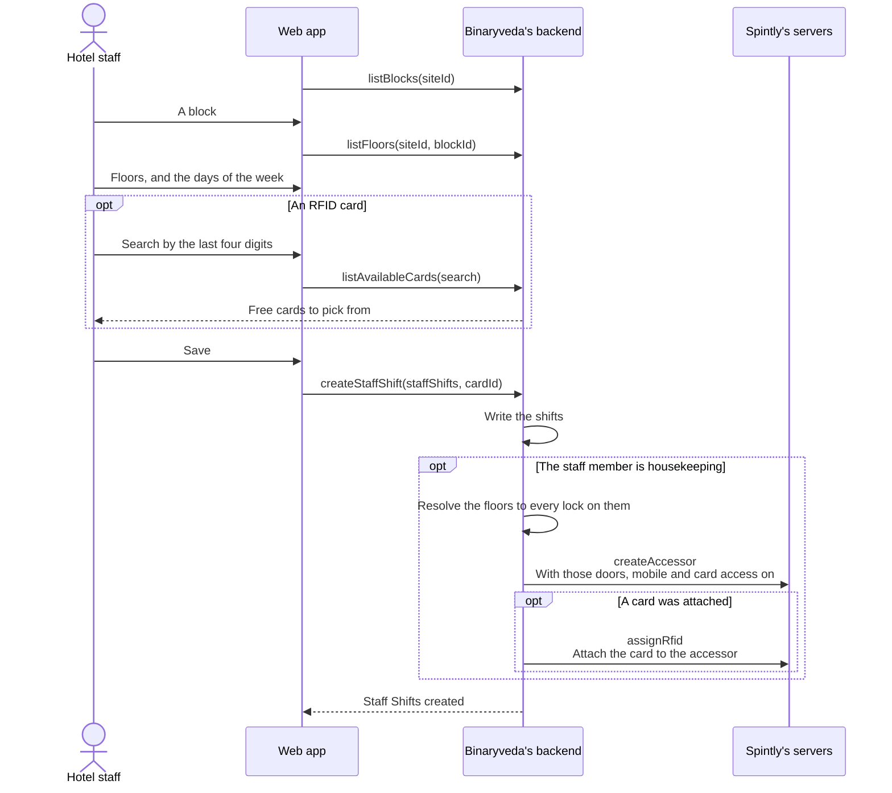

### What a shift holds

| Field | Notes |
|---|---|
| Assigned block | Required for housekeeping, optional for other roles |
| Assigned floors | One or more. Required for housekeeping |
| Days | Any of the seven, at least one |
| Comments | Optional |
| RFID card | Optional, searched the same way as a guest card |

More than one shift row can be added at once, so somebody can cover different
floors on different days. They are sent together as a list.

### What the floors become

For a housekeeping staff member, the backend does not store doors directly. It
resolves the floors on the shift to every room on them, takes each room's lock,
and writes those access points onto the accessor. Changing the floors on the
shift therefore changes the doors.

The accessor is created with both mobile access and card access enabled, so the
same person can open a door with the staff app or with a card.

Saving a shift for somebody who already has an accessor rewrites their
permissions instead of creating a second one.

The RFID card attached to a shift is allocated against every floor the shift
covers, so the same card works across the whole shift.

The floors on a housekeeping shift are used once more, away from this screen.
When that staff member opens the staff app, the socket puts them in a room for
each floor their shift covers today, so floor updates reach the people working
that floor.

For the other roles, the shift is a record of when and where somebody works, and
the duty status on the list is read from it.

## 4. Changing and removing

<figure>
<a href="images/staff/09-delete-staff.png">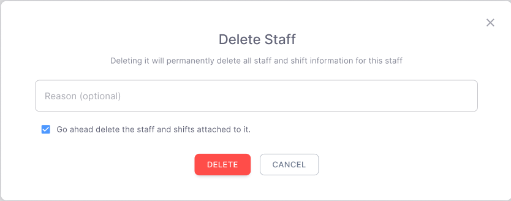</a>
<figcaption><strong>Delete Staff</strong>The same reason and tick as the master data deletions, but this one also deletes the accessor, so the card and the phone stop working everywhere.</figcaption>
</figure>

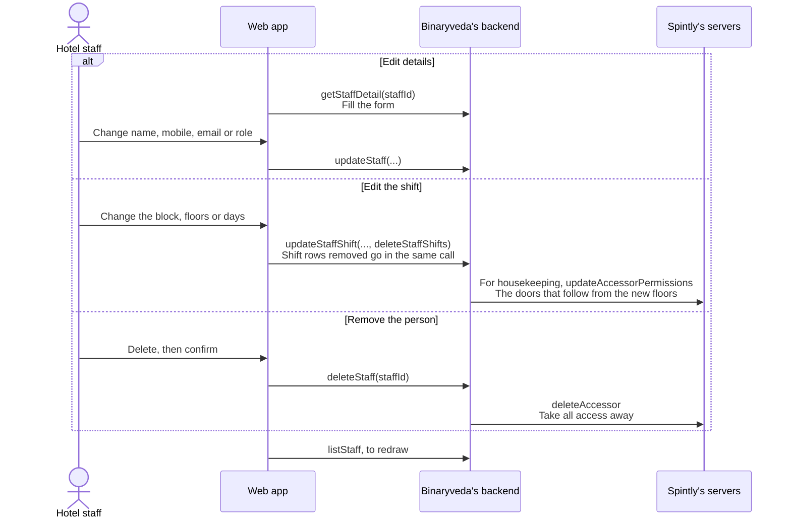

Removing a staff member deletes their accessor at Spintly as well as their
record, so their card and their phone both stop working on every door.

## What the backend does

| Call | Service | Effect |
|---|---|---|
| `listStaff` | `user-service` | The site's staff, filtered and paged |
| `listStaffRoles` | `user-service` | Every role except Hotel Admin and Site Admin |
| `getStaffDetail` | `user-service` | One staff member with their hotel, site and shifts |
| `createStaff` | `user-service` | Writes the record, then `AdminCreateUser` and `AdminAddUserToGroup` at Cognito |
| `updateStaff` | `user-service` | Updates the record |
| `deleteStaff` | `user-service` | Removes the record and calls `deleteAccessor` |
| `createStaffShift` | `user-service` | Writes the shifts, and for housekeeping calls `createAccessor` and `assignRfid` |
| `updateStaffShift` | `user-service` | Rewrites the shifts, removes any listed in `deleteStaffShifts`, and for housekeeping rewrites the permissions that follow from them |
| `listAvailableCards` | `booking-service` | Free, active RFID cards matching a search |
| `listBlocks`, `listFloors` | `inventory-service` | Fill the block and floor dropdowns |
