# 4. Stay Over and Check Out

**What it is.** The two ways a stay ends or is extended. Both act on a room
booking rather than on the whole booking, and both change what the guest can
open.

**How to get there.** Check Out and Stay Over appear on a room card once that
room is `ARRIVED` and every guest booked into it has been checked in.

!!! warning "Key point"

    Checking out does not wait for the lock. The accessor deletion is queued and
    retried by `notification-service`, and the guest is marked departed straight
    away. The RFID card stays allocated until the deletion is confirmed, which
    is why a card cannot be reissued the instant a guest leaves. See
    [step 3](#3-what-happens-to-access).

## Participants

This page uses Hotel staff, Web app, Binaryveda's backend, Spintly's servers and
Guest.

Each one is defined, with the colour it keeps across the site, in
[Reading these pages](conventions.md).

## The whole flow

Four steps. Each one has its own section below.

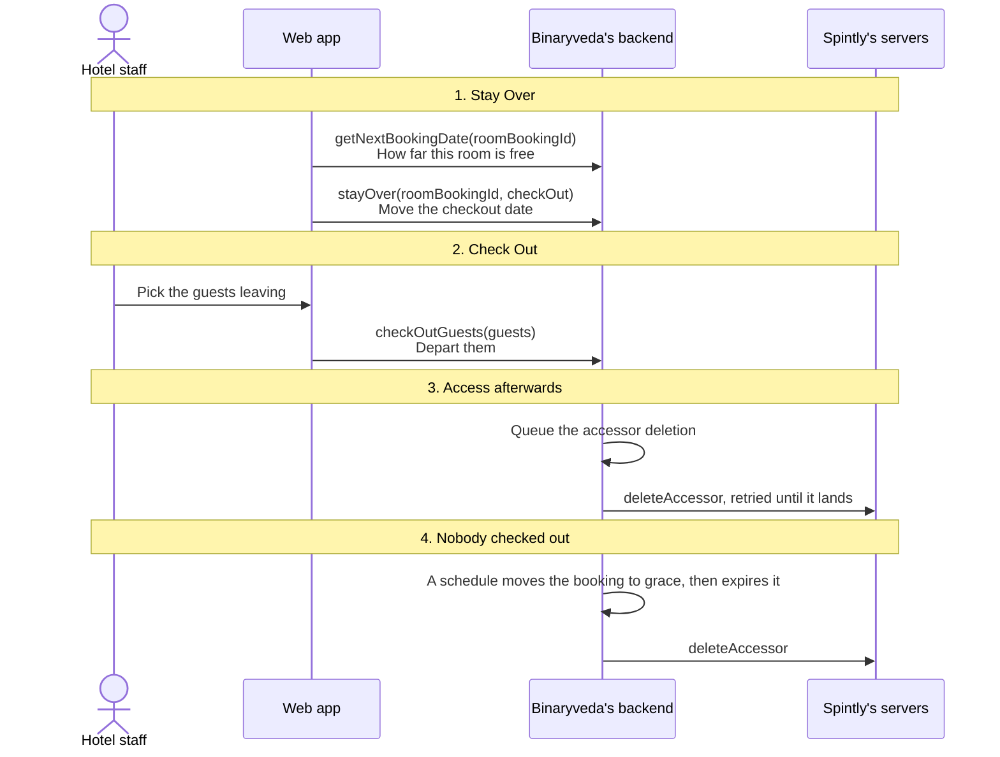

## 1. Stay Over

Extending a stay is two screens: pick the rooms, then set a new checkout date
for each in turn.

<figure>
<a href="images/stay-over-and-check-out/01-stay-over-select.png">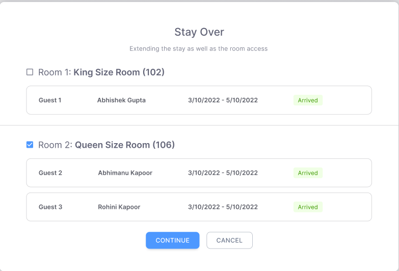</a>
<figcaption><strong>Pick the rooms</strong>Only rooms that are <code>ARRIVED</code> are listed, with the guests in them shown under each.</figcaption>
</figure>
<figure>
<a href="images/stay-over-and-check-out/02-stay-over-extend.png">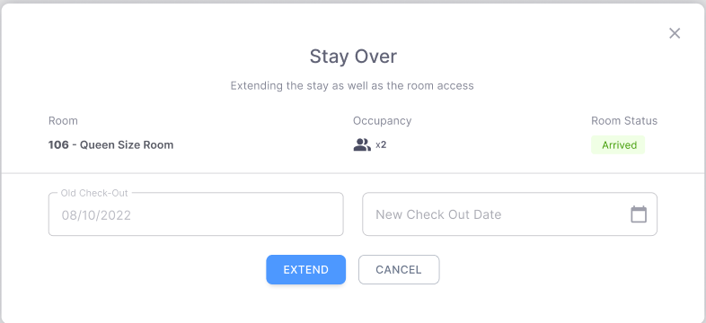</a>
<figcaption><strong>The new date</strong>One room at a time, with the old checkout date shown and locked beside the new one. How far it can run is capped by <code>getNextBookingDate</code>.</figcaption>
</figure>
<figure>
<a href="images/stay-over-and-check-out/09-change-room.png">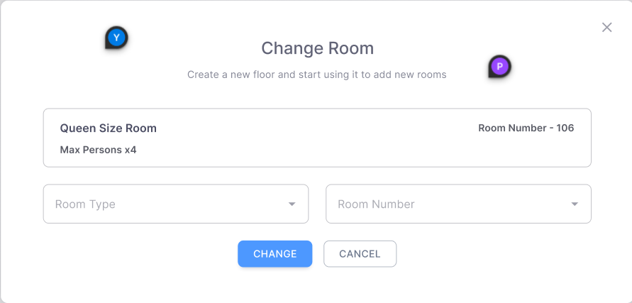</a>
<figcaption><strong>Change Room</strong>The other thing offered on an arrived room card. The current room and its occupancy are shown above the two dropdowns that replace it.</figcaption>
</figure>

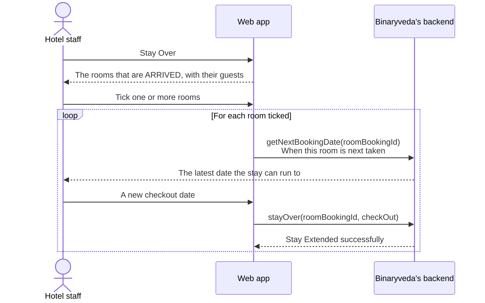

`getNextBookingDate` is what stops a stay being extended over the top of the
next booking for that room. It is asked per room, because two rooms on the same
booking can have different rooms waiting behind them.

Extending also extends access. The guest keeps the same accessor and the same
card, and the backend moves the point at which
[the schedule in step 4](#4-when-nobody-checks-out) will take access away.

Rooms are handled one at a time. After the last one the dialog closes and the
booking is refetched.

## 2. Checking out

Check out opens on the same kind of greeting screen as check in, on its own
five open count, then moves to the selection.

<figure>

<figcaption><strong>The greeting</strong>The same screen as check in with its own wording, and its own count of opens.</figcaption>
</figure>
<figure>
<a href="images/stay-over-and-check-out/04-check-out-select.png">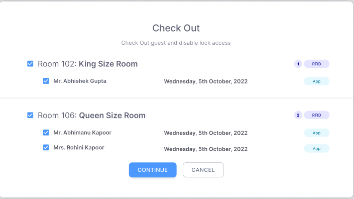</a>
<figcaption><strong>Who is leaving</strong>The tags on the right are what each guest holds. The count beside <strong>RFID</strong> is the number of cards to collect for that room.</figcaption>
</figure>
<figure>
<a href="images/stay-over-and-check-out/05-check-out-confirm.png">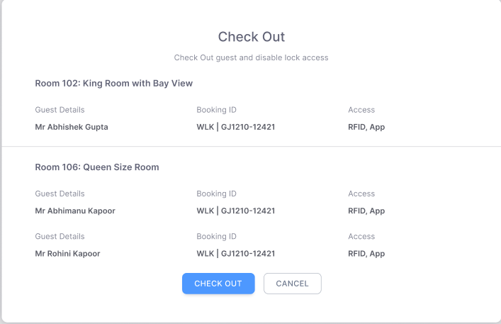</a>
<figcaption><strong>The summary</strong>Guest, booking and access side by side, so a card can be collected before <strong>Check Out</strong> is pressed.</figcaption>
</figure>

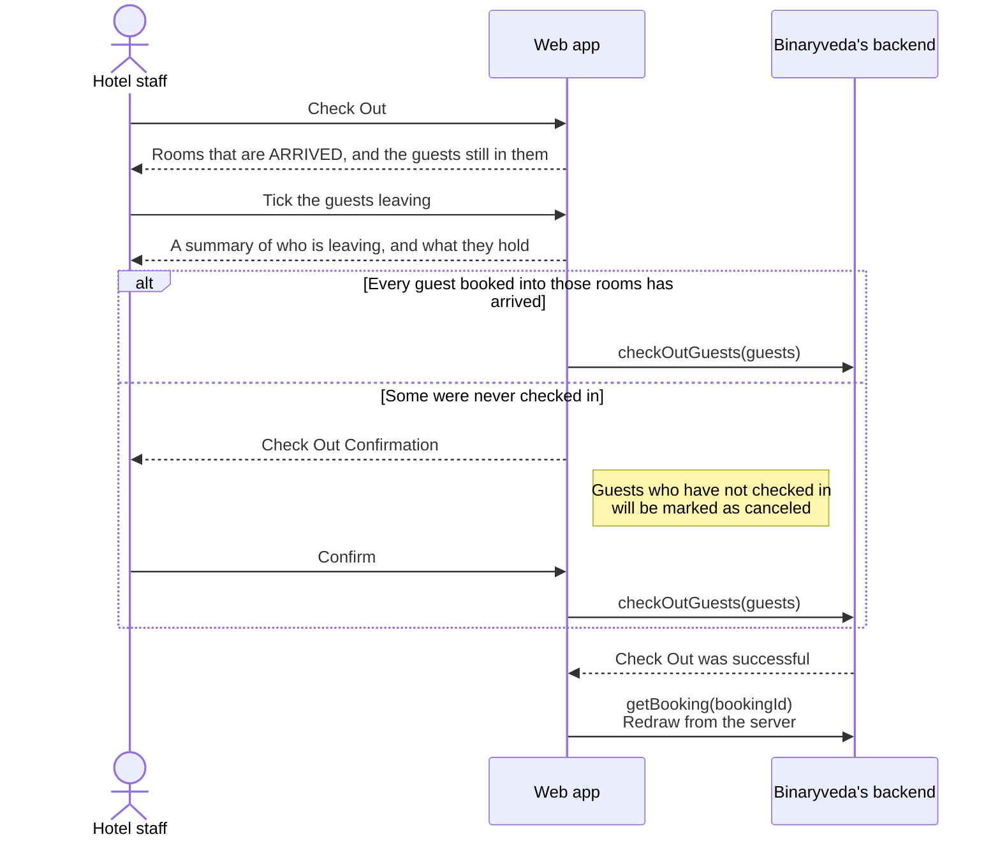

Only guests who are `ARRIVED`, `GRACE_PERIOD` or `GRACE_EXPIRED` are offered.
Guests who never arrived and guests already departed are left out of the list.

The summary lists each guest leaving with the access they hold, so a card can be
collected before the button is pressed.

### The extra confirmation

A room booked for two adults with only one checked in is a room where somebody
never turned up. Checking that room out closes it for the guest who is missing
as well, so the app asks first.

The check compares the guests recorded against the adults the room was booked
for. When they match, check out proceeds with no extra screen. When they do not,
the confirmation appears and names the consequence, which is that the guests who
never arrived are cancelled.

## 3. What happens to access

`checkOutGuests` marks the guests departed and queues the work at Spintly
instead of doing it inline.

<figure>
<a href="images/stay-over-and-check-out/06-partially-departed.png">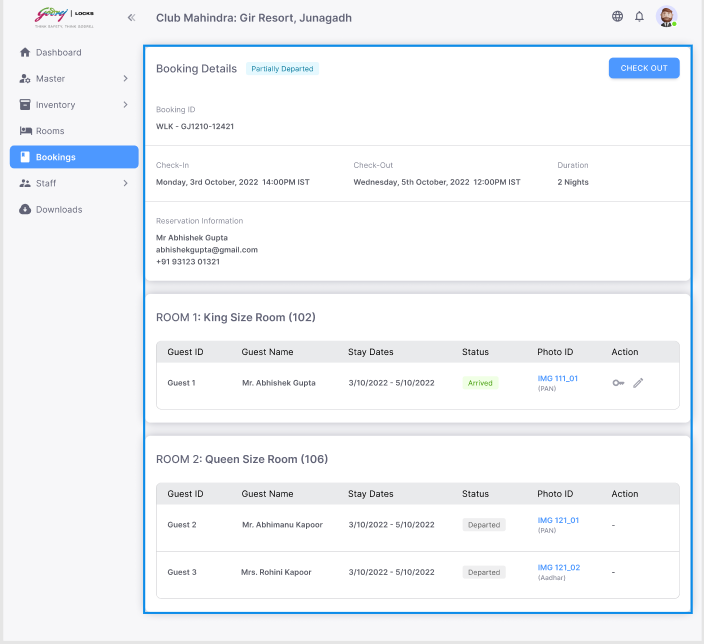</a>
<figcaption><strong>Partly departed</strong>One room out and one still in. A departed row keeps its photo ID and loses both action icons, because there is nothing left to issue or change.</figcaption>
</figure>
<figure>
<a href="images/stay-over-and-check-out/07-departed.png">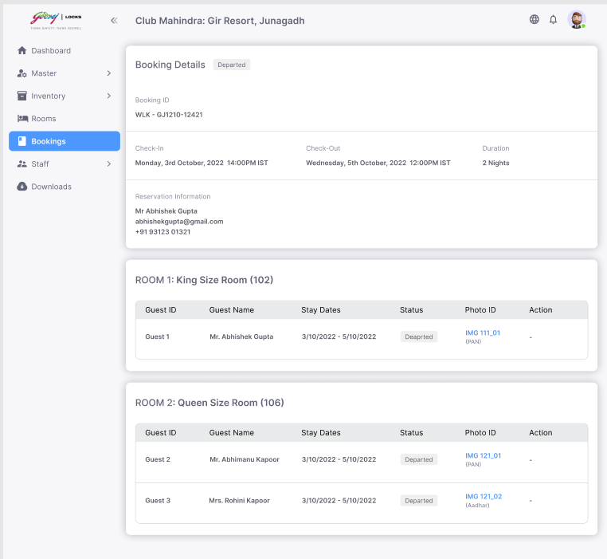</a>
<figcaption><strong>Departed</strong>The booking follows its last room out. The room cards carry no buttons at all once this is reached.</figcaption>
</figure>

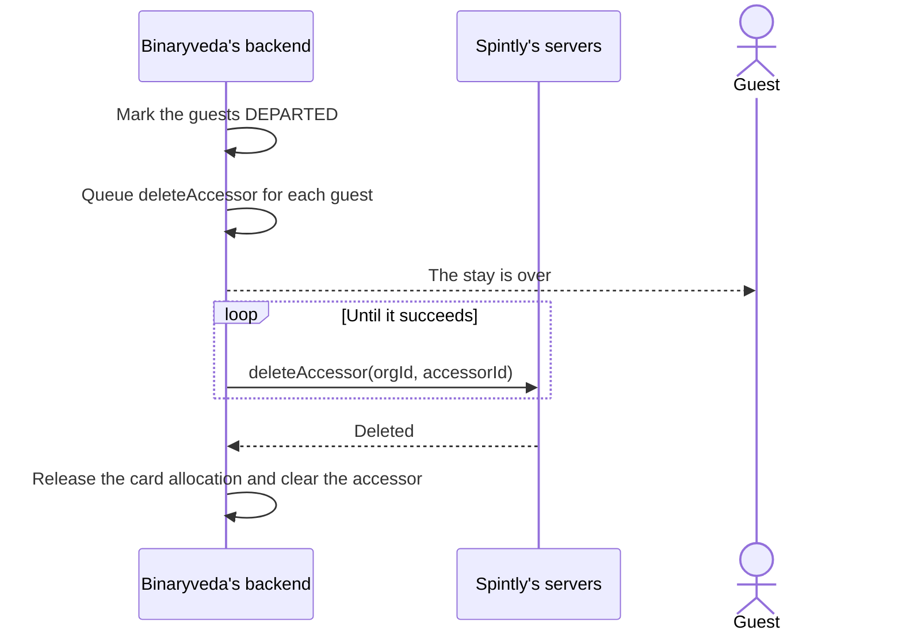

Two decisions are worth knowing about, because they explain what the screen does
and does not show.

- **The queue, rather than an inline call.** A Spintly call can block for around
  a minute when the lock or the gateway is offline, which is exactly when it is
  likely to fail. The front desk is not made to wait for it.
- **The card is released only on confirmation.** Until Spintly confirms the
  accessor is gone, its credential can still be cached on the door. Releasing
  the card straight away would let the next guest issued that card open this
  room, so the allocation and the accessor ID are both held until the deletion
  lands.

`notification-service` owns the retries and clears both once the deletion is
confirmed.

## 4. When nobody checks out

A stay that runs past its checkout time is closed by the backend rather than by
this screen. The mechanism is a schedule, one per room booking, set when the
stay is created and moved whenever the checkout date changes.

<figure>
<a href="images/stay-over-and-check-out/08-grace-expired.png">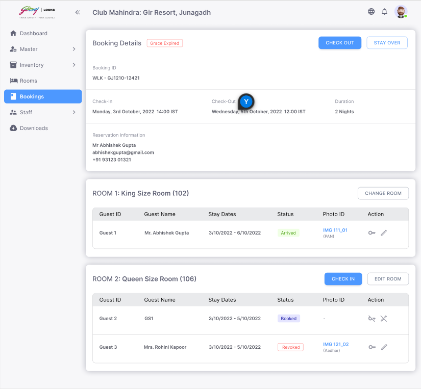</a>
<figcaption><strong>Grace Expired</strong>Set by the schedule rather than by anything on the screen. The guest row reads <strong>Revoked</strong>, which is the accessor having been deleted, and Check Out is still offered.</figcaption>
</figure>

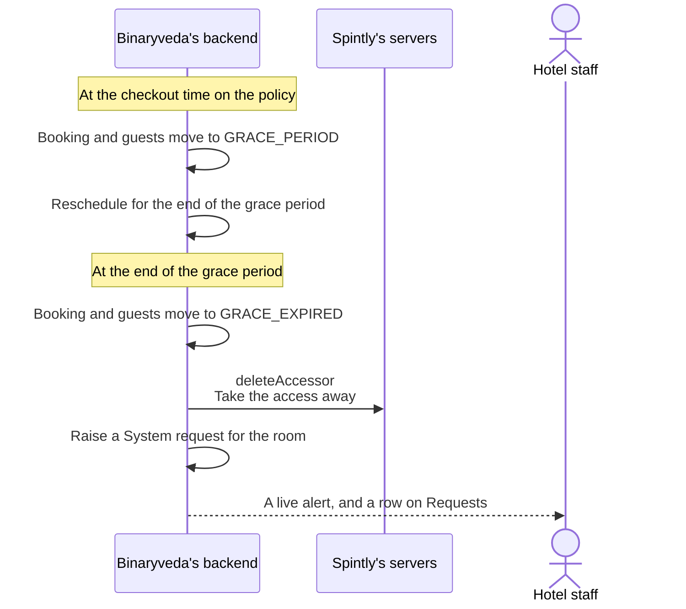

How long the grace period runs is part of the site policy in
[Rooms and Master Data](rooms-and-master-data.md#6-policies).

The System request this raises appears on the Requests screen for Site Admin,
Site Manager and Front Desk, and arrives as a live alert in the corner of the
screen. That is [Requests, step 5](requests.md#5-live-alerts).

A guest in `GRACE_PERIOD` or `GRACE_EXPIRED` can still be checked out normally
from [step 2](#2-checking-out).

A stay over on a room whose booking has already expired restores access rather
than leaving the guest locked out. The accessor was deleted when the grace
period ended, so the backend creates a new one and writes the room permission
back, along with any shared amenity access the guest still held.

## What the backend does

| Call | Service | Effect |
|---|---|---|
| `getNextBookingDate` | `booking-service` | The next booking on that room, which caps the extension |
| `stayOver` | `booking-service` | Moves the checkout date and the revoke schedule with it |
| `checkOutGuests` | `booking-service` | Departs the guests, cancels those who never arrived, queues `deleteAccessor` |
| `getBooking` | `booking-service` | Redraws the booking after either action |

The Spintly calls on this page are `deleteAccessor` only, and it is never called
from a request the browser is waiting on.
